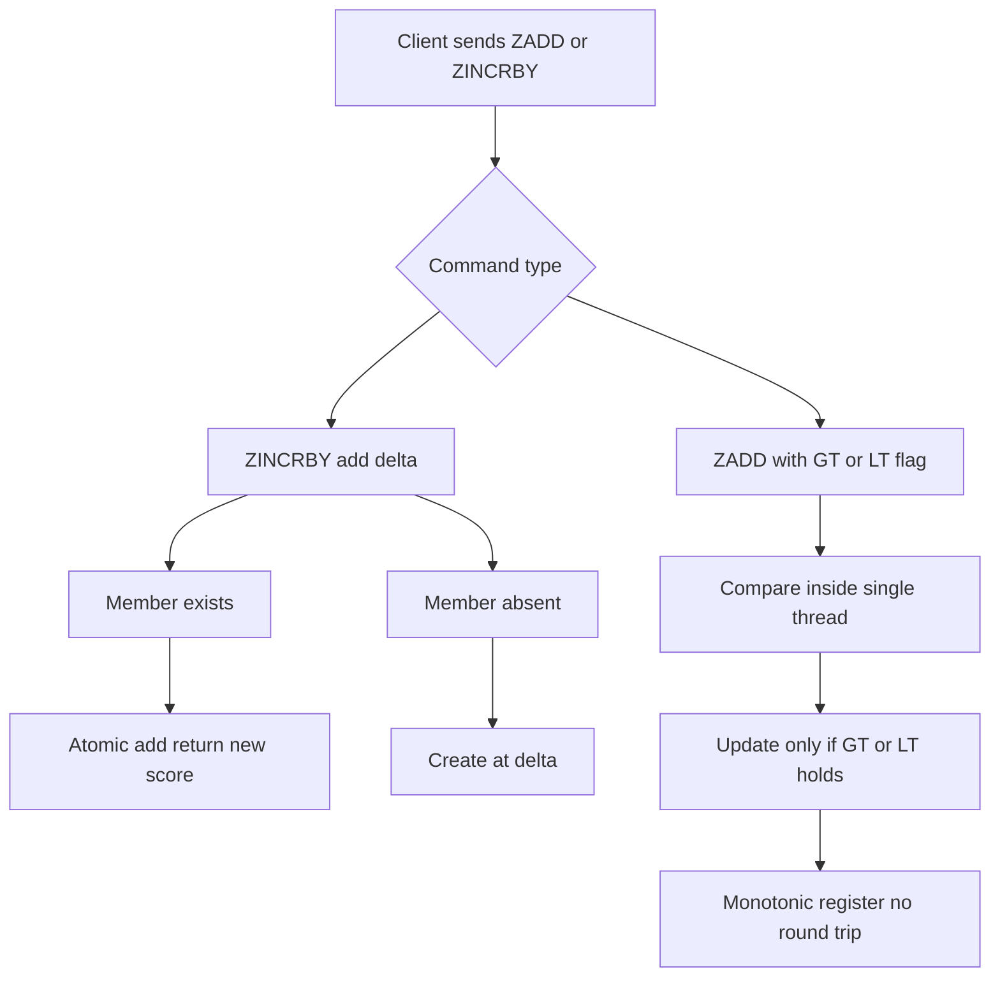

# Sorted Set Score Arithmetic: Using ZINCRBY and ZADD GT/LT as a State Machine

## English

Most people meet sorted sets through leaderboards, but the score field is really a small numeric register that Redis can mutate atomically. ZINCRBY key increment member adds a delta to an existing member's score (creating it at the delta if absent) and returns the new score, so a counter that is also ranked is one command away. Since Redis 6.2, ZADD accepts GT and LT flags: GT only updates the score when the new value is greater than the current one, LT only when it is smaller. That turns the sorted set into a monotonic register — a 'high-water mark' per member — without a read-modify-write round trip and without a Lua script.

Concretely, imagine tracking the latest heartbeat timestamp per service instance. ZADD heartbeats GT <now> <instance-id> will never move a member backwards even if two workers race with slightly out-of-order clocks; the score becomes a safe 'last seen at' value. Conversely, LT is handy for 'earliest deadline' scheduling: ZADD deadlines LT <t> <job-id> keeps the soonest time, and ZRANGEBYSCORE deadlines -inf <now> LIMIT 0 100 pulls the jobs that are due. Because the update and the comparison happen inside the single-threaded command, you get linearizable semantics without any client-side locking.

There are sharp edges. GT and LT are mutually exclusive in one call, and they only apply to updates — a new member is always inserted with the given score regardless of the flag. NX (only add, never update) and XX (only update, never add) are separate flags and can be combined with GT/LT in some versions, but check your server's documentation because flag combinations have changed across releases. Also, scores are IEEE-754 doubles, so 'exact' arithmetic past 2^53 is not guaranteed; if you need integer counters beyond that, store the count in a hash and use the sorted set only for ordering.

A practical pattern is a rate limiter that is also queryable. Each request does ZADD attempts GT <timestamp> <request-id> plus ZREMRANGEBYSCORE attempts -inf <timestamp - window> in a MULTI block; the cardinality of the set (ZCARD) after the trim tells you how many requests landed in the window. GT ensures replayed request IDs do not push the score backwards, and the trim keeps memory bounded. This is the same idea as a sliding-window log, but expressed in two sorted-set commands instead of a bespoke data structure.

Finally, remember that scores are not free. Every member carries the score plus skiplist and dictionary overhead, so a million-member set costs tens of megabytes even before your values. Use ZADD GT/LT for state that genuinely wants monotonicity, and prefer plain hashes with HINCRBY when you only need a counter and never need range queries.

## 中文

大部分人認識有序集合（sorted set）都是從排行榜開始，但分數（score）欄位其實是一個小型數值暫存器，Redis 可以原子地改動它。ZINCRBY key increment member 會把增量加到既有成員的分數上（若不存在則以增量建立），並回傳新分數，所以「既是計數器又可排名」只需一條命令。自 Redis 6.2 起，ZADD 接受 GT 與 LT 旗標：GT 只在新的值大於現值時才更新，LT 則只在更小時更新。這就把有序集合變成一個單調暫存器——每個成員一個「歷史高位」——既不需要讀-改-寫的往返，也不需要 Lua 腳本。

具體一點，想像你要追蹤每個服務實例的最新心跳時間。ZADD heartbeats GT <now> <instance-id> 永遠不會把成員往後移，即使兩個 worker 以略有偏差的時鐘競爭；分數就成為安全的「最後出現時間」。反過來，LT 適合「最早截止時間」排程：ZADD deadlines LT <t> <job-id> 保留最早的時刻，而 ZRANGEBYSCORE deadlines -inf <now> LIMIT 0 100 就拉出已到期的任務。因為比較與更新都在單執行緒的命令內完成，你得到線性一致的語意，而無需任何客戶端鎖。

尖銳的邊角要留意。GT 與 LT 在一次呼叫中互斥，而且它們只作用於更新——新成員不論旗標如何都會以給定分數插入。NX（只新增、不更新）與 XX（只更新、不新增）是另外的旗標，某些版本可與 GT/LT 組合，但請查你伺服器的文件，因為旗標組合在不同版本之間有變動。另外，分數是 IEEE-754 雙精度浮點數，超過 2^53 之後「精確」算術並無保證；若你需要更大的整數計數，把計數放在 hash 裡，有序集合只用來排序。

一個實用模式是可查詢的限流器。每個請求在 MULTI 區塊中執行 ZADD attempts GT <timestamp> <request-id>，加上 ZREMRANGEBYSCORE attempts -inf <timestamp - window>；修剪後集合的基數（ZCARD）就告訴你視窗內落了多少請求。GT 確保重放的請求 ID 不會把分數往回推，而修剪讓記憶體有界。這跟滑動視窗日誌是同一個念頭，只是用兩條有序集合命令表達，而不是自訂資料結構。

最後，記住分數不是免費的。每個成員除了分數，還帶著跳表與字典的額外開銷，所以一百萬個成員的集合在你放值之前就已花掉數十 MB。把 ZADD GT/LT 用在真正需要單調性的狀態上；若你只需要計數、從不做範圍查詢，寧可用普通 hash 配 HINCRBY。

## Key Takeaway

ZADD's GT and LT flags turn a sorted set into an atomic monotonic register, letting you maintain high-water marks and earliest-deadline state without read-modify-write or Lua.

## Related Concepts
- Sorted sets
- Atomic operations

## Diagram

