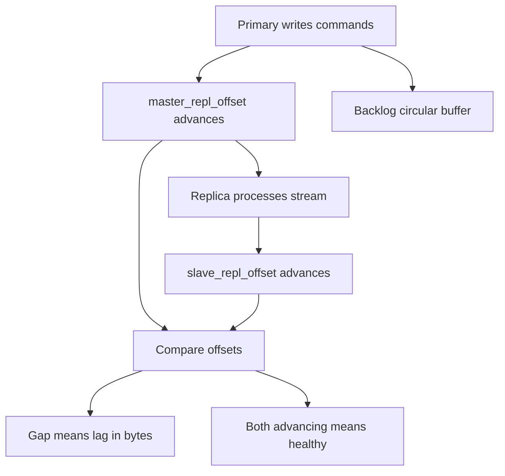

# Reading Replication Offsets: What master_repl_offset and slave_repl_offset Tell You

## English

Replication in Redis is described as a stream of commands flowing from primary to replica, and that stream is numbered. The primary maintains a replication backlog (a fixed-size circular buffer, configured by repl-backlog-size) and a counter called master_repl_offset that advances with every byte written to replicas. Each replica reports its own slave_repl_offset, which is the offset it has successfully processed. The gap between the two — master_repl_offset minus slave_repl_offset — is the replica's lag in bytes, not seconds. This distinction matters because a replica can be thousands of bytes behind while the wall-clock delay is a few milliseconds, or a few bytes behind while the network is stalled.

You can read these values from INFO replication on either side. On the primary you see connected replicas and their offsets; on a replica you see master_repl_offset (the primary's offset as last known to it) and slave_repl_offset (its own). A useful sanity check: if a replica's offset stops advancing while the primary's keeps climbing, the replica is stuck — perhaps the link is broken, the replica is busy with a slow command, or it is in the middle of a full resynchronization. If both advance together, replication is healthy even if you have not measured latency directly.

The backlog is the safety net. When a replica disconnects briefly, the primary keeps writing into the backlog; on reconnect the replica asks to resume from its last offset using PSYNC. If the requested offset is still inside the backlog, the primary sends only the missing bytes — a partial resynchronization. If the replica was away long enough that the offset has fallen out of the circular buffer, the primary must perform a full resynchronization: it forks, writes an RDB snapshot, ships it, and replays the buffer accumulated during the transfer. That is expensive, so sizing the backlog generously (for the write rate times the longest tolerable outage) is a real operational decision, not a default to ignore.

There is a subtlety about durability. A write acknowledged to the client is not necessarily on any replica; replication is asynchronous by default. The WAIT command lets a client ask the primary to block until at least N replicas have acknowledged up to a given offset, with a timeout. WAIT does not make writes durable in the strong sense (a failover can still lose them if the primary dies between the write and the replica's acknowledgment), but it turns 'fire and forget' into 'bounded uncertainty'. Combining WAIT with min-replicas-to-write and min-replicas-max-lag on the primary gives you a crude but effective guard against writing into a partition where no replica can see you.

Finally, offsets are per-replication-stream, not global. If you promote a replica, its offset becomes the new primary's starting point, but it will not match the old primary's numbering. Tools that compare offsets across a failover must account for this. Treat offsets as a diagnostic for lag and partial-resync eligibility, not as a durable sequence number for your application's data.

## 中文

Redis 的複製被描述為從主節點流向副本的命令串流，而這個串流是有編號的。主節點維護一個複製積壓緩衝區（固定大小的環形緩衝，由 repl-backlog-size 設定）以及一個名為 master_repl_offset 的計數器，每寫出一個位元組給副本就前進。每個副本報告自己的 slave_repl_offset，也就是它已成功處理的偏移量。兩者之差——master_repl_offset 減 slave_repl_offset——就是副本的落後量，單位是位元組，不是秒。這個區別很重要，因為副本可能落後數千位元組而牆鐘延遲只有幾毫秒，也可能只落後幾個位元組但網路卡住。

你可以在任一端用 INFO replication 讀到這些值。在主節點上你會看到已連線的副本及其偏移量；在副本上你會看到 master_repl_offset（它最後所知的主節點偏移）與 slave_repl_offset（它自己的）。一個有用的檢查：若副本的偏移停止前進而主節點持續攀升，副本就卡住了——也許連線斷了、副本正忙於慢命令，或正在做完整重新同步。若兩者同步前進，複製就是健康的，即使你沒有直接量測延遲。

積壓緩衝是安全網。當副本短暫斷線，主節點繼續寫入積壓；重連時副本用 PSYNC 要求從最後偏移續傳。若請求的偏移仍在積壓內，主節點只送缺少的位元組——這就是部分重新同步。若副本離開太久、偏移已掉出環形緩衝，主節點就必須做完整重新同步：它 fork、寫出 RDB 快照、傳送，並重放傳輸期間累積的緩衝。這很昂貴，所以把積壓設得寬裕（寫入速率乘以最長可容忍中斷時間）是真正的營運決策，不是可以忽略的預設值。

關於持久性有個微妙之處。一個向客戶端確認的寫入，不一定已落在任何副本上；複製預設是非同步的。WAIT 命令讓客戶端要求主節點阻塞，直到至少 N 個副本已確認到某個偏移，並附帶逾時。WAIT 不會讓寫入變成強意義的持久（若主節點在寫入與副本確認之間死亡，故障轉移仍可能丟失），但它把「射後不理」變成「有界的不確定性」。把 WAIT 與主節點上的 min-replicas-to-write 及 min-replicas-max-lag 結合，就得到一個粗糙但有效的守衛，避免寫入到沒有副本能看見你的分割區。

最後，偏移是針對單一複製串流，不是全域的。若你提升一個副本，它的偏移成為新主節點的起點，但不會與舊主節點的編號相符。跨故障轉移比較偏移的工具必須考慮這點。把偏移當成落後量與部分重同步資格的診斷，而不是應用程式資料的持久序號。

## Key Takeaway

Replication offsets measure bytes processed, not seconds, and the gap between master and replica offsets is the real signal for lag and partial-resync eligibility.

## Related Concepts
- Replication
- INFO command

## Diagram

