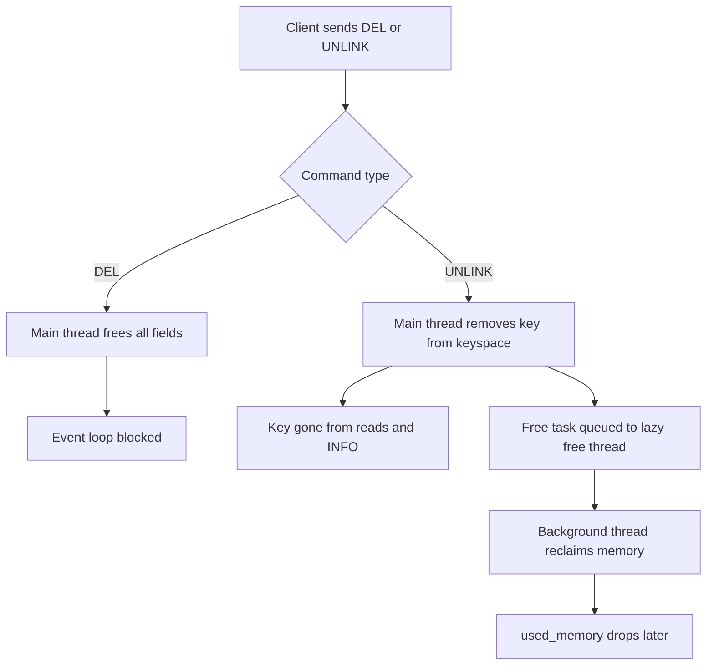

# UNLINK and the Lazy Free Threads: Deleting Big Keys Without Stalling the Event Loop

## English

Deleting a key in Redis is not free. When you call DEL on a key holding a hash with a million fields, the server must walk every field and free its memory before the command returns. Because the main thread is single-threaded and processes commands one at a time, that walk blocks every other client for the duration — a classic 'slow command' that does not look slow in your code. The fix is UNLINK, introduced in Redis 4.0: it removes the key from the keyspace immediately (so subsequent reads see it as gone) but hands the actual memory reclamation to a background thread. The main thread does the cheap bookkeeping; the expensive free happens off the critical path.

The background work is done by 'lazy free' threads, configured with lazyfree-lazy-free-threads (defaults to a small number, often 1 or 4 depending on version). There are also server-level switches that make other operations lazy by default: lazyfree-lazy-expire (expired keys are freed in the background), lazyfree-lazy-eviction (evictions during maxmemory pressure), lazyfree-lazy-server-del (deletions caused by RENAME overwriting a destination, for example), and lazyfree-lazy-user-del (makes DEL behave like UNLINK). These are configuration choices, not command-level ones, so you can decide per deployment whether you want predictable latency or predictable memory release timing.

The trade-off is that memory is not returned instantly. After UNLINK, the key is gone from the keyspace and from INFO's db0:keys count, but used_memory may stay elevated for a while as the background thread works through the object. If you are deleting many large keys in a burst, the free queue can grow and memory can stay high longer than you expect. Monitor lazyfree_pending_objects in INFO memory to see how much work is queued; a persistently high number means your frees are outpacing the background threads and you may want to increase the thread count or spread deletions out.

A common operational pattern is to use UNLINK for any user-triggered deletion of a potentially large key, and to keep DEL for small, known-size keys where the immediate free is cheap and the deterministic timing is nice. For example, deleting a session hash with a dozen fields is fine with DEL; deleting a cached rendered page that happens to contain a huge list is a job for UNLINK. Similarly, when you change a schema and need to drop a whole class of keys, iterate with SCAN and UNLINK each match rather than issuing a single DEL on a pattern — and never use KEYS in production to find them.

Finally, note that UNLINK is not a substitute for good key design. If you routinely store megabyte-sized values, the problem is the shape of your data, not the deletion command. Lazy free buys you latency headroom, but it does not shrink the memory footprint, does not speed up the eventual free, and does not help if the background threads are themselves starved. Treat it as one tool in the latency toolbox, alongside splitting big keys, capping value sizes, and monitoring slowlog for the commands that actually hurt.

## 中文

在 Redis 中刪除一個鍵並非免費。當你對一個含有一百萬個欄位的 hash 鍵呼叫 DEL，伺服器必須走訪每個欄位並釋放其記憶體，才讓命令返回。由於主執行緒是單執行緒、一次處理一條命令，這段走訪會阻塞所有其他客戶端——這是典型的「慢命令」，但在你的程式碼裡看起來不慢。解法是 Redis 4.0 引入的 UNLINK：它立刻把鍵從鍵空間移除（所以後續讀取會看到它已消失），但把實際的記憶體回收交給背景執行緒。主執行緒只做便宜的記帳；昂貴的釋放發生在關鍵路徑之外。

背景工作由「惰性釋放」執行緒完成，以 lazyfree-lazy-free-threads 設定（預設值不大，依版本常為 1 或 4）。另外還有伺服器層級的開關讓其他操作預設變惰性：lazyfree-lazy-expire（過期的鍵在背景釋放）、lazyfree-lazy-eviction（maxmemory 壓力下的驅逐）、lazyfree-lazy-server-del（例如 RENAME 覆寫目的地所造成的刪除），以及 lazyfree-lazy-user-del（讓 DEL 行為像 UNLINK）。這些是設定選擇，不是命令層級的，所以你可以依部署決定要可預測的延遲，還是可預測的記憶體釋放時機。

取捨是記憶體不會立刻歸還。UNLINK 之後，鍵已從鍵空間及 INFO 的 db0:keys 計數中消失，但 used_memory 可能在一段時間內仍偏高，因為背景執行緒還在處理該物件。若你一次刪除許多大鍵，釋放佇列會變長，記憶體維持高位的時間會比你想的久。監看 INFO memory 中的 lazyfree_pending_objects 可看到排隊的工作量；若數字持續偏高，代表釋放速度追不上背景執行緒，你可能要增加執行緒數或把刪除分散開來。

常見的營運模式是：任何使用者觸發、可能很大的鍵刪除都用 UNLINK；小而已知大小的鍵則保留 DEL，因為立即釋放便宜且時機確定。例如刪除只有十幾個欄位的 session hash 用 DEL 沒問題；刪除一個恰好含巨大 list 的已快取頁面，就該用 UNLINK。同樣地，當你改 schema 要丟掉一整類鍵時，用 SCAN 迭代並對每個匹配項 UNLINK，而不是對某個模式發一條 DEL——而且千萬不要在生產環境用 KEYS 去找它們。

最後，注意 UNLINK 不能取代良好的鍵設計。若你 routinely 儲存 MB 級的值，問題在資料形狀，不在刪除命令。惰性釋放買到的是延遲餘裕，但它不縮小記憶體足跡、不加快最終釋放，若背景執行緒本身被餓死也幫不上忙。把它當成延遲工具箱裡的一件工具，與拆分大鍵、限制值大小、用 slowlog 監看真正傷人的命令並列。

## Key Takeaway

UNLINK removes a key immediately but frees its memory on background threads, trading instant memory release for a non-blocking event loop.

## Related Concepts
- Event loop
- Memory management

## Diagram

