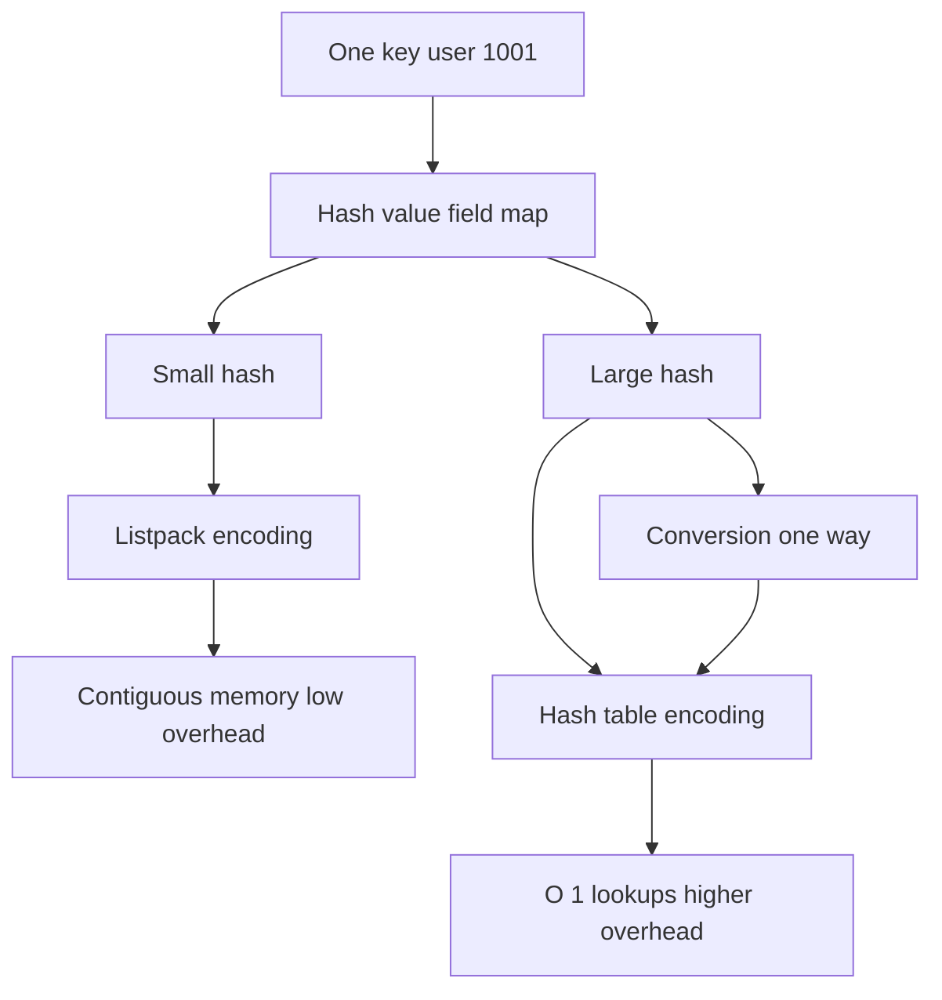

# Hashes: Packing Many Fields Under One Key

## English

A Redis hash is a single key whose value is a map of field-value pairs, so instead of storing user:1001:name, user:1001:email and user:1001:age as three separate top-level keys, you store one key user:1001 holding three fields. This matters far more than it looks, because every top-level key carries bookkeeping overhead: a dictionary entry in the main keyspace, an expiry record if you set a TTL, and often an allocation for the value object itself. Packing related attributes into a hash collapses all of that into one entry, which is why hashes are the standard way to store a small object (a session, a user profile, a shopping cart) rather than a bag of loose strings. It also gives you a natural boundary: you can expire or delete the whole object in one command, and you can never accidentally leave half of a user behind because one of the three keys was forgotten.

The interesting part is what happens inside. For small hashes, Redis uses a compact listpack encoding: fields and values are stored one after another in a single contiguous block of memory, with no per-field hash table, no pointers, and no allocator overhead. This is dramatically cheaper than a real hash table, often by a factor of several in bytes per field, and it is also more cache-friendly because the whole object sits in one or two cache lines. Once the hash grows past a configured threshold (by default a few dozen entries, or a value longer than a set byte limit), Redis converts it to a proper hash table so that lookups stay O(1) as the hash grows. That conversion is one-way: if you shrink the hash again, it stays a hash table until it is deleted. So a hash that briefly spiked to thousands of fields and then shrank will keep paying hash-table overhead forever.

The practical consequence is that you should think about the shape of your data before you write it. If you have millions of tiny objects, packing each into a hash keeps memory sane. But if any single object can grow unboundedly (say, a hash of every event a user ever generated), you will blow past the listpack threshold and end up with a huge hash table under one key, which is both memory-hungry and awkward to operate on: you cannot shard it, and deleting it may block the server unless you use UNLINK. The usual rule is one hash per object, with a bounded number of fields, and a separate key per user or per day if the field count is unbounded.

A second useful property is that hash commands operate per field, so HINCRBY on a counter field is atomic without touching the rest of the object, and HSET on one field does not rewrite the others. This lets you update a single attribute of a cached object cheaply, which is often exactly what you want after a partial update in your database. You can also read a subset with HMGET without pulling the whole object over the wire, which is a real bandwidth win for large objects where the caller only needs two fields. Combine that with the fact that a hash is one key, and you get clean semantics for cache invalidation: delete the key, and the whole object is gone.

One caveat worth internalising: field-level expiry was added only in recent Redis versions, so on older servers a TTL applies to the whole hash, not to individual fields. If you need per-attribute lifetimes, either upgrade or model each attribute as its own key and accept the overhead. Also remember that HGETALL on a large hash returns everything at once and can be a latency spike; HSCAN exists precisely for iterating big hashes without blocking. Treat the hash as a small, bounded object and it will reward you with compact memory and simple invalidation; treat it as a dumping ground and it becomes a hot, unshardable key.

## 中文

Redis 的 hash 是一個鍵，其值是一個由欄位與值組成的對映。與其把 user:1001:name、user:1001:email、user:1001:age 存成三個獨立的頂層鍵，不如用一個鍵 user:1001 裝住三個欄位。這件事比表面看起來重要得多，因為每一個頂層鍵都附帶簿記開銷：主鍵空間裡的一個字典條目、若你設了 TTL 就有一條過期記錄，而且值物件本身往往還要一次記憶體分配。把相關屬性收進一個 hash，就把這些開銷全部壓成一個條目，所以 hash 是存放小型物件（session、使用者資料、購物車）的標準做法，而不是散落一堆字串。它還給你一條自然的邊界：你可以用一個命令令整個物件過期或刪除，也永遠不會因為漏了三個鍵中的一個而留下半個使用者。

有趣的是內部發生什麼事。對於小型 hash，Redis 使用緊湊的 listpack 編碼：欄位與值一個接一個存放在單一連續的記憶體區塊裡，沒有逐欄位的雜湊表、沒有指標、沒有分配器開銷。這比真正的雜湊表便宜得多，每個欄位往往省下數倍位元組，而且對快取更友善，因為整個物件就坐在一兩條快取線裡。一旦 hash 超過設定的門檻（預設是幾十個條目，或某個值超過位元組上限），Redis 就把它轉成真正的雜湊表，令查詢在 hash 變大時仍保持 O(1)。這個轉換是單向的：即使你之後把 hash 縮小，它仍然是雜湊表，直到被刪除為止。所以一個曾經短暫膨脹到幾千個欄位然後縮小的 hash，會永遠背著雜湊表的開銷。

實際後果是：你應該在寫入之前先想清楚資料的形狀。如果你有幾百萬個極小的物件，把每個塞進一個 hash 可以令記憶體保持合理。但如果任何單一物件可以無上限地增長（例如一個記錄使用者歷來所有事件的 hash），你就會衝破 listpack 門檻，最終在一個鍵之下得到一個巨型雜湊表，既耗記憶體又難以操作：你無法對它分片，而且刪除它時除非用 UNLINK，否則可能阻塞伺服器。通常的規則是：每個物件一個 hash，欄位數有上限；如果欄位數無上限，就按使用者或按日期分開不同的鍵。

第二個有用特性是 hash 命令按欄位操作，所以對某個計數欄位做 HINCRBY 是原子的，不會碰到物件其餘部分；對某個欄位做 HSET 也不會重寫其他欄位。這讓你可以在資料庫發生部分更新之後，只便宜地更新快取物件的一個屬性，而這往往正是你要的。你也可以用 HMGET 只讀取一部分，不必把整個物件拉過網路，對於呼叫方只需要兩個欄位的大物件來說，這是實實在在的頻寬節省。再加上 hash 就是一個鍵這一點，你就得到乾淨的快取失效語義：刪掉那個鍵，整個物件就消失了。

有一點要記住：欄位級過期是近期的 Redis 版本才加入的，所以在較舊的伺服器上，TTL 作用於整個 hash，而不是個別欄位。如果你需要逐屬性的存活期，要麼升級，要麼把每個屬性建模成獨立的鍵並接受開銷。另外要記得，對大型 hash 做 HGETALL 會一次過回傳全部，可能造成延遲尖峰；HSCAN 正是為了不阻塞地迭代大 hash 而存在。把 hash 當成小型、有界的物件，它會以緊湊的記憶體和簡單的失效回報你；把它當成什麼都往裡塞的倉庫，它就會變成一個熱門且無法分片的鍵。

## Key Takeaway

A hash packs a whole small object into one key with compact listpack encoding, but it converts one-way to a hash table past a size threshold, so keep each hash bounded.

## Related Concepts
- Memory Overhead: Why a 100 MB Dataset Can Eat 200 MB of RAM
- Keyspace Design: Naming, Cardinality, and the Cost of KEYS

## Diagram

