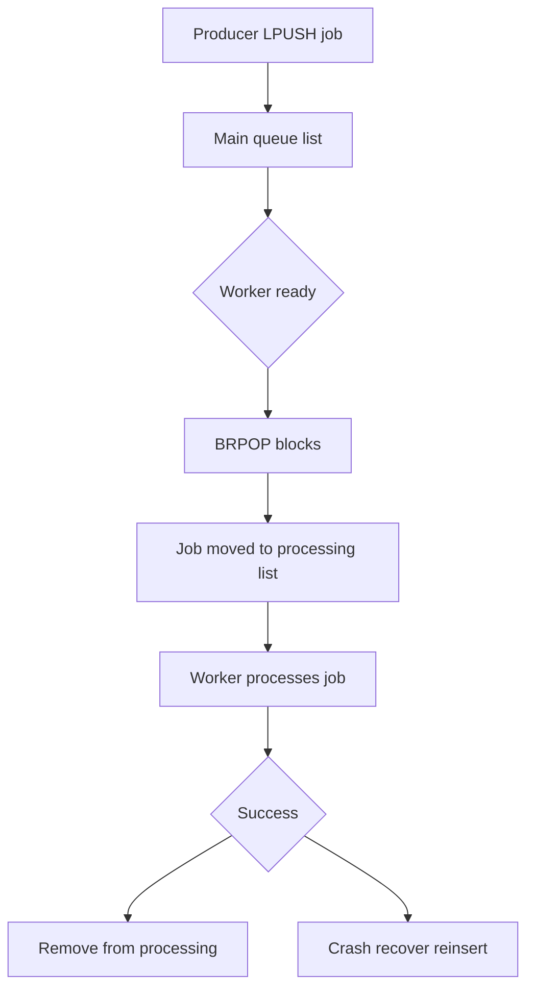

# Lists as Queues and Stacks: LPUSH, RPOP, and the Reliable Queue Pattern

## English

A Redis list is an ordered sequence of strings that you can push onto and pop from at either end. That sounds trivial, but the two ends give you two different data structures for free: push and pop on the same end is a stack (LIFO), and push on one end while popping from the other is a queue (FIFO). LPUSH adds to the head, RPUSH adds to the tail, LPOP removes from the head, and RPOP removes from the tail, each O(1). The classic job-queue idiom is producers doing LPUSH jobs and workers doing RPOP jobs, or the mirror image with RPUSH and LPOP, and either works as long as the two commands touch opposite ends. The important thing to get right is consistency: pick one convention and stick to it, because mixing them turns your queue into a stack without anyone noticing.

The naive queue has a flaw: if the list is empty, RPOP returns nil immediately, so a worker has to poll in a loop, burning CPU and adding latency. The blocking variants fix this: BRPOP and BLPOP take a timeout and a list of keys, and the server parks the client until an element arrives or the timeout expires. The client connection is not spinning; the server simply does not reply until there is something to say. That is how you build a queue that reacts instantly without polling. A subtlety worth knowing is that with multiple keys, BRPOP returns the first key that has an element, checking them in the order given, which lets a single worker prioritise several queues.

But even a blocking pop is not a reliable queue on its own, because the element leaves the list the moment it is handed to the worker. If the worker crashes before finishing the job, the job is gone. The standard fix is a two-step pattern sometimes called reliable queue: the worker moves the item from the main list to a per-worker processing list atomically, using a command that pops from one list and pushes to another in a single operation (RPOPLPUSH, or the blocking variant BRPOPLPUSH, and in newer versions the more general LMOVE and BLMOVE). The item now lives in the worker's processing list. When the job succeeds, the worker removes it from that list. If the worker dies, a supervisor can inspect the processing lists and re-queue the orphaned items. This gives you at-least-once delivery without a separate broker, at the cost of the worker having to be idempotent.

Lists are also useful for bounded recent-item feeds: LPUSH new items and LTRIM to keep only the first N, which gives you a fixed-size ring of the latest events in one round trip. LINSERT lets you insert relative to a pivot value, and LRANGE reads a slice. All of these are O(1) or O(N) in the size of the slice, not the whole list, so they stay cheap even for long lists. The catch is random access: LINDEX and LSET are O(N) because a list is not an array, so if you need indexed access by position, a list is the wrong tool and a sorted set or hash is better.

One design point that bites people: a list is one key, so it lives on one cluster node and cannot be sharded automatically. A single very hot queue is therefore bounded by one core and one node's memory, which is fine for many workloads but not for a firehose. If you need more throughput, shard the queue yourself by hashing a job attribute into several list keys, or move to Streams, which offer consumer groups, acknowledgement, and pending-entry tracking as first-class features. Lists are the simplest possible queue and that simplicity is their virtue; just know exactly where the simplicity ends.

## 中文

Redis 的 list 是一串有序的字串，你可以從兩端推入和彈出。聽起來沒什麼，但兩端就免費給你兩種不同的資料結構：在同一端推入和彈出就是堆疊（LIFO），一端推入、另一端彈出就是佇列（FIFO）。LPUSH 加到頭部，RPUSH 加到尾部，LPOP 從頭部移除，RPOP 從尾部移除，每個都是 O(1)。經典的工作佇列慣用法是生產者做 LPUSH、工作者做 RPOP，或者反過來用 RPUSH 配 LPOP；只要兩個命令碰的是相反的兩端就都行。真正要弄對的是前後一致：選定一種慣例並堅持下去，因為混用會在你不知不覺間把佇列變成堆疊。

樸素的佇列有個缺陷：如果 list 是空的，RPOP 會立刻回傳 nil，於是工作者必須在迴圈裡輪詢，浪費 CPU 又增加延遲。阻塞版本解決了這個問題：BRPOP 和 BLPOP 接受一個逾時和一組鍵，伺服器會把客戶端停住，直到有元素到達或逾時為止。客戶端連線並沒有在空轉；伺服器只是等到有話可說才回覆。這就是建立一個即時反應、無需輪詢的佇列的方法。有個值得知道的細節：給多個鍵時，BRPOP 會按給定的順序檢查，回傳第一個有元素的鍵，這讓單一工作者可以優先處理多條佇列。

但即使有了阻塞彈出，它本身仍然不是可靠的佇列，因為元素一交到工作者手上就離開了 list。如果工作者在完成工作前當掉，工作就消失了。標準解法是兩步模式，有時稱為可靠佇列：工作者用一個命令原子地把專案從主 list 移到每個工作者各自的處理中 list，即在單一操作裡從一個 list 彈出並推入另一個（RPOPLPUSH，或阻塞版 BRPOPLPUSH，較新版本則有更通用的 LMOVE 和 BLMOVE）。專案現在住在工作者的處理中 list 裡。工作成功時，工作者把它從該 list 移除。如果工作者死掉，監督程式可以檢查處理中 list 並把孤兒專案重新排入佇列。這給你至少一次送達，而不需要額外的訊息代理，代價是工作者必須具備冪等性。

list 也適合做有界的最近專案動態：LPUSH 新專案並用 LTRIM 只保留前 N 個，一次往返就得到一個固定大小的最新事件環。LINSERT 可以相對某個樞軸值插入，LRANGE 讀取一個切片。這些操作的複雜度是 O(1) 或相對於切片大小的 O(N)，而不是整個 list，所以即使 list 很長也很便宜。陷阱在於隨機存取：LINDEX 和 LSET 是 O(N)，因為 list 不是陣列，所以如果你需要按位置索引存取，list 就是錯的工具，sorted set 或 hash 更合適。

一個會咬人的設計要點：list 是一個鍵，所以它只住在一個 cluster 節點上，無法自動分片。因此一條極度熱門的佇列受限於一個核心和一個節點的記憶體，對許多工作負載來說沒問題，但對洪流級流量就不行。如果你需要更高吞吐量，就自己按某個工作屬性雜湊到多個 list 鍵來分片，或者改用 Streams，它把消費者群組、確認、待處理條目追蹤都做成了一等公民。list 是最簡單的佇列，而這份簡單正是它的優點；只要清楚知道簡單在哪裡結束就好。

## Key Takeaway

Lists give you O(1) stacks and queues, and the RPOPLPUSH/BRPOPLPUSH two-list pattern turns a fragile queue into an at-least-once reliable one.

## Related Concepts
- Blocking Commands and the Event Loop: How Redis Waits Without Spinning
- Handling Backpressure: When the Producer Outruns the Server

## Diagram

