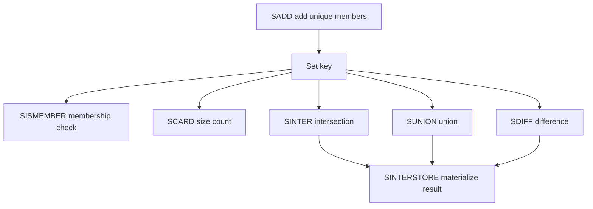

# Sets and Set Algebra: Membership, Unions, and Intersections as Queries

## English

A Redis set is an unordered collection of unique strings. Its two basic operations are SADD (add, ignoring duplicates) and SISMEMBER (is this element present), both O(1) on average, which makes a set the natural answer to questions of the form does this exist in this group. Classic uses are tagging (one set per tag, or one set per object holding its tags), deduplication of events seen in a window, and access control lists where membership means permission. Because duplicates are silently ignored, SADD is idempotent, which is exactly what you want when retries are possible: replaying the same write twice leaves the set unchanged. SCARD gives the size in O(1), which is handy for cheap counters that must never double-count.

The real power, though, is set algebra. SINTER returns the intersection of several sets, SUNION the union, and SDIFF the difference. These turn questions that would otherwise be a database join into a single server-side command: given a set of users who liked post A and another set who liked post B, SINTER gives you the people who liked both, and SDIFF gives the ones who liked A but not B. Because the computation happens inside Redis, you avoid shipping two large lists to the client and intersecting them in application code. Variants like SINTERSTORE write the result to a destination key instead of returning it, which lets you materialise a derived set and reuse it, at the cost of memory and a write.

Cost is the thing to watch. The complexity of SINTER is roughly proportional to the size of the smallest set times the number of sets, because Redis iterates the smallest one and probes the others. So intersecting a tiny set with a huge one is cheap, but intersecting several huge sets is not, and it blocks the single-threaded event loop for the duration. The mitigation is to keep the small set on the left of your mental model, or to precompute intersections into stored sets when the inputs are large and the query is frequent. Also note that SINTERSTORE and the other store variants will overwrite the destination key, which is fine for a cache but dangerous if the destination is also a source of truth.

Internally, small sets of integers use a compact sorted-array encoding, and small sets of strings use a listpack, both of which save a lot of memory compared to a hash table. Past a threshold (by default a few hundred entries, or a value longer than a byte limit), the set converts to a real hash table. As with hashes, that conversion is one-way. There is also a special case worth knowing: when every member of a set is an integer, Redis can use a dedicated integer-set encoding that is extremely compact, so sets of IDs are much cheaper than sets of UUID strings. If you have a choice between numeric IDs and long random strings as set members, the numeric form can save an order of magnitude in memory.

Two practical cautions. First, do not use SMEMBERS on a large set in production: it returns everything at once and can stall both the server and the client. SSCAN exists to iterate a set in small batches without blocking. Second, sets are unordered, so if you need ranking or ordering, a sorted set is the tool, not a set. Use sets when the question is membership or overlap, use sorted sets when the question is order or score, and use hashes when the question is a field of an object. Getting that mapping right is most of what makes a Redis data model feel natural rather than forced.

## 中文

Redis 的 set 是一組無序且唯一的字串集合。它的兩個基本操作是 SADD（加入，忽略重複）和 SISMEMBER（這個元素是否存在），平均都是 O(1)，這令 set 成為「這個東西是否屬於這一組」這類問題的自然答案。經典用途包括標籤（每個標籤一個 set，或每個物件一個 set 裝住它的標籤）、在一個時間窗內對事件去重，以及以成員身分代表權限的存取控制清單。因為重複會被靜默忽略，SADD 是冪等的，這正是有可能重試時你想要的：同一個寫入重放兩次，set 依然不變。SCARD 以 O(1) 給出大小，對於絕不能重複計算的便宜計數器來說很方便。

真正的力量在於集合代數。SINTER 回傳多個 set 的交集，SUNION 是聯集，SDIFF 是差集。這些把本來需要資料庫 join 的問題變成單一伺服器端命令：假設有一組喜歡貼文 A 的用戶，另一組喜歡貼文 B 的用戶，SINTER 給你兩者都喜歡的人，SDIFF 給你喜歡 A 但不喜歡 B 的人。因為計算在 Redis 內部發生，你就不必把兩個大 list 送到客戶端再在應用程式碼裡求交集。像 SINTERSTORE 這類變體把結果寫到目標鍵而不是回傳，讓你物化一個衍生 set 並重複使用，代價是記憶體和一次寫入。

成本是要留意的東西。SINTER 的複雜度大致正比於最小那個 set 的大小乘以 set 的數目，因為 Redis 會迭代最小的那個並探測其餘的。所以用一個小 set 去和一個大 set 求交集很便宜，但幾個大 set 互相求交集就不便宜，而且會在計算期間阻塞單執行緒的事件迴圈。緩解方法是把小的那個 set 放在你心智模型裡的左邊，或者在輸入很大而查詢頻繁時，預先把交集算好存成 set。另外要注意 SINTERSTORE 及其他 store 變體會覆寫目標鍵，作為快取沒問題，但如果目標鍵本身也是真實來源就危險了。

在內部，小型的整數 set 使用緊湊的有序陣列編碼，小型的字串 set 使用 listpack，兩者都比雜湊表省很多記憶體。超過門檻（預設幾百個條目，或某個值超過位元組上限）之後，set 會轉成真正的雜湊表。和 hash 一樣，這個轉換是單向的。還有一個值得知道的特例：當 set 的每個成員都是整數時，Redis 可以使用一種極度緊湊的專用整數集合編碼，所以 ID 的 set 比 UUID 字串的 set 便宜得多。如果你可以選擇用數字 ID 還是長的隨機字串做 set 成員，數字形式可以省下一個數量級的記憶體。

兩個實務警告。第一，不要在生產環境對大型 set 用 SMEMBERS：它一次過回傳全部，可能同時卡住伺服器和客戶端。SSCAN 正是為了以小批次迭代 set 而不阻塞而存在。第二，set 是無序的，所以如果你需要排名或順序，工具是 sorted set 而不是 set。當問題是成員身分或重疊時用 set，當問題是順序或分數時用 sorted set，當問題是物件的某個欄位時用 hash。把這個對應關係弄對，就是令 Redis 資料模型感覺自然而非勉強的大部分功夫。

## Key Takeaway

Sets answer membership questions in O(1) and let you compute intersections, unions, and differences server-side, but expensive algebra on large sets blocks the event loop.

## Related Concepts
- Sorted Sets: The Ranked Leaderboard Data Structure
- Command Complexity: Reading the Big-O Notes Before You Deploy

## Diagram

