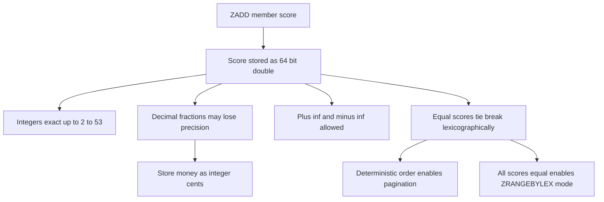

# Sorted Set Scores Are Doubles: Precision, Ties, and Lexicographic Fallback

## English

A sorted set (ZSET) pairs every member with a floating-point score, and Redis stores that score as a 64-bit IEEE 754 double. That detail matters more than it looks. Doubles can represent integers exactly only up to 2^53 (about 9 quadrillion), so if you use scores as timestamps in microseconds or as large counters, you are safe for a very long time — but if you use them as financial amounts with many decimal places, you will silently lose precision. The classic trap is 0.1 + 0.2: adding them with ZINCRBY produces 0.30000000000000004, not 0.3. The fix is to store money as integer cents, not as floats.

Scores also have a special value: +inf and -inf are legal, which is why ZRANGEBYSCORE can be called with -inf and +inf to mean 'everything'. And when two members have exactly the same score, Redis does not leave their order undefined — it breaks the tie by comparing the members lexicographically (byte order). That is a deliberate design choice: it makes sorted set iteration deterministic. If you add 'alice' and 'bob' both with score 100, ZRANGE will always return alice first, on every replica, on every restart. Determinism is what lets you paginate reliably with ZRANGEBYSCORE ... LIMIT offset count without skipping or duplicating rows.

Lexicographic ordering also unlocks a second mode. When every member has the same score (commonly 0), the commands ZRANGEBYLEX, ZREVRANGEBYLEX, and ZLEXCOUNT let you query by member range instead of by score. This turns a sorted set into a sorted string index — useful for prefix scans, autocomplete, and time-ordered IDs that embed a timestamp. The catch is that lexicographic range queries assume all scores are equal; if scores differ, the results are unspecified, so treat the two modes as mutually exclusive.

A practical consequence of the double score is that NaN is rejected. You cannot ZADD a member with a NaN score; Redis returns an error. That is a small mercy, because NaN comparisons are always false and would corrupt the skiplist ordering. Likewise, ZINCRBY on a member that would overflow to infinity is allowed but will behave strangely in range queries, so guard against runaway increments in application code.

Finally, remember that the score is not the only cost. Each member is a string stored alongside its score, so a sorted set of a million 40-byte members carries real memory overhead beyond the 8 bytes of the score itself. When you design a leaderboard or a scheduling index, pick short member IDs and keep the score semantics simple — integers where possible, and a documented tie-breaking rule that the lexicographic fallback already gives you for free.

## 中文

有序集合（ZSET）會為每個成員配一個浮點分數，而 Redis 把該分數存成 64 位元 IEEE 754 雙精度浮點數。這個細節比表面上看來重要得多。雙精度浮點只能精確表示到 2^53（約九千萬億）以內的整數，所以如果你用分數當微秒時間戳或大計數器，很長時間內都安全；但若拿它當帶多位小數的金額，就會無聲無息地丟失精度。經典陷阱是 0.1 + 0.2：用 ZINCRBY 相加會得到 0.30000000000000004，而不是 0.3。解法是把金額存成整數「分」，而不是浮點數。

分數還有一個特殊值：+inf 與 -inf 是合法的，所以 ZRANGEBYSCORE 可以用 -inf 和 +inf 表示「全部」。而當兩個成員分數完全相同時，Redis 不會讓它們的順序不確定——它會用成員的字節序（字典序）來打破平局。這是刻意的設計：讓有序集合的遍歷具確定性。若你把 'alice' 和 'bob' 都以分數 100 加入，ZRANGE 永遠先回傳 alice，在每個副本、每次重啟都一樣。正是這份確定性，讓你用 ZRANGEBYSCORE ... LIMIT offset count 分頁時不會漏行或重複。

字典序還解鎖了第二種模式。當所有成員分數相同（通常設為 0），ZRANGEBYLEX、ZREVRANGEBYLEX 和 ZLEXCOUNT 讓你按成員範圍而非分數查詢。這把有序集合變成一個有序字串索引——適合前綴掃描、自動補全，以及內嵌時間戳的時間排序 ID。要注意的是，字典序範圍查詢假定所有分數相等；若分數不同，結果未定義，所以要把這兩種模式視為互斥。

雙精度分數還有一個實際後果：NaN 會被拒絕。你不能用 NaN 分數 ZADD 成員，Redis 會回傳錯誤。這是小小的恩惠，因為 NaN 的比較永遠為假，會破壞跳表的排序。同樣地，ZINCRBY 讓成員溢位到無限大雖被允許，但在範圍查詢中行為怪異，所以應用程式碼要防止失控的遞增。

最後，記住分數不是唯一成本。每個成員是與分數並存的字串，所以一百萬個 40 字節成員的有序集合，除了分數本身的 8 字節外，還有真實的記憶體開銷。設計排行榜或排程索引時，選短成員 ID，並保持分數語意簡單——盡量用整數，而平局規則就交給字典序回退免費提供。

## Key Takeaway

Sorted set scores are doubles, so store money as integer cents, rely on the lexicographic tie-break for deterministic pagination, and treat score-range and lex-range queries as separate modes.

## Related Concepts
- IEEE 754 floating-point precision
- Skiplist ordering invariants

## Diagram

