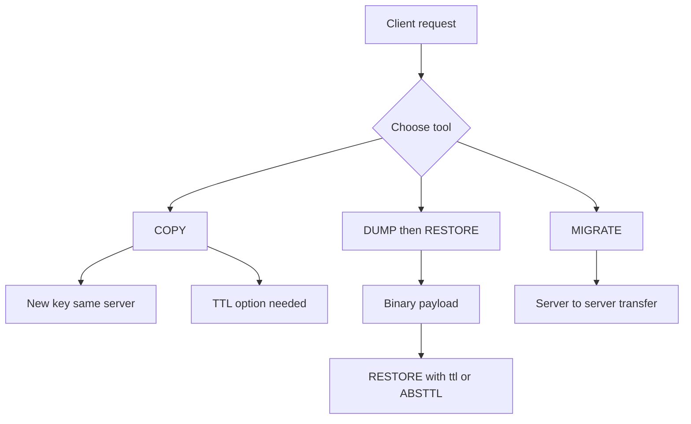

# COPY, DUMP/RESTORE, and MIGRATE: Moving Data Between Keys and Servers

## English

Most Redis work happens inside one server, but eventually you need to move data: copying a key before mutating it, exporting a key to another instance, or migrating a whole database during a deployment. Redis provides three distinct tools for this, and confusing them is a common source of surprise.

The simplest is COPY. COPY source destination creates a new key with the same value, and since Redis 6.2 it accepts a DB option to copy into another logical database on the same server. It is a server-side operation, so it does not serialize the value over the network and does not require the client to hold the data. By default COPY fails if the destination already exists; REPLACE overrides that. Crucially, COPY does not copy the TTL by default — you must add the TTL option if you want the expiration to travel with the value. This is a subtle trap: people copy a session key, forget TTL, and end up with a session that never expires.

DUMP and RESTORE handle serialization. DUMP key returns a binary, version-tagged payload that encodes the value in Redis's internal format, and RESTORE key ttl payload recreates it. The payload includes a checksum and a format version, so a RESTORE into an incompatible Redis version fails loudly rather than silently corrupting data. TTL is a parameter of RESTORE in milliseconds, and passing 0 means no expiry. There is also an ABSTTL option (since Redis 5) that lets the TTL argument be an absolute Unix timestamp in milliseconds, which is what you want when migrating keys whose expiration must be preserved exactly. The payload is opaque — do not try to parse it — but it is portable across architectures because Redis normalizes byte order.

MIGRATE is the heavyweight: it connects from the source server to a destination server, sends a RESTORE command over the wire, and deletes the key locally on success. It is what redis-cli --cluster reshard uses under the hood to move hash slots. MIGRATE host port key destination-db timeout [COPY] [REPLACE] [KEYS ...] can move one key or, with the KEYS form, several at once, and COPY keeps the source key instead of deleting it. Because MIGRATE blocks the source while it runs, migrating a huge key can stall the event loop — the same trap as any slow command. For big keys, prefer DUMP to the client, then RESTORE on the target, so the blocking work is spread out.

A practical rule of thumb: use COPY for cheap in-server duplication, DUMP/RESTORE when you want to control the transfer through your own client (batching, retries, cross-version checks), and MIGRATE when you are doing cluster operations or bulk moves and can tolerate the synchronous behavior. In all three cases, remember that expiration metadata is separate from the value and must be carried explicitly — it is the single most common thing people forget when moving keys around.

## 中文

大部分 Redis 操作都在單一伺服器內完成，但總有一天你需要搬資料：在改動前複製某個鍵、把鍵匯出到另一個實例，或在部署時遷移整個資料庫。Redis 為此提供三種不同工具，把它們混淆是常見的意外來源。

最簡單的是 COPY。COPY source destination 會建立一個值相同的新鍵，自 Redis 6.2 起還接受 DB 選項，複製到同一伺服器上的另一個邏輯資料庫。這是伺服器端操作，所以不會把值序列化後經網路傳輸，也不需客戶端持有資料。預設情況下若目標鍵已存在，COPY 會失敗；REPLACE 可覆寫。關鍵是：COPY 預設不複製 TTL——你必須加上 TTL 選項，過期時間才會跟著值一起走。這是個微妙的陷阱：有人複製 session 鍵卻忘了 TTL，結果得到一個永不過期的 session。

DUMP 與 RESTORE 負責序列化。DUMP key 回傳一段帶版本標記的二進位負載，以 Redis 內部格式編碼該值；RESTORE key ttl payload 則重建它。負載含校驗和與格式版本，所以把不相容版本的資料 RESTORE 進新版本會明確失敗，而不是默默損壞資料。TTL 是 RESTORE 的毫秒參數，傳 0 表示不過期。自 Redis 5 起還有 ABSTTL 選項，讓 TTL 參數是絕對的 Unix 毫秒時間戳——當你要精確保留鍵的過期時刻時就用它。負載是不透明的，別試圖解析，但因為 Redis 會正規化位元組序，它可跨架構移植。

MIGRATE 是重量級工具：它從來源伺服器連到目標伺服器，透過網路送出 RESTORE 指令，成功後在本地刪除該鍵。redis-cli --cluster reshard 底層就是用它搬移雜湊槽。MIGRATE host port key destination-db timeout [COPY] [REPLACE] [KEYS ...] 可搬一個鍵，或用 KEYS 形式一次搬多個；COPY 會保留來源鍵而不刪除。由於 MIGRATE 執行時會阻塞來源，遷移巨大的鍵可能卡住事件迴圈——和任何慢指令一樣的陷阱。對大鍵，最好改用 DUMP 到客戶端、再在目標端 RESTORE，讓阻塞工作分散開來。

實用經驗法則：用 COPY 做便宜的伺服器內複製；用 DUMP/RESTORE 當你想透過自己的客戶端控制傳輸（批次、重試、跨版本檢查）；用 MIGRATE 做叢集操作或大量搬移，且能忍受其同步行為。三種情況都要記住：過期中介資料與值本身是分開的，必須明確攜帶——這是人們搬鍵時最常忘記的事。

## Key Takeaway

COPY duplicates in-server (TTL only if you ask), DUMP/RESTORE serializes with a version-tagged payload you can control, and MIGRATE is the blocking, server-to-server tool that cluster resharding relies on.

## Related Concepts
- Hash slot migration
- TTL metadata versus value payload

## Diagram

