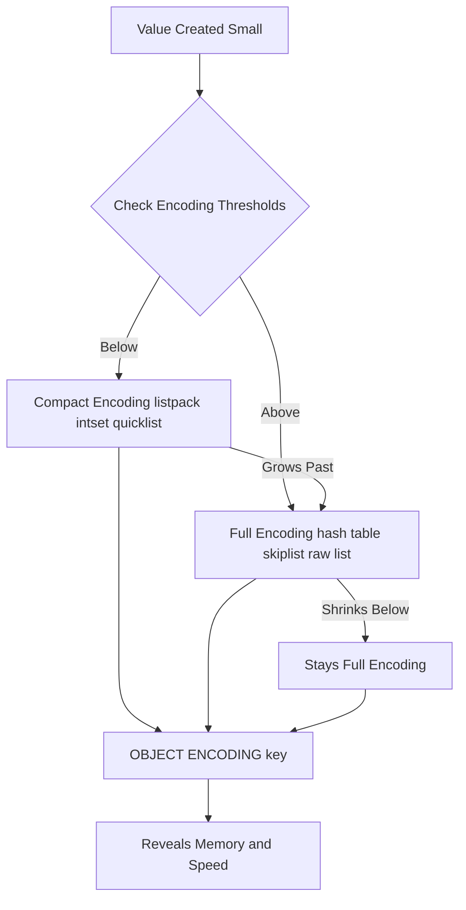

# OBJECT ENCODING and the Hidden Conversions That Change Memory and Speed

## English

A Redis value is not stored one way forever. The same logical list, hash, set, or sorted set can be held in a compact encoding or a full data-structure encoding, and Redis switches between them automatically based on size thresholds. The command OBJECT ENCODING key tells you which one a key is currently using, and reading it is one of the fastest ways to understand why a dataset is bigger or slower than you expected.

Small collections use packed encodings. A hash with few fields and short values is stored as a listpack (formerly ziplist), which is a single contiguous block of bytes rather than a hash table — no pointers per entry, no per-element allocation overhead. A small set of integers can be an intset, a sorted array of integers. A small sorted set is also a listpack. A small list is a plain listpack on Redis 7.0 and newer, becoming a quicklist of listpacks once it grows past the configured limit. These encodings trade update flexibility for memory density, and for the vast majority of real keys — a user profile with ten fields, a set of five tags — they are dramatically cheaper.

When a key grows past a threshold, Redis converts it to the full encoding: a hash table, a skiplist plus hash table, a quicklist of listpacks for a large list. The thresholds are configurable: hash-max-listpack-entries and hash-max-listpack-value (and analogous list-max-listpack-size, set-max-intset-entries, set-max-listpack-entries, zset-max-listpack-entries, zset-max-listpack-value). The default for hashes is 512 entries and 64 bytes per value (the 128-entry figure belongs to sorted sets). The critical word is one-way: once a hash key converts from listpack to hash table, shrinking it back below the threshold does NOT convert it back. The conversion is permanent for that key's lifetime. This is why a key that briefly spiked to 200 fields and then shrank to 10 can still be using far more memory than a freshly created 10-field key.

The performance implications run both ways. Listpack-encoded structures are excellent for reads and for small writes, but inserting into the middle of a large listpack is O(n) in the size of the packed block, because bytes must be shifted. That is fine at 128 entries and painful at 10,000. Conversely, the hash-table encoding gives O(1) field access but pays pointer and allocation overhead per entry, which can be several times the raw data size for tiny values. Understanding which encoding you are in explains seemingly contradictory advice: 'hashes save memory' is true for small hashes and can be false for large ones.

A practical workflow: run OBJECT ENCODING on a sample of your keys, and if you see listpack on a key that should be large, investigate why it never grew; if you see hashtable on a key that should be small, check whether it was once large. Then tune the thresholds deliberately. Raising them saves memory on medium-sized keys but risks O(n) inserts and longer blocking during conversion — the conversion itself is a single-threaded operation, so converting a huge key can stall the server. The safest pattern is to keep individual keys small by design, so encodings stay packed and conversions stay cheap.

## 中文

一個 Redis 值不會永遠用同一種方式儲存。同一個邏輯上的 list、hash、set 或 sorted set，可以用緊湊編碼或完整資料結構編碼來存放，而 Redis 會依大小閾值自動切換。指令 OBJECT ENCODING key 會告訴你某個鍵目前用哪一種，讀它是最快理解「為何資料集比預期更大或更慢」的方法之一。

小型集合使用緊湊編碼。欄位少、值又短的 hash 會存成 listpack（以前叫 ziplist），那是一整塊連續位元組，而不是雜湊表——每個條目沒有指標、沒有逐元素配置開銷。小型整數集合可以是 intset，一個排序的整數陣列。小型有序集合也是 listpack。在 Redis 7.0 之後，小型 list 會直接存成 listpack，長大超過設定上限才轉為 listpack 組成的 quicklist。這些編碼以更新彈性換取記憶體密度，而對絕大多數真實的鍵——十個欄位的使用者資料、五個標籤的集合——它們便宜得多。

當鍵成長超過閾值，Redis 會把它轉成完整編碼：雜湊表、跳表加雜湊表、大型 list 則轉成 listpack 組成的 quicklist。閾值可設定：hash-max-listpack-entries 與 hash-max-listpack-value（以及類似的 list-max-listpack-size、set-max-intset-entries、set-max-listpack-entries、zset-max-listpack-entries、zset-max-listpack-value）。hash 的預設是 512 個條目、每個值 64 位元組（128 個條目係有序集合的數字）。關鍵詞是「單向」：hash 鍵一旦從 listpack 轉成雜湊表，即使之後縮回閾值以下，也不會轉回去。對該鍵的生命週期而言，轉換是永久的。這就是為何一個曾短暫衝到 200 個欄位、後來縮回 10 個欄位的鍵，記憶體用量仍遠高於全新建立的 10 欄位鍵。

效能影響是雙向的。listpack 編碼的結構對讀取和小量寫入極佳，但往大型 listpack 中間插入是 O(n)（以打包區塊大小計），因為必須搬移位元組。128 個條目時沒問題，一萬個時就很痛。反過來，雜湊表編碼提供 O(1) 欄位存取，但每個條目要付指標與配置開銷，對極小的值可能是原始資料的好幾倍。了解自己身處哪種編碼，就能解釋看似矛盾的建議：「hash 省記憶體」對小 hash 成立，對大 hash 可能不成立。

實用流程：對一批樣本鍵跑 OBJECT ENCODING；若某個本該很大的鍵顯示 listpack，查查它為何從未長大；若本該很小的鍵顯示 hashtable，查查它是否曾經很大。然後刻意調整閾值。調高可為中型鍵省記憶體，但冒著 O(n) 插入與轉換時更久阻塞的風險——轉換本身是單執行緒操作，轉換巨大鍵會卡住伺服器。最安全的模式是從設計上就讓單一鍵保持小，編碼才會維持緊湊，轉換才便宜。

## Key Takeaway

OBJECT ENCODING reveals whether a key is in a compact listpack/intset form or a full hash-table form; hash and set conversions never shrink back, so keep keys small by design and tune thresholds deliberately.

## Related Concepts
- Listpack and intset encodings
- Hash table versus contiguous storage trade-offs

## Diagram

