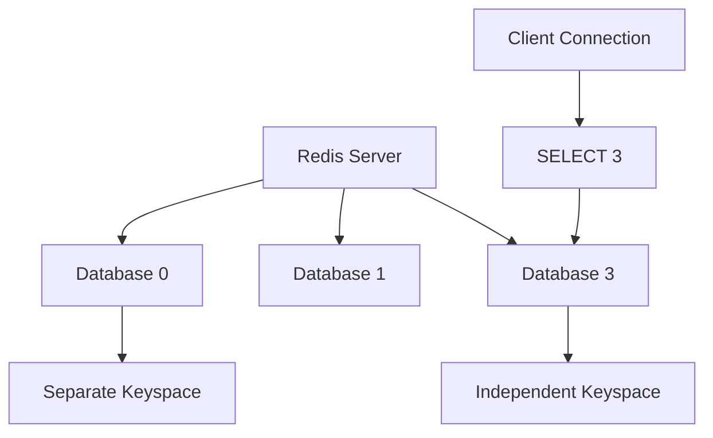

# Database Selection: One Connection, Many Namespaces

## English

A single Redis server actually holds several independent key spaces, called databases, numbered from 0 upward. A fresh default configuration exposes 16 of them (the `databases` directive in redis.conf controls how many). A client picks one with the `SELECT` command — `SELECT 3` — and from then on every command it sends operates inside database 3. Keys in database 0 and database 3 with the same name are completely different keys: they can hold different types, have different TTLs, and expire independently. This is why you can run a cache, a session store, and a job queue against one server without their key names colliding, as long as each role selects its own database number. It is a cheap namespacing mechanism that costs nothing to set up.

The catch is that database selection is a property of the connection, not of the key. When a client library hands you a pooled connection, you must make sure the connection is already pointing at the right database before you issue commands, otherwise you may silently read or write the wrong namespace. Most clients handle this by letting you configure the database number once at client-construction time, and internally they re-`SELECT` whenever they establish a new connection from the pool. If you ever see mysterious missing keys, check whether some code path is using a connection that never selected the expected database.

Databases are not free in some respects. Background operations like `FLUSHALL` wipe every database on the server, while `FLUSHDB` wipes only the currently selected one. Keyspace notifications are configured per-database using the `notify-keyspace-events` setting, so if you enable notifications only on database 0, a subscriber listening on database 2 will see nothing. Replication and persistence, however, cover all databases together — an RDB snapshot captures every database, and an AOF log replays writes for all of them. You cannot replicate or snapshot just one database.

The biggest limitation arrives with Redis Cluster. Cluster mode supports only database 0; `SELECT` with any other number is rejected. The reason is that keys are distributed across nodes by hash slot, and there is no way to keep a whole database on a single node without breaking the sharding model. So if you plan to move from a single server to a cluster, any code that relies on numbered databases will need to migrate to key-name prefixes (for example `cache:user:42` versus `session:42`) instead. Treat numbered databases as a convenience for single-server deployments.

A practical rule of thumb: use separate databases when the separation is operationally simple and the data is low-stakes — a throwaway cache in database 1, a test fixture in database 2. Use key prefixes when you need cluster compatibility, when you need per-tenant metrics, or when you want to be able to `SCAN` a namespace without accidentally touching another. Prefixes also make debugging easier because `MONITOR` shows the full key name, whereas a `SELECT` is a separate command whose effect on subsequent lines is easy to miss when reading logs.

## 中文

一個 Redis 伺服器實際上同時容納了好幾個互相獨立的鍵空間，稱為資料庫（database），從 0 開始編號。預設設定通常會開放 16 個（由 redis.conf 裡的 `databases` 指令控制數量）。客戶端用 `SELECT` 指令選擇其中一個——例如 `SELECT 3`——之後它送出的每一條指令都在第 3 號資料庫裡運作。第 0 號和第 3 號資料庫裡同名的鍵是完全不同的鍵：可以存不同型別、有不同 TTL、各自獨立過期。這就是為什麼你可以在同一臺伺服器上跑快取、session 儲存和工作佇列，只要每個角色各自 SELECT 自己的資料庫編號，鍵名就不會相撞。這是一個零成本的名稱空間機制。

問題在於，資料庫選擇是連線的屬性，不是鍵的屬性。當客戶端程式庫交給你一條連線池裡的連線時，你必須確保那條連線在送出指令前已經指向正確的資料庫，否則你可能悄悄讀寫了錯的名稱空間。多數客戶端會讓你在建立客戶端時設定一次資料庫編號，內部在從連線池建立新連線時自動重新 `SELECT`。如果你遇到莫名其妙的「鍵不見了」，先檢查是不是某條程式路徑用了從未選對資料庫的連線。

資料庫在某些方面並非免費。像 `FLUSHALL` 這種背景操作會清空伺服器上所有資料庫，而 `FLUSHDB` 只清空當前選中的那一個。鍵空間通知是逐資料庫設定的，透過 `notify-keyspace-events` 控制；如果你只在第 0 號資料庫開啟通知，那麼在第 2 號資料庫監聽的訂閱者什麼都收不到。不過複製與持久化是涵蓋所有資料庫的——RDB 快照會拍下每一個資料庫，AOF 日誌會重播所有資料庫的寫入。你無法只複製或只快照某一個資料庫。

最大的限制在 Redis Cluster 出現。叢集模式只支援第 0 號資料庫；`SELECT` 其他編號會被拒絕。原因是鍵會依雜湊槽分散到各節點，若要把整個資料庫留在單一節點，就會破壞分片模型。所以如果你打算從單機搬到叢集，任何依賴編號資料庫的程式碼都必須改成鍵名字首（例如 `cache:user:42` 對比 `session:42`）。把編號資料庫當成單機部署的便利工具就好。

實務上的經驗法則：當分隔很簡單、資料風險低時（例如第 1 號放用完即丟的快取、第 2 號放測試資料）就用獨立資料庫；當你需要叢集相容、需要逐租戶指標、或想在不誤觸其他名稱空間的情況下 `SCAN` 某個名稱空間時，就用鍵名字首。字首也讓除錯更容易，因為 `MONITOR` 會顯示完整鍵名，而 `SELECT` 是一條獨立指令，讀日誌時很容易忽略它對後續幾行的影響。

## Key Takeaway

Numbered databases give you cheap namespacing on a single server, but they are per-connection, cluster-incompatible, and invisible in key names — so prefer prefixes when portability and debuggability matter.

## Related Concepts
- Redis Cluster hash slots
- Key naming conventions

## Diagram

