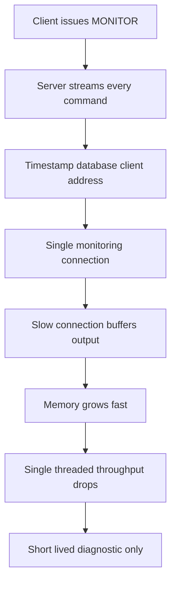

# The MONITOR Command and the Cost of Watching Everything

## English

`MONITOR` is Redis's built-in wiretap. When a client issues `MONITOR`, the server starts streaming every command that any client executes — with a timestamp, the database number, and the client address — back to that one connection. It is enormously useful for debugging: you can see exactly what your application is sending, whether a command is being issued in a tight loop, and whether a client is hitting the wrong database. During an incident, `MONITOR` often answers the question "what is actually happening?" in seconds. It is also a great teaching tool when you are learning a new client library and want to verify that the library is doing what you think it is doing.

The catch is that `MONITOR` is a firehose with no flow control. Every command from every client is written to the monitoring connection, and if that connection is slow — a terminal over SSH, a logging process, a developer's laptop on hotel Wi-Fi — the server buffers the output in memory. On a busy server, that buffer can grow to hundreds of megabytes in minutes, and because Redis is single-threaded, the memory pressure and the socket writes compete with actual work. The Redis documentation explicitly warns that running `MONITOR` in production can reduce throughput and is not recommended for extended periods. Treat it as a short-lived diagnostic, not a permanent observability tool.

For ongoing visibility, the better tools are `SLOWLOG` and `LATENCY`. `SLOWLOG` records commands whose execution exceeded a configurable threshold (the `slowlog-log-slower-than` setting is in microseconds), along with the command, its arguments, and how long it took — but only the slow ones, so the overhead is bounded. `LATENCY` tracks spikes in specific event types (fork, command execution, expire cycles) and is designed to be cheap enough to leave on permanently. Both give you the signal you actually care about — "what is slow?" — without the noise of every fast command. If you need to know which commands a specific client is sending, `CLIENT LIST` and `CLIENT INFO` show per-connection stats without streaming every command.

There is also a subtler issue: `MONITOR` output can leak sensitive data. If your application stores session tokens, API keys, or personal data in Redis, those values will appear verbatim in the monitor stream and in whatever log file or terminal scrollback you happen to have. Anyone with access to that output has effectively seen your secrets. In regulated environments, running `MONITOR` may itself be a compliance concern. If you must capture it, consider redacting before storage, restricting who can run `MONITOR` (it requires no special permission by default beyond being able to connect), and treating the captured output with the same care as a database dump.

A healthy pattern is: reach for `MONITOR` when you have a specific question and a short window to answer it, then turn it off. Reach for `SLOWLOG`, `LATENCY`, `INFO`, and application-side tracing for ongoing visibility. If you find yourself wanting `MONITOR` running all the time, that is usually a sign that your application lacks proper tracing or metrics, and the fix belongs in the application, not in the database. The same reasoning explains why `KEYS` is discouraged in favor of `SCAN`: some operations are fine as a diagnostic and dangerous as a habit.

## 中文

`MONITOR` 是 Redis 內建的竊聽器。當某個客戶端下 `MONITOR`，伺服器就會開始把任何客戶端執行的每一條指令——附上時間戳、資料庫編號和客戶端位址——串流回那條連線。它在除錯上極其有用：你可以看到應用程式到底送了什麼、某條指令是否被塞在緊密迴圈裡、客戶端是否打錯資料庫。事故發生時，`MONITOR` 常常在幾秒內就回答「現在到底發生什麼事」。它也是學新客戶端程式庫時的絕佳教學工具，讓你驗證程式庫是否如你所想地運作。

問題在於，`MONITOR` 是沒有流量控制的消防水管。每個客戶端的每條指令都會被寫進監控連線，而那條連線若很慢——透過 SSH 的終端機、寫日誌的行程、飯店 Wi-Fi 上的開發者筆電——伺服器就會把輸出緩衝在記憶體裡。在忙碌的伺服器上，這個緩衝區幾分鐘內就可能漲到數百 MB，而因為 Redis 是單執行緒，記憶體壓力和 socket 寫入會和真正的工作搶資源。Redis 官方檔案明確警告，在生產環境跑 `MONITOR` 可能降低吞吐量，不建議長時間開啟。把它當成短命的診斷工具，而不是永久的可觀測性工具。

若要持續觀察，更好的工具是 `SLOWLOG` 和 `LATENCY`。`SLOWLOG` 會記錄執行時間超過可設定門檻的指令（`slowlog-log-slower-than` 以微秒為單位），附上指令、引數與耗時——但只記錄慢的，所以額外開銷有上限。`LATENCY` 追蹤特定事件型別（fork、指令執行、過期迴圈）的尖峰，設計上便宜到可以永久開啟。兩者都給你真正在意的訊號——「什麼慢？」——而沒有每條快速指令的噪音。若你需要知道某個特定客戶端送了哪些指令，`CLIENT LIST` 和 `CLIENT INFO` 能顯示逐連線統計，而不必串流每一條指令。

還有一個更隱微的問題：`MONITOR` 的輸出可能洩漏敏感資料。如果你的應用程式在 Redis 裡存 session token、API key 或個人資料，那些值會原封不動地出現在監控串流裡，以及你剛好開著的日誌檔或終端機回捲緩衝中。任何能看到那份輸出的人，等於看到了你的機密。在受監管的環境裡，跑 `MONITOR` 本身可能就是合規問題。若非得擷取，考慮在儲存前先遮蔽、限制誰能跑 `MONITOR`（預設除了能連線之外並無特殊許可權要求）、並把擷取的輸出當成資料庫傾印一樣謹慎對待。

健康的做法是：有具體問題、有短暫時間窗時才用 `MONITOR`，問完就關。持續的可觀測性交給 `SLOWLOG`、`LATENCY`、`INFO` 與應用端追蹤。如果你發現自己希望 `MONITOR` 一直開著，那通常表示應用程式缺少適當的追蹤或指標，該修的是應用程式，不是資料庫。同樣的道理也解釋了為什麼 `KEYS` 被勸退、改用 `SCAN`：有些操作當診斷很好，當習慣就危險了。

## Key Takeaway

MONITOR is a powerful but unbounded diagnostic — use it in short bursts, prefer SLOWLOG and LATENCY for ongoing visibility, and remember that its output can expose secrets.

## Related Concepts
- SLOWLOG
- Observability and tracing

## Diagram

