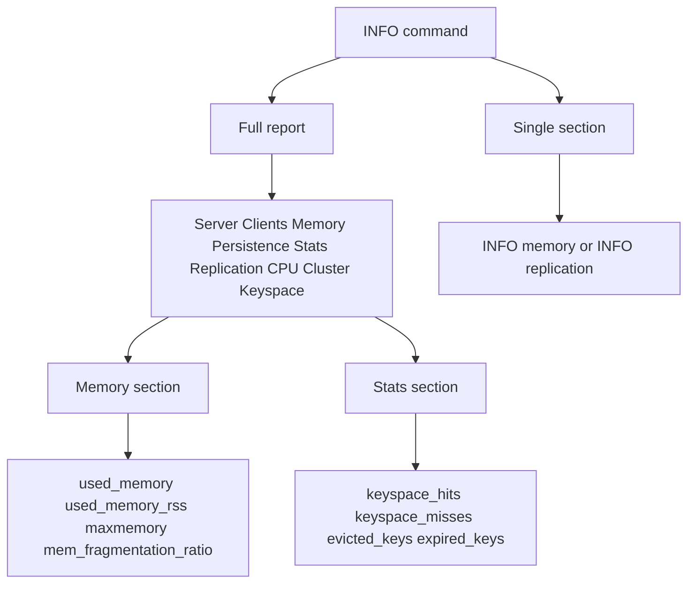

# The INFO Command: Reading the Server's Own Health Report

## English

`INFO` is the closest thing Redis has to a built-in health report. Called with no arguments, it returns a large block of plain-text sections separated by `# SectionName` headers — `Server`, `Clients`, `Memory`, `Persistence`, `Stats`, `Replication`, `CPU`, `Cluster`, `Keyspace`, and more. Each section is a list of `field:value` lines. You can ask for just one section with `INFO memory` or `INFO replication`, which is what most monitoring agents do to keep the output small. Learning to read `INFO` is arguably the single highest-leverage operational skill with Redis, because it tells you what the server thinks is happening, independent of what your application thinks.

The `Memory` section is where most people start. `used_memory` is the allocator's view of how many bytes Redis has allocated for data; `used_memory_rss` is what the operating system has actually given the process, which is usually larger because of fragmentation and allocator overhead. `used_memory_peak` records the high-water mark since the last restart, and `maxmemory` shows your configured ceiling. `mem_fragmentation_ratio` is roughly `used_memory_rss / used_memory` — a value near 1 is healthy, above about 1.5 suggests fragmentation is wasting memory, and below 1 means the OS has swapped part of the process out to disk, which is catastrophic for latency. Watching these numbers over time tells you whether you are drifting toward an out-of-memory event or a fragmentation problem.

The `Stats` section tracks command and connection activity: `total_connections_received`, `total_commands_processed`, `expired_keys`, `evicted_keys`, `keyspace_hits`, and `keyspace_misses`. The hit/miss ratio is the single best indicator of whether your cache is actually doing its job; a sudden drop in hits usually means a key-name change, a TTL that is too short, or a new code path bypassing the cache. `evicted_keys` climbing steadily means `maxmemory` is being hit and the eviction policy is discarding data — often the first sign that you need to either add memory, shrink values, or reconsider what belongs in Redis at all. `expired_keys` growing quickly is normal if you use TTLs heavily, but a sudden spike can indicate a stampede of expirations.

The `Replication` section is the one to read during an incident. `role:master` or `role:slave` tells you what this instance thinks it is. `connected_slaves` and per-replica lines show which replicas are attached and how far behind they are. `master_repl_offset` and `slave_repl_offset` (on a replica) let you compute replication lag in bytes, and `master_link_status:down` on a replica is a five-alarm signal that it is no longer receiving updates. The `Persistence` section shows `rdb_last_bgsave_status`, `aof_last_write_status`, and whether a background save is currently in progress — a `bgsave_in_progress:1` that has been stuck for minutes is a serious warning sign. The `Keyspace` section shows, per database, how many keys exist and how many have TTLs set, which is a cheap way to check that data is landing where you expect.

A practical habit is to poll `INFO` on a schedule (every 10–30 seconds is typical) from your monitoring system, store the fields you care about as time series, and alert on changes rather than absolute values. Absolute numbers are hard to threshold across environments; deltas and ratios travel better. For example, alert when `evicted_keys` increases by more than some amount in five minutes, when `connected_slaves` drops below the expected count, or when `mem_fragmentation_ratio` crosses 1.5 and stays there. `INFO` is not a substitute for application metrics, but it is the ground truth about the server itself — and it is available even when your application is too broken to report anything.

## 中文

`INFO` 是 Redis 最接近內建健康報告的東西。不帶引數呼叫時，它會回傳一大塊純文字區段，以 `# SectionName` 標頭分隔——包括 `Server`、`Clients`、`Memory`、`Persistence`、`Stats`、`Replication`、`CPU`、`Cluster`、`Keyspace` 等等。每個區段是一串 `欄位:值` 的行。你可以只要求某一個區段，例如 `INFO memory` 或 `INFO replication`，這也是多數監控代理的做法，以縮小輸出。學會讀 `INFO` 可以說是 Redis 運維裡投報率最高的一項技能，因為它告訴你伺服器自己認為發生了什麼，獨立於應用程式的說法。

`Memory` 區段是多數人的起點。`used_memory` 是配置器眼中 Redis 為資料配置了多少位元組；`used_memory_rss` 是作業系統實際給該行程的記憶體，通常較大，因為有碎片和配置器額外開銷。`used_memory_peak` 記錄自上次重啟以來的最高水位，`maxmemory` 顯示你設定的上限。`mem_fragmentation_ratio` 大約是 `used_memory_rss / used_memory`——接近 1 是健康，高於約 1.5 表示碎片在浪費記憶體，低於 1 則表示作業系統已把行程的一部分換出到磁碟，對延遲是災難性的。長期觀察這些數字能告訴你是否正漂向記憶體不足或碎片問題。

`Stats` 區段追蹤指令與連線活動：`total_connections_received`、`total_commands_processed`、`expired_keys`、`evicted_keys`、`keyspace_hits`、`keyspace_misses`。命中／未命中比率是判斷快取是否真的在工作的最佳單一指標；命中率突然下降通常意味著鍵名改了、TTL 太短，或某條新程式路徑繞過了快取。`evicted_keys` 穩定攀升表示已撞到 `maxmemory`、淘汰策略正在丟棄資料——這往往是你需要加記憶體、縮小值、或重新考慮什麼東西根本不該放進 Redis 的第一個徵兆。`expired_keys` 快速增長在你大量使用 TTL 時很正常，但突然尖峰可能表示一波過期潮。

`Replication` 區段是事故期間必讀的。`role:master` 或 `role:slave` 告訴你這個例項自認為是什麼。`connected_slaves` 與每個 replica 的明細行顯示哪些 replica 已掛上、落後多少。`master_repl_offset` 和（replica 上的）`slave_repl_offset` 讓你以位元組計算複製延遲，而 replica 上的 `master_link_status:down` 是它已不再接收更新的重大警訊。`Persistence` 區段顯示 `rdb_last_bgsave_status`、`aof_last_write_status`，以及目前是否有背景儲存在進行——`bgsave_in_progress:1` 卡了好幾分鐘是嚴重警訊。`Keyspace` 區段則逐資料庫顯示有多少鍵、多少設了 TTL，是確認資料是否落在預期位置的便宜方法。

實務習慣是：由監控系統定期輪詢 `INFO`（每 10–30 秒很常見），把你關心的欄位存成時間序列，並對「變化」而非絕對值告警。絕對數字很難跨環境設門檻，差值與比率更好用。例如：當 `evicted_keys` 在五分鐘內增加超過某個量、`connected_slaves` 掉到預期數量以下、或 `mem_fragmentation_ratio` 超過 1.5 且持續時就告警。`INFO` 不能取代應用程式指標，但它是關於伺服器本身的基準真相——而且即使應用程式壞到什麼都報不出來，它依然可用。

## Key Takeaway

INFO is the server's self-report; learn the Memory, Stats, Replication, Persistence, and Keyspace sections and alert on deltas and ratios rather than absolute values.

## Related Concepts
- Memory fragmentation ratio
- Replication offsets

## Diagram

