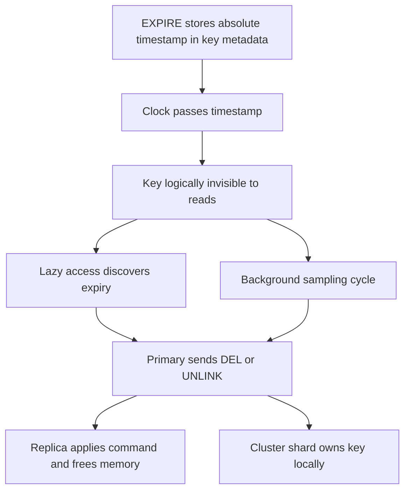

# Expire Semantics in Cluster and Replicas: Where TTL Lives and Who Deletes

## English

A TTL in Redis is not a timer that fires at an exact instant. When you run EXPIRE, Redis stores an absolute Unix timestamp in milliseconds (the expire field of the key's metadata), not a countdown. The key becomes logically invisible to reads the moment the clock passes that timestamp, but the memory is only reclaimed later, either lazily when the key is accessed or actively by a background sampling cycle. This separation between logical expiry and physical deletion is what makes TTL cheap: no per-key timer object exists, so ten million keys with TTLs cost almost nothing extra in scheduling overhead.

The subtle part is what happens on replicas. Replicas do not expire keys on their own initiative; they wait for the primary to send an explicit DEL or UNLINK command, which the primary generates when it actively expires a key or when a lazy access discovers a logically expired key. Until that command arrives, a replica will hide a logically expired key from reads (so clients never see stale data) but will still count it in memory. This design keeps replicas byte-for-byte deterministic with the primary's command stream, which is essential for replication correctness. If you ever see a replica reporting more used_memory than its primary, expired-but-not-yet-deleted keys are a common explanation.

In Redis Cluster, TTLs are per-key and each key lives on exactly one hash slot owned by one primary, so expiry is naturally local to that shard. There is no cross-shard coordination for a single key's TTL. What does span shards is your own logic: if you write a session key and an index entry in the same MULTI block, both must hash to the same slot for the transaction to work, which is why hash tags like {user:42}:session and {user:42}:index are used to pin related keys together. Forgetting this breaks atomicity across keys that were meant to expire together.

A practical consequence: never treat TTL as a correctness guarantee for anything but cache freshness. A key with a one-hour TTL may survive slightly longer in memory on a replica, and a key with a very short TTL may be deleted a few milliseconds late under load because active expiry is a sampling loop, not a hard scheduler. If you need strict time-based state transitions, store the timestamp as a value and check it in application code, or use a sorted set keyed by expiry time and poll with ZRANGEBYSCORE.

Finally, remember that commands like SET key value EX 60 are atomic in the sense that the value and expiry are set together, while separate SET followed by EXPIRE leaves a window where the key has no TTL. If the process crashes between the two calls, you have a key that never expires — a classic slow memory leak. Prefer the combined form, or use SET with the KEEPTTL option deliberately when you want to preserve an existing expiry across a value update.

## 中文

Redis 裡的 TTL 並不是一個會在精確時刻觸發的計時器。當你執行 EXPIRE，Redis 儲存的是絕對的 Unix 毫秒時間戳（即鍵元資料裡的 expire 欄位），而不是倒數計時。當時鐘越過該時間戳的那一刻，該鍵對讀取而言就邏輯上不可見，但記憶體要到稍後才會被回收——可能是鍵被存取時的惰性刪除，也可能是背景取樣週期的主動刪除。這種「邏輯過期」與「實際刪除」的分離，正是 TTL 便宜的原因：系統不存在每個鍵一個計時器物件，所以一千萬個帶 TTL 的鍵幾乎不增加排程開銷。

微妙之處在於副本（replica）上會發生什麼。副本不會自行主動讓鍵過期；它們等待主節點送出明確的 DEL 或 UNLINK 命令，而主節點是在主動過期某鍵、或惰性存取發現某鍵邏輯上已過期時才產生該命令。在該命令抵達之前，副本會在讀取時隱藏邏輯上已過期的鍵（因此客戶端永遠看不到過期資料），但仍會在記憶體中計算它。這個設計讓副本與主節點的命令流保持逐位元組的確定性，對複寫正確性至關重要。如果你看到副本回報的 used_memory 比主節點多，已過期但尚未刪除的鍵是常見的解釋。

在 Redis Cluster 中，TTL 是逐鍵的，每個鍵恰好落在一個由某個主節點擁有的雜湊槽上，所以過期自然是該分片的本地事務。單一鍵的 TTL 沒有任何跨分片協調。真正跨分片的是你自己的邏輯：如果你在同一個 MULTI 區塊裡寫入一個 session 鍵和一個索引鍵，兩者必須雜湊到同一個槽，事務才能運作，這就是為什麼會用 {user:42}:session 和 {user:42}:index 這類雜湊標籤把相關的鍵釘在一起。忘記這點，就會破壞原本打算一起過期的鍵之間的原子性。

一個實務上的推論：除了快取新鮮度之外，永遠不要把 TTL 當成任何東西的正確性保證。帶一小時 TTL 的鍵在副本的記憶體中可能存活稍久；帶極短 TTL 的鍵在高負載下可能因為主動過期是取樣迴圈而非硬性排程器而延遲幾毫秒才被刪除。如果你需要嚴格的時間狀態轉換，請把時間戳存成值並在應用程式碼中檢查，或使用以到期時間為分數的 sorted set，並用 ZRANGEBYSCORE 輪詢。

最後，請記住 SET key value EX 60 這種命令在「值與到期時間一起設定」的意義上是原子的，而分開的 SET 加 EXPIRE 會留下一個鍵還沒有 TTL 的視窗。如果行程在這兩次呼叫之間崩潰，你就得到一個永不過期的鍵——典型的緩慢記憶體洩漏。優先使用合併形式，或在刻意想保留既有到期時間時，才使用帶 KEEPTTL 選項的 SET。

## Key Takeaway

TTL is a stored timestamp, not a timer; replicas only delete on the primary's command, so treat expiry as cache freshness rather than a correctness guarantee.

## Related Concepts
- Lazy vs Active Expiration
- Redis Cluster hash slots

## Diagram

