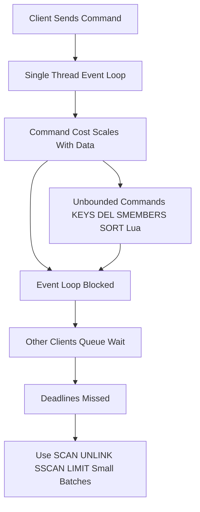

# The Slow Command Problem: Latency Budgets and Defensive Command Choices

## English

Because Redis executes commands on a single thread, every command's cost is paid by every other client in the queue behind it. This turns latency into a shared resource. A command that takes 10 ms does not just slow one caller; it stalls the entire event loop for 10 ms, during which thousands of other clients wait. Under a 50,000 ops/sec workload, a single 10 ms command can push hundreds of requests past their deadline. The mental model to adopt is that Redis is a queue of commands processed one at a time, and your job as a designer is to keep every individual command small and predictable.

The usual suspects are commands whose cost scales with data size. KEYS walks the entire keyspace and is effectively banned in production; SCAN is the cursor-based replacement that bounds work per call. DEL on a huge hash or list frees every element in one go and blocks; UNLINK moves the free to a background thread. SMEMBERS on a set with millions of members returns them all in one reply, saturating both the server's output buffer and the client's parser; SSCAN or a different data model is safer. SORT without LIMIT, LRANGE 0 -1 on a long list, and ZRANGEBYSCORE over a vast range all have the same shape: work proportional to the result size, paid inside the event loop.

Even commands that look bounded can hide expensive work. ZADD is O(log N) for each element, so a single ZADD with 10,000 members is O(M log N) and can be slow on a large set. HDEL with many fields behaves similarly. Lua scripts are the biggest trap because they run to completion without yielding: a script that loops over a million keys blocks everything, and there is no preemption. The busylua-script and busy-reply-threshold settings can log warnings, and SCRIPT KILL can terminate a read-only script, but a script that has already written cannot be killed without sacrificing atomicity.

Defensive design means choosing the right shape of command before deployment. Batch large operations into chunks of a few hundred elements per pipeline round, using SSCAN or HSCAN to iterate incrementally. Prefer UNLINK over DEL for large keys. Use ZRANGE with LIMIT-style arguments (ZRANGEBYSCORE ... LIMIT offset count) rather than pulling entire ranges. When you must run something heavy, do it against a replica if your consistency model allows, or schedule it during low-traffic windows. Measure with SLOWLOG GET and the latency command to find the outliers that your application actually triggers, not the ones you imagine.

Finally, remember that the slow command problem is often a data modeling problem in disguise. A list with ten million elements that you LRANGE in full is a design smell: perhaps you wanted a paginated feed, in which case LRANGE with bounded offsets or a sorted set with score-based pagination is the right tool. The fix is rarely to make Redis faster; it is to make your access pattern ask for less at once.

## 中文

因為 Redis 在單一執行緒上執行命令，每個命令的成本都由排在它後面的所有其他客戶端共同承擔。這使延遲成為一種共享資源。一個耗時 10 毫秒的命令不只拖慢一個呼叫者；它會讓整個事件迴圈停頓 10 毫秒，期間數千個其他客戶端都在等待。在每秒五萬次操作的負載下，單一個 10 毫秒的命令就能讓數百個請求超過期限。要建立的心智模型是：Redis 是一個逐條處理的命令佇列，而你作為設計者的工作，是讓每一個命令都小而可預測。

常見的嫌疑犯是成本隨資料量成長的命令。KEYS 會走訪整個鍵空間，在生產環境基本上被禁用；SCAN 是以遊標為基礎的替代方案，可限制每次呼叫的工作量。對一個巨大的 hash 或 list 執行 DEL 會一次釋放所有元素並造成阻塞；UNLINK 則把釋放工作移到背景執行緒。對有數百萬成員的 set 執行 SMEMBERS 會在一次回覆中全部回傳，同時塞爆伺服器的輸出緩衝區和客戶端的解析器；SSCAN 或改用不同的資料模型更安全。沒有 LIMIT 的 SORT、對長 list 執行 LRANGE 0 -1、對龐大範圍執行 ZRANGEBYSCORE，形狀都一樣：工作量與結果大小成正比，而且都在事件迴圈內支付。

即使是看起來有界的命令，也可能隱藏昂貴的工作。ZADD 對每個元素是 O(log N)，所以帶一萬個成員的單一 ZADD 是 O(M log N)，在大型 set 上可能很慢。帶許多欄位的 HDEL 行為類似。Lua 指令碼是最大的陷阱，因為它會執行到完成而不讓出：一個迴圈走訪一百萬個鍵的指令碼會阻塞一切，而且沒有搶佔機制。busy-reply-threshold 等設定可以記錄警告，SCRIPT KILL 可以終止唯讀指令碼，但已經寫入過的指令碼無法在不犧牲原子性的情況下被殺掉。

防禦性設計意味著在部署前就選對命令的形狀。把大型操作切成每批數百個元素，用 pipeline 分輪送出，並用 SSCAN 或 HSCAN 增量迭代。對大鍵優先使用 UNLINK 而非 DEL。使用帶 LIMIT 風格引數的 ZRANGE（ZRANGEBYSCORE ... LIMIT offset count），而不是拉出整個範圍。當你非得執行重工作時，若一致性模型允許，就在副本上做，或安排在低流量時段。用 SLOWLOG GET 和 latency 命令量測，找出你的應用程式實際觸發的離群值，而不是你想像中的那些。

最後，請記住慢命令問題往往是資料建模問題的偽裝。一個有一千萬個元素、而你卻整段 LRANGE 的 list 是設計異味：也許你要的是分頁的動態牆，那麼帶有界偏移量的 LRANGE，或以分數分頁的 sorted set，才是正確工具。解法很少是讓 Redis 更快；而是讓你的存取模式一次只要求更少的東西。

## Key Takeaway

Every command's cost is paid by all other clients on the single thread, so bound the work per command with SCAN, UNLINK, LIMIT, and chunked batches.

## Related Concepts
- Single-threaded event loop
- SLOWLOG and latency monitoring

## Diagram

