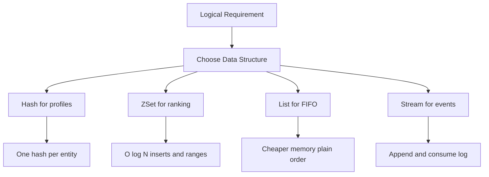

# Data Modeling as the Real Performance Lever: Choosing Between Hash, ZSet, and Stream

## English

Most Redis performance problems are not solved by tuning the server; they are solved by picking a different data structure. The same logical requirement — say, storing a user's recent activity feed — has wildly different cost profiles depending on whether you model it as a list, a sorted set, or a stream. Understanding the trade-offs at the modeling stage is more valuable than any configuration flag, because the structure you choose determines which commands are cheap and which are expensive forever after.

Consider a hash for user profiles. A hash with a few dozen fields is stored compactly (small hashes use a listpack encoding), and HGET on one field is O(1). But if you model every user's attributes as separate top-level string keys, you multiply key overhead — each key carries metadata, an expiry slot, and hash table entry — and you lose the ability to fetch or expire a whole profile atomically. Conversely, if you put millions of fields in one hash, operations like HGETALL become catastrophic and the hash no longer fits the compact encoding. The right answer is usually one hash per entity, sized to be small.

Sorted sets are the go-to for anything ranked or time-ordered. A leaderboard maps naturally to ZADD with score as the rank metric and ZREVRANGE for the top-N. A scheduling queue maps to ZADD with score as the Unix timestamp and ZRANGEBYSCORE for due items. A rate limiter maps to ZADD with timestamps and ZREMRANGEBYSCORE to prune old entries. In each case the sorted set gives you O(log N) inserts and range queries, but the memory cost per element is higher than a plain list because each member carries a score and skiplist bookkeeping. If you only ever need FIFO order, a list is cheaper; the sorted set buys you arbitrary ordering and range queries.

Streams solve a problem the others cannot: multiple consumers reading the same log independently, with acknowledgement and pending-entry tracking. A list used as a queue has one consumer group semantics at best — once you LPOP, the element is gone. A stream with consumer groups lets several workers process the same stream, track which entries each has acknowledged via XACK, and reclaim stuck entries with XAUTOCLAIM. The cost is more bookkeeping and a slightly steeper mental model, but for event-driven fan-out it replaces a lot of custom code.

The unifying principle is to ask two questions before writing any command: what is the access pattern (point lookup, range scan, ranked order, fan-out), and what is the shape of growth (bounded per entity or unbounded over time)? A bounded set of fields per entity points to a hash; an unbounded time-ordered log points to a stream or a sorted set with pruning; a simple FIFO points to a list. Getting this right at design time avoids the slow-command trap entirely, because you never issue a command whose cost scales with data you did not intend to touch.

## 中文

大多數 Redis 效能問題不是靠調整伺服器解決，而是靠換一種資料結構解決。同一個邏輯需求——比如儲存使用者的近期活動動態——用 list、sorted set 或 stream 來建模，成本特徵天差地別。在建模階段就理解這些取捨，比任何設定旗標都更有價值，因為你選的結構會永遠決定哪些命令便宜、哪些命令昂貴。

以 hash 儲存使用者個人檔案為例。只有幾十個欄位的 hash 會被緊湊儲存（小型 hash 使用 listpack 編碼），而對單一欄位做 HGET 是 O(1)。但如果你把每個使用者的屬性都建模成各自獨立的頂層 string 鍵，你就會放大鍵的開銷——每個鍵都帶著元資料、到期槽和雜湊表專案——而且失去原子地取得或讓整個檔案過期的能力。反過來說，如果你把數百萬個欄位塞進一個 hash，HGETALL 之類的操作會變成災難，而且該 hash 不再符合緊湊編碼。正確答案通常是每個實體一個 hash，並讓它保持小。

Sorted set 是任何排名或時間排序事物的首選。排行榜自然對應到以分數為排名指標的 ZADD，以及取前 N 名的 ZREVRANGE。排程佇列對應到以 Unix 時間戳為分數的 ZADD，以及取到期專案的 ZRANGEBYSCORE。速率限制器對應到以時間戳做 ZADD，並用 ZREMRANGEBYSCORE 修剪舊專案。在每個例子裡，sorted set 都給你 O(log N) 的插入與範圍查詢，但每個元素的記憶體成本比純 list 高，因為每個成員都帶著分數和 skiplist 的簿記。如果你只需要 FIFO 順序，list 更便宜；sorted set 換來的是任意排序與範圍查詢。

Stream 解決了其他結構做不到的問題：多個消費者獨立讀取同一份日誌，並具備確認與待處理專案的追蹤。把 list 當佇列用，最多隻有單一消費者的語意——一旦 LPOP，元素就消失了。帶消費者群組的 stream 讓多個工作者處理同一條 stream，透過 XACK 追蹤各自確認了哪些專案，並用 XAUTOCLAIM 回收卡住的專案。代價是更多簿記和稍微陡峭的心智模型，但對於事件驅動的扇出，它取代了大量自訂程式碼。

統一的原則是：在寫任何命令之前先問兩個問題——存取模式是什麼（點查詢、範圍掃描、排名順序、扇出），而成長形狀是什麼（每個實體有界，還是隨時間無界）？每個實體有界的欄位集合指向 hash；無界的時間排序日誌指向 stream，或帶修剪的 sorted set；簡單的 FIFO 指向 list。在設計階段就做對，能完全避開慢命令陷阱，因為你永遠不會發出成本與你無意觸碰的資料量成正比的命令。

## Key Takeaway

Choose the data structure from the access pattern and growth shape first; the right model makes commands cheap by construction and avoids tuning later.

## Related Concepts
- Command complexity (Big-O)
- Lists as queues and streams

## Diagram

