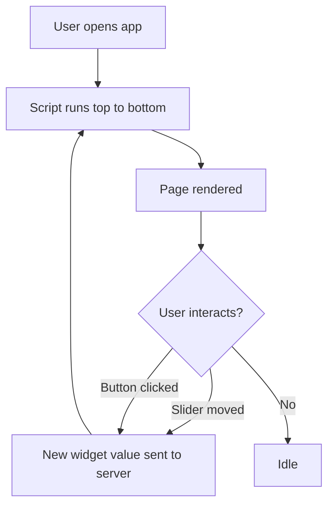

# The Rerun Model: How StreamLit Reacts to You

### English

Streamlit is different from most Python web frameworks because it does not have a request handler that runs when a page is loaded. Instead, your whole script is a single function that runs from top to bottom, top to bottom, every time anything changes. This is called the **rerun model**, and it is the single most important thing to understand about Streamlit.

When you open a Streamlit app, the script runs once and produces a page. When you click a button, move a slider, or type in a text box, Streamlit sends that interaction to the server and runs the script **again from the top**. Widgets are identified by the variables they are assigned to, so the server keeps track of their values across reruns and applies them again. The output is then redrawn. If your script takes two seconds to run, every slider drag will feel like a two-second wait.

Because everything reruns, the order of your code matters in a new way. Statements below a widget will still see that widget's new value on the next rerun, but statements *above* it will still see the previous value in the current run. Anything expensive — a database query, loading a large CSV, calling an API — will execute on every single interaction unless you protect it.

The fix is to separate three kinds of state, which is the subject of the next learning point. The mental model that helps: think of your script as a **function of its inputs**, where the inputs are widget values plus session state, and the output is the page. Because the model is declarative, you cannot rely on "this line only runs once" — you have to structure the code so that rerunning is cheap and harmless.

### 中文

Streamlit 與多數 Python 網頁框架不同，它沒有「頁面載入時執行一次的 request handler」。你的整個 script 其實是一個函數，任何東西一有變化，就會由上至下重新執行一次整個 script。這就是所謂的 **rerun model**（重跑模型），是理解 Streamlit 最關鍵的一點。

當你開啟一個 Streamlit app，script 會執行一次並產生頁面。當你按按鈕、拖動滑桿或在文字框輸入，Streamlit 就把該互動傳給伺服器，然後 **由頭重新執行 script**。Widget（互動元件）靠它們被賦值的變數來識別，所以伺服器可以跨 rerun 追蹤其數值並重新套用，畫面亦隨之重繪。如果你的 script 要跑兩秒，每次拖動滑桿就會感覺像等兩秒。

正因為一切都會重跑，你的程式碼順序的影響方式也很特別。widget 底下的 statement 在下一次 rerun 才會讀到新值，而位於它**上面**的 statement 在當次執行中仍讀到舊值。任何昂貴的操作 —— 資料庫查詢、載入大型 CSV、呼叫 API —— 每次互動都會執行一次，除非你加以保護。

解法是分開三種不同種類的 state，這正是下一篇學習點的主題。幫助理解的思考模型是：把你的 script 想像成「輸入（widget 數值加 session state）的函數」，輸出是頁面。因為這個模型是宣告式的，你不能倚賴「這行只會執行一次」，而要把程式碼組織成令重跑既便宜又無害。

## Key Takeaway
Streamlit reruns your entire script on every widget interaction, so all work must be written to be safely repeatable.

## Related Concepts
- Rerun Model
- Widget State
- Script Execution Order

## Diagram

