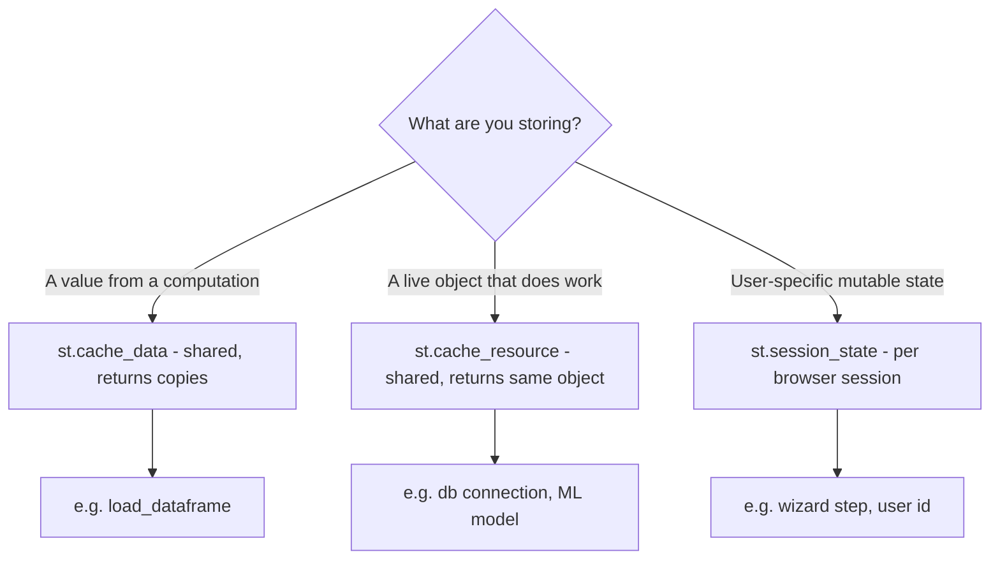

# Three Kinds of State: session_state, cache_data, cache_resource

### English

Because Streamlit reruns the whole script, it needs several different mechanisms for remembering things. Confusing them is the most common source of slow or broken Streamlit apps, so it is worth being precise about what each one does.

**st.session_state** is per-browser-session mutable state that survives reruns. Think of it as a dictionary attached to the user's browser tab: it persists as long as that tab is open, it is not shared between different users, and you can freely mutate it. Use it for things like the current user id, the contents of a text area, or a multi-step wizard's current step. It does not survive a page refresh, and it is not meant to hold large datasets.

**st.cache_data** caches a *result* of a function. It is designed for pure, side-effect-free operations: loading a dataframe from CSV or a database, calling an API, doing some arithmetic. The cache is shared across all users of the app, and the function's arguments act as the cache key — if you call it with the same arguments, you get the cached value back without recomputing. Streamlit returns a copy each time, so one user cannot accidentally mutate another's data. When the underlying data changes, you invalidate it with st.cache_data.clear() or by using a TTL.

**st.cache_resource** caches a *resource* — a connection, a model, a session object. It runs the function only once and hands the same object to every caller. That is exactly what you want for a database connection pool or a loaded machine-learning model, because those are expensive to build and are safe to share. If you used cache_data here, you would get a fresh copy of the model on every call and destroy the point of caching.

A practical decision rule: if it is a *value* that came from a computation, use cache_data; if it is a *thing* that does work, use cache_resource; if it is *user-specific state* that the user changes, use session_state.

### 中文

因為 Streamlit 每次都會重跑整個 script，它需要幾種不同的機制來記住資料。把這些機制混淆，是 Streamlit app 變慢或出錯最常見的來源，所以有必要講清楚各自的用途。

**st.session_state** 是「每個瀏覽器工作階段（session）」各自擁有、並可跨 rerun 保留的可變狀態。可以把它想成附在某個瀏覽器分頁上的一個字典：在該分頁開啟期間一直存在，不同使用者之間並不共享，你可以任意修改。適用途例如目前的 user id、文字區內容，或多步驟表單的當前步驟。它不會在重新整理頁面後保留，也不適合存放大型資料集。

**st.cache_data** 快取的是函式的「結果」。它設計給純函數（沒有副作用）使用：從 CSV 或資料庫載入 dataframe、呼叫 API、做運算。快取由整個 app 的所有使用者共用，函式的引數充當快取鍵（cache key）—— 以相同引數呼叫就會直接取回快取值，毋須重新計算。Streamlit 每次會回傳一份副本，因此某個使用者無法意外改到其他人的資料。底層資料有變時，可用 st.cache_data.clear() 清除快取，或設定 TTL 自動過期。

**st.cache_resource** 快取的是「資源」—— 連線、模型、session 物件。它只執行函式一次，然後把同一個物件交給所有呼叫者。資料庫連線池或已載入的機器學習模型正屬此類：建立成本高，但可以安全共用。若在這裏誤用 cache_data，每次呼叫都會複製一份模型，反而喪失快取的意義。

實用的判斷準則：計算所得的「值」用 cache_data；會做事的「物件」用 cache_resource；使用者會修改的個人狀態用 session_state。

## Key Takeaway
Use session_state for user-specific mutable data, cache_data for expensive pure computations, and cache_resource for shared expensive objects like connections and models.

## Related Concepts
- st.session_state
- st.cache_data
- st.cache_resource
- Cache Invalidation

## Diagram

