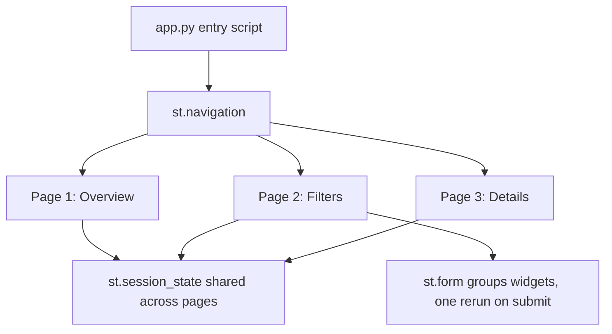

# Multipage Apps, Layout Containers, and Performance Budgets

### English

A **multipage app** is a Streamlit app made of several pages, each with its own URL and its own script. You declare them in a `pages/` folder (each `.py` file there becomes a page, ordered by filename prefix) or explicitly in `st.navigation` / `st.Page` for more control over titles, icons, and URLs. Navigating between pages resets the script, so state that must survive navigation should live in `st.session_state`, not in module-level variables — module-level variables are re-created every time the script runs.

Layout is built from containers. `st.columns` splits the page horizontally, `st.container` groups widgets into a logical box, `st.expander` gives a collapsible section, and `st.tabs` splits it into tabs. The important structural rule is that you can only write to the "current" container at the point where it is created: once you open a column and then write below it, those elements go into the column, not the page. This means layout is defined by *where* you put your write calls, not by where you declare the container. For responsive design, `st.columns` can take a ratio list such as `[1, 2]`, and columns collapse on narrow screens.

Performance in Streamlit is largely a question of how much work each rerun does. The budget to watch is: one rerun should complete in well under a second for a comfortable feel. The main levers are caching (as in the previous learning point), keeping the dataset small, and avoiding work that does not depend on widget values. `st.form` batches several widgets so the script only reruns once when the user submits, instead of on every keystroke — very useful for filters that trigger an expensive query. For genuinely long-running or blocking operations, `st.status`, `st.progress`, and `st.spinner` keep the user informed, and running work in a thread pool or using `st.cache_resource` for a shared client avoids blocking the event loop.

Deployment is straightforward: Streamlit apps are Python programs run by `streamlit run app.py` behind a reverse proxy, and they scale horizontally because sessions are independent — but each active session holds its own state and memory, so resource limits (CPU, memory, container sizing) matter as user count grows.

### 中文

**多頁 app**（multipage app）是指由多個頁面組成的 Streamlit 應用，每頁有獨立網址與獨立 script。你可以在一個 `pages/` 資料夾裏宣告頁面（每個 `.py` 檔會成為一頁，排序由檔名前綴決定），亦可用 `st.navigation` / `st.Page` 更仔細地控制標題、圖示與網址。切換頁面會重新執行 script，所以需要跨頁面保留的狀態必須放在 `st.session_state`，而不能放在模組層級變數 —— 模組層級變數每次執行都會重新建立。

版面由各種容器（container）組合而成。`st.columns` 把頁面水平分割，`st.container` 把 widget 分組成一個邏輯區塊，`st.expander` 提供可摺合區段，`st.tabs` 分成多個標籤頁。有一條重要結構規則：同一時間只能寫入「當前」的容器 —— 開啟某個 column 後再寫內容，元素會進入該 column 而非頁面。換言之，版面是由你「在哪裡寫入」決定，而非由你「在哪裡宣告容器」決定。做響應式設計時，`st.columns` 可接受如 `[1, 2]` 的比例列表，在窄螢幕上會自動收疊。

Streamlit 的效能，主要取決於每次 rerun 做多少工作。要留意的預算標準是：一次 rerun 應遠少於一秒，否則操作會覺得遲鈍。主要手段包括快取（見上一個學習點）、縮小資料集體積，以及避免執行與 widget 數值無關的工作。`st.form` 可以把多個 widget 組成一個表單，提交時才觸發一次 rerun，而非每敲一個字就重跑 —— 對觸發昂貴查詢的篩選條件特別有用。對於真正耗時或會阻塞的操作，可以用 `st.status`、`st.progress`、`st.spinner` 讓用戶知道進度，並以執行緒池或 `st.cache_resource` 共享 client，避免阻塞 event loop。

部署方式直接：Streamlit app 就是 Python 程式，用 `streamlit run app.py` 啟動並放在 reverse proxy（反向代理）之後。由於各 session 互相獨立，可以水平擴展；但每個活躍 session 都持有自己的狀態與記憶體，所以隨使用人數增長，資源上限（CPU、記憶體、容器規格）就變得重要。

## Key Takeaway
Multipage apps need session_state for cross-page memory, layout depends on where you write rather than where you declare containers, and every rerun must stay under roughly one second to feel responsive.

## Related Concepts
- Multipage Apps
- Layout Containers
- st.form
- Deployment and Resource Limits

## Diagram

