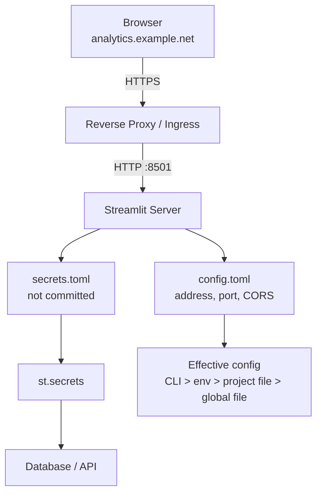

# Configuration, Secrets, and Deployment Behind a Reverse Proxy

### English

A Streamlit app that works on a laptop often breaks the moment it meets a real network. The reason is that Streamlit's defaults are tuned for local development: it binds to all interfaces, uses a self-signed certificate in some setups, allows CORS from any origin, and expects the browser to talk to it directly. Behind a corporate reverse proxy or a load balancer, you must be explicit about several things, and the good news is that almost all of them live in one file: `.streamlit/config.toml`.

```toml
[server]
headless = true
port = 8501
address = "0.0.0.0"
enableCORS = false
enableXsrfProtection = true
maxUploadSize = 200
baseUrlPath = "analytics"

[browser]
gatherUsageStats = false
serverAddress = "analytics.example.net"

[theme]
primaryColor = "#FF4B4B"
```

Configuration can arrive from four places, in increasing order of precedence: the global file `~/.streamlit/config.toml`, the per-project file `.streamlit/config.toml`, environment variables prefixed `STREAMLIT_` (e.g. `STREAMLIT_SERVER_PORT=8501`), and command-line flags (`streamlit run app.py --server.port 8501`). The environment-variable convention is the one to remember for containers: convert the section and key to upper snake case and add the prefix. A `config.toml` value set via CLI beats the same value in the file.

Secrets are handled separately, through `st.secrets`. They live in TOML files — `~/.streamlit/secrets.toml` globally or `.streamlit/secrets.toml` per project, with the project file taking precedence — and are read as a dictionary-like object supporting both `st.secrets["database"]["password"]` and `st.secrets.database.password`. Critically, the `secrets.toml` file must be in `.gitignore`; a leaked database password in a public repository is a real and common incident. Because Streamlit also exposes the root-level secret values as environment variables to the app process, you can hand the same credentials to third-party libraries without re-plumbing them.

```toml
# .streamlit/secrets.toml  (NEVER commit this)
[database]
host = "db.internal"
user = "analytics"
password = "…"

[api]
key = "…"
```

```python
conn = st.connection("postgresql", url=st.secrets["database"]["host"])
```

Two deployment details cause real outages. First, **CORS and XSRF**: Streamlit normally sets CORS headers allowing any origin, because in local development the browser and the server are on the same host. When the app is served from `analytics.example.net` but the Streamlit server is reached via a proxy on another origin, the browser will block the websocket connection unless the proxy rewrites headers and `enableCORS` is set consistently. The rule of thumb is: when the browser talks to the proxy and the proxy talks to Streamlit, set `enableCORS = false` **only** if the proxy injects the right headers itself; otherwise leave CORS enabled and make sure `serverAddress` and `serverPort` match what the browser actually sees, because Streamlit uses those to build the websocket URL. Second, **upload size**: `maxUploadSize` defaults to 200 MB, and exceeding it produces an opaque failure; raise it deliberately rather than discovering the limit in production.

For containers, the canonical pattern is to run headless, bind to a port, and let the platform's ingress terminate TLS:

```bash
streamlit run app.py \
  --server.headless true \
  --server.port 8501 \
  --server.address 0.0.0.0 \
  --browser.serverAddress analytics.example.net
```

Finally, remember that a `secrets.toml` created *while* the app is running is not picked up until the server restarts, whereas theme changes in `config.toml` apply immediately. That asymmetry is worth internalising before you spend an afternoon wondering why a credential change "did nothing".

### 中文

在筆電上運作正常的 Streamlit app，一放上真實網絡就好常失效。原因是預設值是為本機開發而調校：它綁定所有介面、某些情況會用自我簽署憑證、容許任何來源跨網域（CORS），而且預期瀏覽器直接連去它。當 app 放在公司反向代理（reverse proxy）或負載平衡器之後，就要把幾件事講清楚 —— 好消息是它們幾乎全部集中在同一個檔案：`.streamlit/config.toml`。

```toml
[server]
headless = true
port = 8501
address = "0.0.0.0"
enableCORS = false
enableXsrfProtection = true
maxUploadSize = 200
baseUrlPath = "analytics"

[browser]
gatherUsageStats = false
serverAddress = "analytics.example.net"

[theme]
primaryColor = "#FF4B4B"
```

設定可以來自四個地方，優先次序由低至高：全域檔 `~/.streamlit/config.toml`、專案檔 `.streamlit/config.toml`、帶 `STREAMLIT_` 前綴的環境變數（例如 `STREAMLIT_SERVER_PORT=8501`），以及命令列參數（`streamlit run app.py --server.port 8501`）。容器環境最需要記住的是環境變數那條規則：把 section 與 key 轉成大寫蛇形再加前綴。命令列的值會蓋過檔案中的同名設定。

祕密則另行處理，透過 `st.secrets`。它們放在 TOML 檔 —— 全域 `~/.streamlit/secrets.toml` 或專案層 `.streamlit/secrets.toml`（專案檔優先）—— 讀取時像字典一樣，同時支援 `st.secrets["database"]["password"]` 與 `st.secrets.database.password`。關鍵是 `secrets.toml` **必須**放進 `.gitignore`；資料庫密碼外洩到公開程式庫是常見而真實的事故。另外，Streamlit 會把根層級的祕密值也以環境變數形式暴露給 app 程序，方便你把同一組憑證交給第三方程式庫而無需重新接線。

```toml
# .streamlit/secrets.toml （絕對不要 commit）
[database]
host = "db.internal"
user = "analytics"
password = "…"

[api]
key = "…"
```

有兩個部署細節會造成真實事故。第一，**CORS 與 XSRF**：Streamlit 預設會送出容許任何來源的 CORS 標頭，因為本機開發時瀏覽器與伺服器同主機。當 app 由 `analytics.example.net` 提供，但實際連去的是另一個 origin 的代理，瀏覽器會攔截 websocket 連線，除非代理改寫標頭並一致地設定 `enableCORS`。經驗法則是：當瀏覽器連代理、代理連 Streamlit 時，只有在代理自己會補上正確標頭的情況下才設 `enableCORS = false`；否則保持 CORS 開啟，並確保 `serverAddress` 與 `serverPort` 與瀏覽器實際看到的相符，因為 Streamlit 是用它們組出 websocket 網址。第二，**上傳大小**：`maxUploadSize` 預設 200 MB，超出會出現令人困惑的失敗；應當有意識地調高，而不是在生產環境才發現上限。

容器的標準寫法是以 headless 模式啟動、綁定介面埠，由平台的 ingress 負責 TLS 終結：

```bash
streamlit run app.py \
  --server.headless true \
  --server.port 8501 \
  --server.address 0.0.0.0 \
  --browser.serverAddress analytics.example.net
```

最後記住一個不對稱：在 app 執行**期間**新增的 `secrets.toml` 必須重啟伺服器才會生效，但 `config.toml` 裡的主題（theme）改動會即時反映。把這點記住，可以省下一下午懷疑「密碼改了為何沒反應」的時間。

## Key Takeaway
Production Streamlit deployment is mostly about configuration precedence, keeping secrets in an uncommitted secrets.toml, and making CORS, address and upload limits match what the browser and reverse proxy actually see.

## Related Concepts
- Configuration Precedence (file vs env vs CLI)
- st.secrets and secrets.toml
- CORS / XSRF and baseUrlPath Behind a Proxy
- Headless Container Deployment

## Diagram

