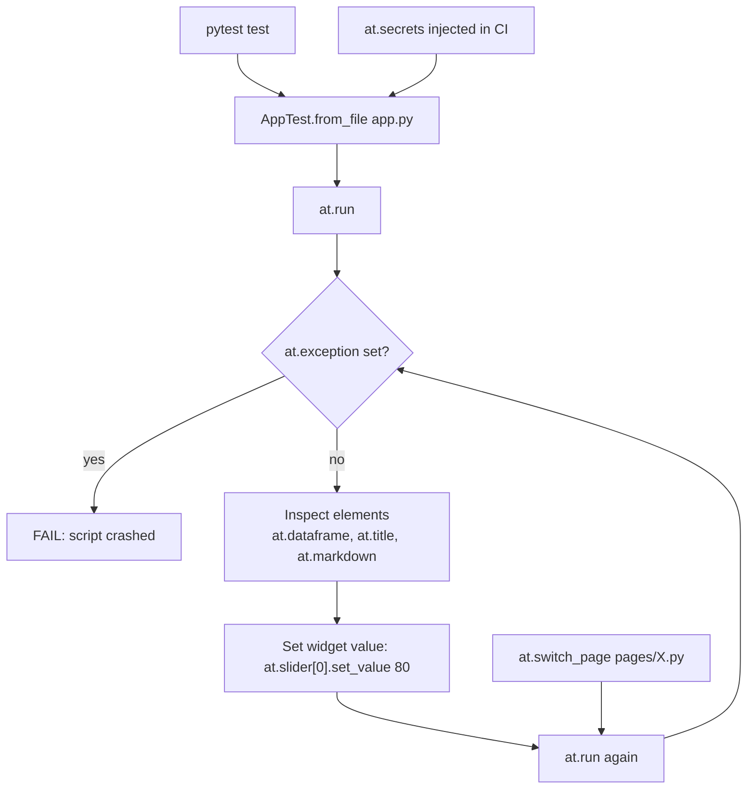

# Testing Streamlit Apps with AppTest

### English

Testing a Streamlit app is awkward for an obvious reason: the app is a script whose behaviour is defined by how widgets are interacted with, and there is no function to call. The usual workaround is to extract the logic into pure functions and test those, leaving the UI untested — which means the most fragile part of the app gets the least protection. `st.testing.v1.AppTest` was built to close that gap: it simulates a running Streamlit app so you can drive it and inspect it from ordinary Python test code.

The entry point is one of three constructors. `AppTest.from_file("app.py")` is the recommended one for CI because it uses exactly the file you would pass to `streamlit run`. `AppTest.from_string(code)` runs a script given as a string, and `AppTest.from_function(fn)` wraps a callable.

```python
from streamlit.testing.v1 import AppTest

def test_filter_applies_threshold():
    at = AppTest.from_file("app.py")
    at.run()
    assert not at.exception

    at.slider[0].set_value(80).run()
    assert at.dataframe[0].value["score"].min() >= 80
```

The API mirrors the app rather than the DOM. Widgets are addressable by type and position — `at.slider[0]`, `at.button[1]`, `at.text_input[0]` — and you set values with `.set_value(...)`. Crucially, **you must call `.run()` explicitly** after every change. In a live app, moving a slider triggers a rerun automatically; in AppTest nothing happens until you ask for it. This is the single biggest source of confusion for newcomers, and it is also a feature: the test drives the execution model deterministically rather than racing it.

Assertions use the same vocabulary. `at.exception` holds any exception raised by the script, `at.error` and `at.warning` capture elements rendered into error containers, `at.title[0].value` gives you a rendered title, `at.dataframe[0].value` gives you the DataFrame that was rendered, and `at.markdown[0].value` gives you the Markdown text. Checking `at.exception` right after `at.run()` is a good universal smoke test — it catches syntax errors, missing secrets, and broken imports that would otherwise surface as a blank page for a real user.

Session state is reachable and writable through `at.session_state`, and secrets can be injected with `at.secrets` so a test can run in CI without a real credentials file:

```python
at = AppTest.from_file("app.py")
at.secrets["database"]["password"] = "test-password"
at.run()
assert at.session_state["rows_loaded"] == 0
```

For multipage apps, `AppTest` renders one page at a time. You initialise it with the app's entrypoint script — the same file you would give to `streamlit run`, whether the app uses `st.navigation` or a `pages/` directory — and to test another page you call `at.switch_page("pages/Reports.py")` followed by another `at.run()`. Because each page needs its own test, a rule of thumb is one test module per page.

```python
at.switch_page("pages/Reports.py")
at.run()
assert not at.exception
```

AppTest runs in-process, so it is fast enough to be part of every pull request, and it runs the *real* app script rather than a refactored copy — which is exactly the property that makes it valuable. The cost is that AppTest is not a browser: it does not render CSS, does not execute custom components, and cannot test anything that depends on JavaScript in the browser. The realistic strategy is therefore to use AppTest for logic-and-state coverage of the app, and to keep a small number of true end-to-end browser tests (with a tool such as Playwright) for the handful of paths that need real rendering.

A useful discipline is to keep your app's data-fetching functions pure and separately testable anyway, and use AppTest on top of that for the wiring. The combination gives fast unit tests for logic and fast integration tests for the UI wiring, with no browser required.

### 中文

測試 Streamlit app 有點尷尬，原因很明顯：app 是一段 script，行為由使用者操作 widget 的方式決定，並沒有可以直接呼叫的函式。常見的應對是把邏輯抽成純函式去測，UI 則不測 —— 結果是最脆弱的部分反而最少受到保護。`st.testing.v1.AppTest` 就是為填補這個缺口而造：它模擬一個執行中的 Streamlit app，讓你用普通 Python 測試碼驅動它、檢查它。

進入點有三個建構方式。`AppTest.from_file("app.py")` 是 CI 的首選，因為它用的正是你會傳給 `streamlit run` 的那個檔案。`AppTest.from_string(code)` 執行以字串提供的 script，`AppTest.from_function(fn)` 則包裝一個可呼叫物件。

```python
from streamlit.testing.v1 import AppTest

def test_filter_applies_threshold():
    at = AppTest.from_file("app.py")
    at.run()
    assert not at.exception

    at.slider[0].set_value(80).run()
    assert at.dataframe[0].value["score"].min() >= 80
```

這個 API 沿用 app 的語彙而非 DOM 的語彙。Widget 可以用類型與位置索引取得 —— `at.slider[0]`、`at.button[1]`、`at.text_input[0]` —— 並以 `.set_value(...)` 設值。關鍵是：**每次改動之後你必須顯式呼叫 `.run()`**。在真實 app 裡，郁動滑桿會自動觸發重跑；在 AppTest 裡，除非你要求，什麼都不會發生。這是新手最大的困惑來源，但同時也是一項優點：測試以確定性的方式驅動執行模型，而不是與它賽跑。

斷言用的詞彙與 app 一致。`at.exception` 存放 script 拋出的例外，`at.error` 與 `at.warning` 收集渲染到錯誤容器的元素，`at.title[0].value` 取得標題文字，`at.dataframe[0].value` 取得已渲染的 DataFrame，`at.markdown[0].value` 取得 Markdown 內容。在 `at.run()` 之後檢查 `at.exception` 是一條通用的煙霧測試 —— 它能抓到語法錯誤、缺少祕密、匯入失敗，這些問題在真實使用者眼中只會表現為一片空白。

Session state 可以透過 `at.session_state` 讀寫，祕密則可用 `at.secrets` 注入，令測試在 CI 環境中無需真實憑證檔：

```python
at = AppTest.from_file("app.py")
at.secrets["database"]["password"] = "test-password"
at.run()
assert at.session_state["rows_loaded"] == 0
```

多頁面 app 的話，`AppTest` 一次只渲染一頁。你要用 app 的進入點 script 初始化它（不論 app 用 `st.navigation` 還是 `pages/` 目錄），要測另一頁就呼叫 `at.switch_page("pages/Reports.py")`，再補一次 `at.run()`。由於每頁要各自測試，一個實用的比例是「一頁一個測試模組」。

```python
at.switch_page("pages/Reports.py")
at.run()
assert not at.exception
```

AppTest 在同一個程序內執行，所以快到足以納入每個 pull request；而且它執行的是**真實**的 app script，不是重構出來的副本 —— 這正是它有價值的地方。代價是 AppTest 不是瀏覽器：它不渲染 CSS、不執行自訂元件、亦無法測試任何依賴瀏覽器內 JavaScript 的行為。因此現實的策略是：用 AppTest 覆蓋邏輯與狀態，再用少量真正以瀏覽器驅動的端到端測試（例如 Playwright）覆蓋那些必須真實渲染的路徑。

另一個有用的紀律是：無論如何都把取數函式保持純粹、可獨立測試，然後在此之上再用 AppTest 測接線。兩者結合，就得到快速的邏輯單元測試與快速的 UI 接線整合測試，全程不需要瀏覽器。

## Key Takeaway
AppTest lets you drive a real Streamlit script from pytest — set widget values, call run() explicitly, and assert on exceptions and rendered elements — without a browser.

## Related Concepts
- AppTest Constructors and Widget Addressing
- Explicit run() Semantics
- Session State and Secret Injection in Tests
- Per-Page Testing for Multipage Apps

## Diagram

