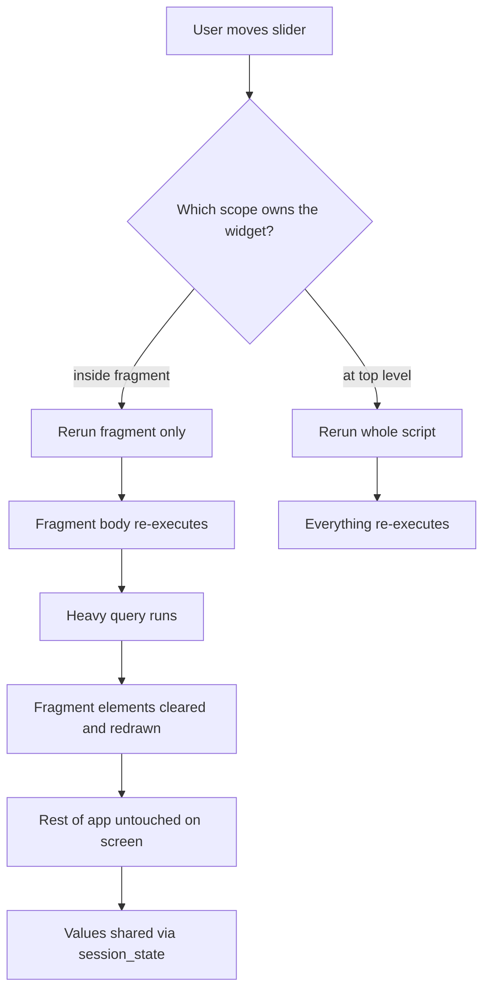

# Fragments and Partial Reruns: Making Streamlit Apps Feel Instant

### English

The classic complaint about Streamlit is that "every click reruns the whole script". That is true of the app as a whole, but modern Streamlit gives you a way to scope the rerun to just the part of the UI that actually changed. The tool is the `@st.fragment` decorator. A fragment is a function whose widgets, when interacted with, cause **only that fragment to rerun** instead of the entire app script. Everything outside the fragment stays exactly as it was on screen.

```python
import streamlit as st

@st.fragment
def live_filter():
    threshold = st.slider("Threshold", 0, 100, 50)
    st.write(f"Only the rows above {threshold} are shown.")
    # heavy query runs only when this fragment reruns
    rows = query_dataframe(threshold)
    st.dataframe(rows)

st.title("Dashboard")
live_filter()          # fragment
st.write("This text is never recomputed when the slider moves.")
```

The performance benefit is direct: if the expensive part of your app is a query that depends on one slider, moving that slider now re-executes only the fragment, not the whole dashboard. This is the difference between a two-second wait and a two-hundred-millisecond one, and it is why fragments are the recommended structure for anything that looks like a real-time dashboard.

There are rules to know. Values produced inside a fragment are **not** automatically visible to the rest of the app; if the wider script needs them, store them in `st.session_state`. A fragment that renders into a container created outside itself will **accumulate** elements on each fragment rerun, because the container is not cleared — so either let the fragment draw directly, or clear the container explicitly. To force a rerun from inside a fragment, call `st.rerun()`; to rerun only the fragment itself, use `st.rerun(scope="fragment")`. And `run_every` turns a fragment into a polling panel: `st.fragment(run_every="5s")` refreshes that section every five seconds while the session is active, even if nothing is clicked — perfect for a "last updated" tile or a live status board.

```python
@st.fragment(run_every=5)
def status_tile():
    st.metric("Active sessions", fetch_active_sessions())
```

Fragments also compose: a fragment may call other fragments, and the inner one reruns first. If you need a full app rerun triggered from a fragment, use the plain `st.rerun()` and be aware it will reset any fragment-local state unless it lives in `session_state`.

The design habit that follows from all this is worth stating explicitly: **push expensive work into fragments, keep shared state in `session_state`, and treat the script top level as the cheap part**. Many production Streamlit apps adopt a rule of thumb that the top-level script should do almost no work, only layout and composition, because anything at the top level is re-executed on every interaction anywhere in the app.

### 中文

關於 Streamlit 最經典的抱怨是「撳一下掣就重跑成段script」。就整個 app 而言這是真的，但現代 Streamlit 提供了一個方法，可以把重跑範圍限定在真正改變了的 UI 部分。這個工具就是 `@st.fragment` 裝飾器。Fragment 是一個函數，當它內部的 widget 被操作時，**只有該 fragment 會重跑**，而不是整個 app script。Fragment 以外的內容會在畫面上原封不動地保留。

```python
import streamlit as st

@st.fragment
def live_filter():
    threshold = st.slider("Threshold", 0, 100, 50)
    st.write(f"只顯示高於 {threshold} 的資料列。")
    # 昂貴的查詢只會喺呢個 fragment 重跑時執行
    rows = query_dataframe(threshold)
    st.dataframe(rows)

st.title("儀表板")
live_filter()          # fragment
st.write("呢段文字喺滑桿郁動時唔會重新運算。")
```

性能上的好處很直接：如果 app 最昂貴的部分是一條依賴單一滑桿的查詢，把滑桿移入 fragment 之後，郁動滑桿只會重新執行該 fragment，而唔係整個儀表板。兩秒的等待與兩百毫秒的等待之間的差距，正正是 fragment 成為推薦結構的原因。

有幾條規則要記住。Fragment 內產生的值**不會**自動讓外部程式碼看見；如果外層需要，就把它們存入 `st.session_state`。若 fragment 把內容寫進由外部建立的容器，每次 fragment 重跑時元素會**累積**（因為該容器不會被清空）—— 所以要嘛讓 fragment 直接繪製，要嘛自己顯式清理容器。在 fragment 內想強制重跑，呼叫 `st.rerun()`；只想重跑該 fragment 自身，就用 `st.rerun(scope="fragment")`。而 `run_every` 會把 fragment 變成輪詢面板：`st.fragment(run_every="5s")` 會在 session 活躍期間每五秒刷新一次該區段，即使使用者完全沒有操作 —— 非常適合「最後更新」卡片或即時狀態板。

```python
@st.fragment(run_every=5)
def status_tile():
    st.metric("活躍 session", fetch_active_sessions())
```

Fragment 之間也可以組合：一個 fragment 可以呼叫另一個 fragment，內層會先重跑。如果要從 fragment 觸發整個 app 重跑，就用普通的 `st.rerun()`，並留意它會重設 fragment 內的狀態，除非那些狀態存放在 `session_state`。

由此衍生出一個設計習慣，值得明確講出：**把昂貴的工作推入 fragment，把共用狀態放進 `session_state`，把 script 最頂層當成最廉價的部分**。不少生產環境的 Streamlit app 都採用一條原則：頂層幾乎不做事，只負責版面與組合 —— 因為頂層的每一行，都會在 app 內任何一次互動時被重新執行。

## Key Takeaway
Fragments let you rerun only the expensive part of a Streamlit app, but they require shared values to live in session_state and containers to be cleared explicitly.

## Related Concepts
- Fragment Rerun Scope
- Session State as the Shared Store
- run_every Polling Fragments
- Top-Level Script Cost

## Diagram

