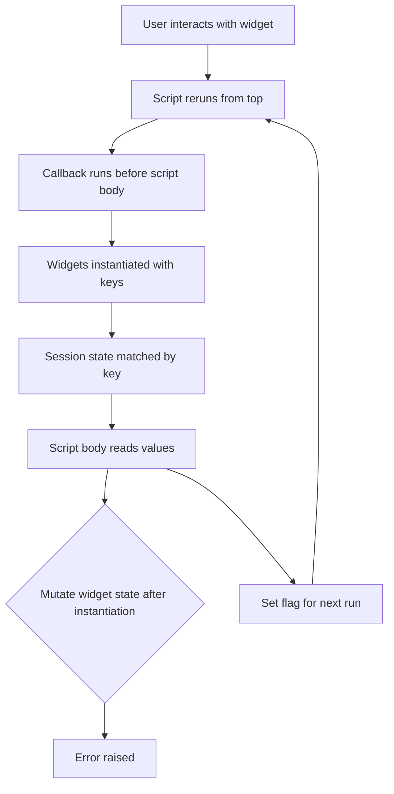

# Widget Keys, Callbacks, and the Order-of-Execution Trap

## English

Every Streamlit widget can be given an optional key argument, and that key does more than label it: it becomes the identity the framework uses to match a widget in the browser to a value in session state across reruns. Without a key, Streamlit derives an implicit identity from the widget's type, label, and position in the script, which is why two buttons with the same label in different columns can behave oddly, and why reordering code can silently reset a widget's value. The rule of thumb is to pass explicit keys for anything whose value you read in st.session_state, because the key is exactly the dictionary key you use: st.text_input("Name", key="user_name") is then read as st.session_state["user_name"].

Callbacks are the second half of the story. A widget accepts an on_change (or on_click for buttons) argument pointing at a Python function. That function runs at the top of the next rerun, before the rest of your script body executes. This ordering is the source of a classic beginner bug: people write code that reads a widget's value, then tries to mutate that same widget's session state value in the same run, and Streamlit raises an error like 'st.session_state.user_name cannot be modified after the widget with key user_name is instantiated'. The fix is either to use a callback (which runs before instantiation) or to restructure so the mutation happens on a subsequent run, for example by setting a flag and handling it at the top of the script.

A concrete example makes this vivid. Imagine a selectbox for choosing a dataset and a text input for a filter string. You want the filter to clear whenever the dataset changes. If you write if st.session_state.dataset != last_dataset: st.session_state.filter = "" after the widgets are drawn, you will hit the error. Instead, attach on_change=reset_filter to the selectbox, and inside reset_filter set st.session_state.filter = "". Because callbacks fire before widget instantiation on the next run, the assignment is legal and the text input renders empty.

Keys also matter for dynamically generated widgets. If you loop over a list of items and create a checkbox per item, you must give each one a unique key (often f"check_{item_id}") or Streamlit will complain about duplicate widget IDs. This is not a quirk to work around — it is the framework telling you that identity must be stable and unique, just like keys in React or in a database primary key. Thinking of keys as primary keys for UI state is the mental model that makes the whole system click.

Finally, note that widget values live in session state under their key, but you should not treat session state as a general-purpose store for widget values you want to persist after the widget disappears. If a widget is conditionally rendered and stops being drawn, its key is cleaned up. For durable data, copy the value into a separate session state key in a callback, or hold it in a plain Python object stored under a non-widget key. Separating 'widget identity' from 'application data' prevents a whole class of confusing bugs.

## 中文

每一個 Streamlit 組件都可以傳入一個可選的 key 參數，而這個 key 不止是標籤那麼簡單：它會成為框架用來在多次重跑之間，把瀏覽器裡的組件同 session state 裡的值配對起來的身份標識。如果唔俾 key，Streamlit 會根據組件的類型、標籤同它在腳本中的位置推導出一個隱含身份，所以兩個位於不同欄、標籤相同的按鈕可能會有古怪行為，而重新排列程式碼亦可能靜悄悄咁重設某個組件的值。實用原則是：凡是你會在 st.session_state 裡讀取它值的組件，都應該傳入明確的 key，因為那個 key 正是你用的字典鍵：st.text_input("Name", key="user_name") 之後就可以用 st.session_state["user_name"] 讀取。

回調（callback）是故事的另一半。組件可以接受 on_change（按鈕則是 on_click）參數，指向一個 Python 函數。該函數會在下次重跑的開頭執行，即是在你腳本主體其餘部分之前。這個執行順序正是經典新手陷阱的來源：有人寫程式碼先讀取組件的值，然後在同一次運行裡試圖改動同一個組件的 session state 值，Streamlit 就會拋出類似「st.session_state.user_name cannot be modified after the widget with key user_name is instantiated」的錯誤。解決方法有兩個：一是用回調（它在組件實例化之前執行），二是重構程式碼令改動發生在下一次運行，例如設定一個旗標，然後在腳本開頭處理它。

一個具體例子可以令這件事更清晰。想像有一個選擇資料集的下拉選單，以及一個輸入過濾字串的文字框。你希望每次切換資料集時清空過濾字串。如果你在畫完組件之後才寫 if st.session_state.dataset != last_dataset: st.session_state.filter = ""，你就會撞到上述錯誤。相反，在選擇框上掛 on_change=reset_filter，並在 reset_filter 裡設定 st.session_state.filter = ""。因為回調在下一次運行的組件實例化之前觸發，這個賦值是合法的，文字框亦會渲染成空白。

Key 對動態生成的組件亦同樣重要。如果你在一個列表上循環，為每一項建立一個勾選框，就必須為每一個給一個獨一無二的 key（通常係 f"check_{item_id}"），否則 Streamlit 會投訴組件 ID 重複。這不是要你繞過的怪癖——這是框架在告訴你：身份必須穩定且唯一，就好似 React 裡的 key 或資料庫裡的主鍵一樣。把 key 想像成 UI 狀態的主鍵，就是令整個系統豁然開朗的心智模型。

最後要留意，組件的值會以它的 key 存在 session state 裡，但你不應該把 session state 當成通用倉庫，去保存那些組件消失之後仍想保留的組件值。如果一個組件是有條件地渲染，然後不再被畫出來，它的 key 會被清理。要持久保存資料，請在回調裡把值複製到另一個獨立的 session state key，或者把它放在一個以非組件 key 儲存的普通 Python 物件裡。將「組件身份」同「應用程式資料」分開，可以避免一整類令人困惑的錯誤。

## Key Takeaway

Give widgets explicit keys and use callbacks when you need to mutate their state, because Streamlit forbids modifying a widget's session state value after the widget has been instantiated in the same run.

## Related Concepts
- Callback execution order
- Duplicate widget ID errors

## Diagram

