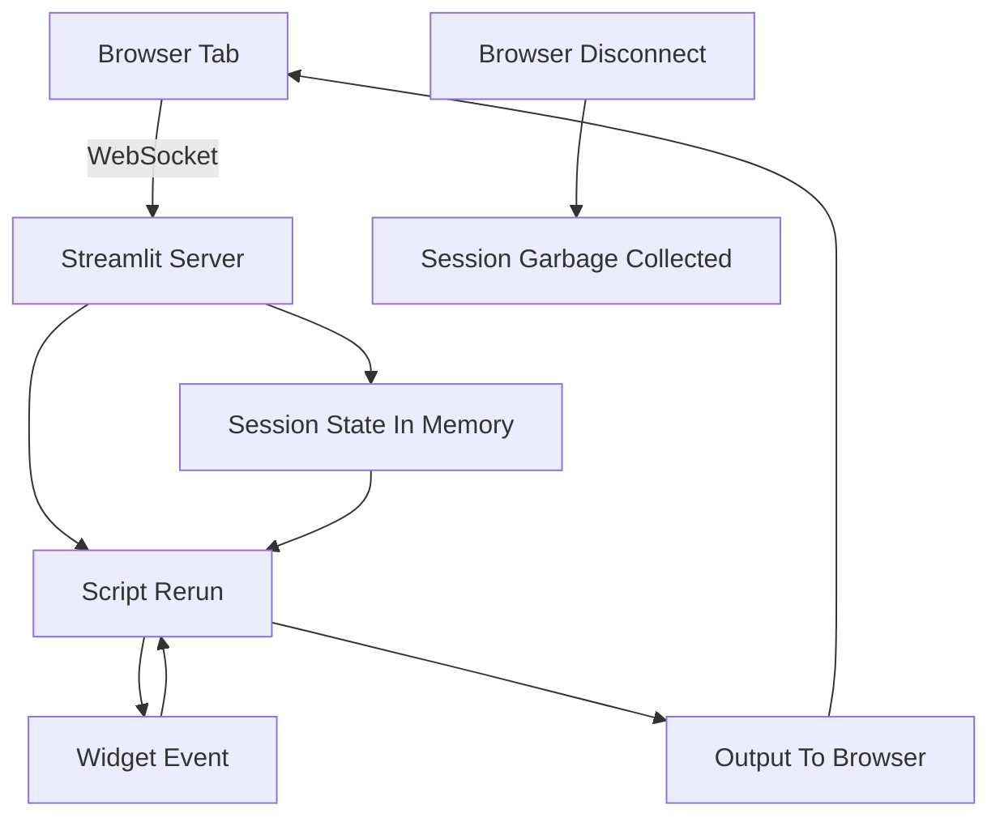

# Streamlit's Execution Model Versus Traditional Request-Response Web Frameworks

## English

If you have used Flask or Django, your instinct is that a web request arrives, a view function runs, a response is returned, and the server forgets everything. Streamlit looks superficially similar — a script runs, output appears — but the lifecycle is fundamentally different, and understanding the difference explains most of its surprising behaviours. In a request-response framework, each HTTP request is independent and stateless unless you explicitly attach a session cookie or database lookup. In Streamlit, a long-lived WebSocket connection per browser tab carries events (widget changes, button clicks) from the browser to the Python server, and each event triggers a full script rerun on the server side. The server keeps that session's state in memory between reruns.

This means Streamlit is stateful by default, whereas Flask is stateless by default. That single inversion drives a lot of design decisions. In Flask you worry about how to persist a user's choices across requests (sessions, cookies, hidden form fields). In Streamlit you worry about the opposite: how to stop the in-memory state from growing, how to reset it, and how to reason about what happens when the WebSocket drops and the session is garbage-collected. If a user leaves a tab open overnight, that session's memory is still held; if the server restarts, all session state evaporates and the browser tab must reconnect fresh.

Concurrency is another divergence. A Flask app typically handles many requests in parallel via multiple worker processes or threads. A Streamlit server runs one script execution per session at a time — the same session cannot run two reruns concurrently — but it can serve many sessions in parallel, each with its own script thread. Understanding this matters when you write code that touches shared resources: a module-level global variable in your Streamlit script is shared across all sessions in the same process, which is almost never what you want. Session state is per-session; module globals are per-process. Mixing them up causes data leaking between users, a subtle and serious bug.

A practical consequence is that Streamlit is not the right tool for building a public REST API, serving static assets at scale, or handling millions of tiny requests. It is designed for interactive data apps where a human is looking at a screen and clicking things — a handful to a few hundred concurrent users is the comfortable zone, and beyond that you scale horizontally with multiple instances behind a load balancer and sticky sessions (or you move the heavy lifting into a separate service). Knowing this boundary prevents the painful discovery that your Streamlit app melts under load because you were treating it like a general web server.

Finally, the mental model of 'a long-running Python process per user session, driven by events over a WebSocket' explains the auto-refresh workflow too: when you save your file, the server detects the change and reruns the script in every connected session, which is why you see your edit appear in the browser without a manual reload. It is not magic watching your filesystem — it is the same rerun mechanism, triggered by a file-watch event rather than a widget interaction.

## 中文

如果你用過 Flask 或 Django，你的直覺會是：一個網頁請求到達、一個視圖函數執行、一個回應返回，然後伺服器忘掉一切。Streamlit 表面上相似——腳本執行、輸出出現——但它的生命週期根本不同，而理解這個差異就能解釋它大部分令人意外的行為。在請求-回應框架裡，每個 HTTP 請求都是獨立且無狀態的，除非你明確掛上 session cookie 或查詢資料庫。在 Streamlit 裡，每個瀏覽器分頁都有一條長壽命的 WebSocket 連線，把事件（組件變更、按鈕點擊）從瀏覽器送到 Python 伺服器，而每個事件都會在伺服器端觸發一次完整的腳本重跑。伺服器會在多次重跑之間，把該 session 的狀態保存在記憶體裡。

這意味著 Streamlit 預設是有狀態的，而 Flask 預設是無狀態的。這個倒轉驅動了很多設計決策。在 Flask 裡你擔心如何跨請求保存使用者的選擇（session、cookie、隱藏表單欄位）。在 Streamlit 裡你擔心的恰恰相反：如何阻止記憶體內的狀態不斷增長、如何重設它，以及當 WebSocket 斷開、session 被垃圾回收時會發生什麼事。如果使用者把分頁開過夜，該 session 的記憶體仍然被佔用；如果伺服器重啟，所有 session state 都會蒸發，瀏覽器分頁必須重新連接。

並行性是另一個分歧點。Flask 應用通常透過多個工作進程或執行緒並行處理大量請求。Streamlit 伺服器對每個 session 一次只執行一個腳本——同一個 session 不能同時跑兩次重跑——但它可以並行服務多個 session，每個都有自己的腳本執行緒。當你寫會接觸共享資源的程式碼時，這一點很重要：Streamlit 腳本裡的模組層級全域變數，會在同一個進程內的所有 session 之間共享，而這幾乎永遠不是你想要的。Session state 是每個 session 一份；模組全域變數是每個進程一份。搞混兩者會導致資料在使用者之間洩漏，這是一個隱蔽而嚴重的錯誤。

一個實際後果是：Streamlit 不適合用來建立公開的 REST API、大規模提供靜態資源，或處理數以百萬計的細小請求。它是為互動式資料應用而設，即係有真人望着螢幕點擊東西——由幾個人到幾百個並行使用者是舒適區，超出這個範圍就要用多個實例加負載平衡器和黏性 session 做水平擴展（或者把重活搬到獨立服務）。知道這個邊界，可以避免你發現 Streamlit 應用在負載下融化時才痛苦地意識到自己一直把它當成通用網頁伺服器。

最後，「每個使用者 session 一條長壽命 Python 進程，由 WebSocket 上的事件驅動」這個心智模型，也解釋了自動刷新工作流：當你儲存檔案，伺服器偵測到變更，就會在每個已連接的 session 裡重跑腳本，這就是為什麼你的編輯會在瀏覽器裡出現而無需手動重新載入。這不是有魔法在監視你的檔案系統——而是同一個重跑機制，由檔案監視事件觸發，而非組件互動。

## Key Takeaway

Streamlit keeps one stateful Python process per browser session driven by WebSocket events, the inverse of stateless request-response frameworks, which shapes everything from concurrency to how you should scale it.

## Related Concepts
- WebSocket session lifecycle
- Stateless versus stateful web servers

## Diagram

