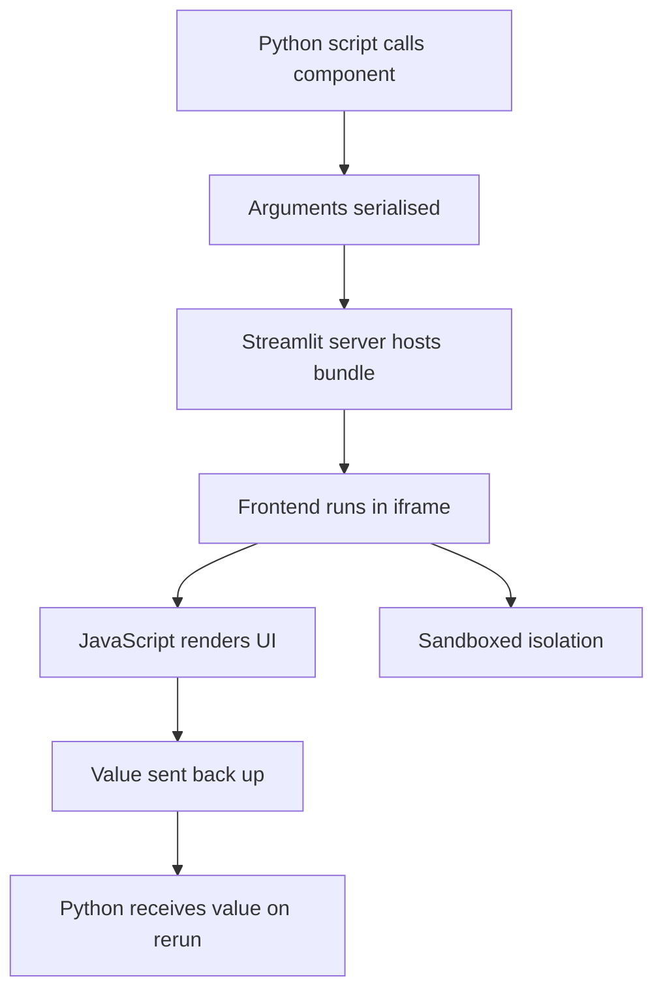

# Custom Components and the Escape Hatch When Built-Ins Are Not Enough

## English

Streamlit ships with a rich library of widgets, but eventually you hit something it does not provide: a specialised chart interaction, a drag-and-drop canvas, a rich text editor, a map with custom overlays, or a third-party JavaScript library you must embed. Streamlit's answer is the custom components system, which lets you build a frontend in HTML/JavaScript (usually React) and communicate with your Python script through a bidirectional channel. The Python side uses the components API to declare the component, pass arguments down, and receive a return value; the JavaScript side receives those arguments, renders, and can send values back up. From the Python script's perspective, it looks almost like calling any other widget — you call it, you get a value back on the next rerun.

Mechanically, a custom component is served as a small static frontend bundle that the Streamlit server hosts and embeds in an iframe inside the main app. Communication happens via a message-passing protocol over that iframe boundary. This design has real consequences: your component runs in a sandboxed iframe, so it cannot directly touch the parent page's DOM, and it cannot read your Python process's memory. Everything must go through explicit messages. That isolation is a feature — it lets third-party components be embedded without giving them full control of the page — but it also means you cannot easily style the parent app from inside a component, and you must serialise all data crossing the boundary.

Building a component from scratch is genuinely more work than using built-ins: you need a JavaScript toolchain (Node, a bundler), a build step that produces the static assets, and a release mechanism so your Python package can ship the built assets alongside it. For many teams the pragmatic path is to search the community component gallery first — there are published components for common needs like richer dataframes, graph visualisations, chat interfaces, and authentication — and only build custom when nothing fits. The trade-off is dependency risk: a community component may lag behind Streamlit versions or be unmaintained, so pin versions and test upgrades.

There is a lighter-weight escape hatch worth knowing before you reach for a full custom component: st.components.v1.html lets you embed arbitrary HTML, CSS, and JavaScript in an iframe with a specified height. This is perfect for dropping in a self-contained visualisation, an embedded video, or a small interactive that does not need to send data back to Python. The limitation is one-way communication — the embedded page cannot easily call back into your script without a full custom component. Choosing between st.components.v1.html and a real custom component is essentially asking: does this need to return a value to Python, or is it purely display?

A final practical note is about debugging. Because the frontend lives in an iframe, browser developer tools show its console and network activity in a separate context, and errors inside the component often appear there rather than in the terminal where your Python tracebacks show. When a custom component 'does nothing', the first step is almost always to open the browser console and look at the iframe's logs. Knowing this workflow saves hours of confusion, and it reinforces the broader lesson: Streamlit hides the web stack from you until you need it, and custom components are exactly the point where the web stack comes back into view.

## 中文

Streamlit 內建了豐富的元件庫，但總有一天你會撞到它沒有提供的東西：一個專門的圖表互動、一個拖放畫布、一個富文字編輯器、一個有自訂覆蓋層的地圖，或者一個你必須嵌入的第三方 JavaScript 函式庫。Streamlit 的答案是自訂元件系統，讓你在 HTML/JavaScript（通常係 React）裡建立前端，並透過一條雙向通道與你的 Python 指令碼溝通。Python 端使用 components API 宣告元件、向下傳遞引數，並接收回傳值；JavaScript 端接收這些引數、渲染，並可以把值送上去。從 Python 指令碼的角度看，它幾乎就像呼叫任何其他元件——你呼叫它，在下一次重跑時拿回一個值。

在機制上，自訂元件是一個細小的靜態前端 bundle，由 Streamlit 伺服器託管，並以 iframe 嵌入主應用程式之中。溝通是透過跨越 iframe 邊界的訊息傳遞協定進行。這個設計有真實後果：你的元件在沙盒化的 iframe 裡執行，所以它不能直接接觸父頁面的 DOM，也不能讀取你 Python 程序的記憶體。一切都必須透過明確的訊息傳遞。這種隔離是一個特性——它讓第三方元件可以被嵌入而不會獲得對頁面的完全控制——但它也意味著你不能輕易從元件內部為父應用程式設定樣式，而且所有跨越邊界的資料都必須序列化。

由零開始建立元件，確實比使用內建元件辛苦得多：你需要一套 JavaScript 工具鏈（Node、打包器）、一個產生靜態資源的建置步驟，以及一個釋出機制，令你的 Python 套件可以把建置好的資源一併出貨。對很多團隊來說，務實的做法是先搜尋社群元件庫——已有釋出的元件滿足常見需求，例如更豐富的資料表、圖形視覺化、聊天介面同身份驗證——只有在沒有東西合用時才自己建。取捨是依賴風險：社群元件可能落後於 Streamlit 版本或無人維護，所以要鎖定版本並測試升級。

在你伸手去拿完整自訂元件之前，有一個值得知道的較輕量逃生門：st.components.v1.html 讓你以指定高度，在 iframe 裡嵌入任意 HTML、CSS 同 JavaScript。這非常適合放入自成一體的視覺化、嵌入影片，或者一個不需要把資料送回 Python 的小型互動。限制是單向溝通——嵌入的頁面無法輕易回呼你的指令碼，除非用完整的自訂元件。在 st.components.v1.html 同真正自訂元件之間選擇，本質上就是問：這東西需要回傳一個值給 Python，還是純粹顯示？

最後一個實用提示關於除錯。因為前端住在 iframe 裡，瀏覽器開發者工具會在一個獨立的上下文顯示它的主控臺同網路活動，元件內部的錯誤通常會出現在那裡，而不是在你的 Python traceback 顯示的終端機。當一個自訂元件「什麼都不做」時，第一步幾乎總是用瀏覽器主控臺看 iframe 的日誌。知道這個工作流程可以節省幾小時的困惑，也強化了更廣泛的教訓：Streamlit 把網頁技術堆疊藏起來，直到你需要它為止，而自訂元件正是網頁技術堆疊重新出現在你眼前的那一刻。

## Key Takeaway

Custom components trade the simplicity of built-in widgets for full frontend control via an isolated iframe and message passing, so reach for st.components.v1.html for display-only HTML and build a real component only when you need a value returned to Python.

## Related Concepts
- Iframe sandboxing
- Bidirectional message passing

## Diagram

