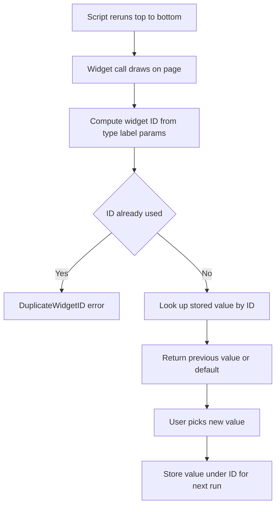

# The Widget Identity System: How Streamlit Tells Your Inputs Apart

## English

Every widget you call in Streamlit gets an internal identity, and understanding how that identity is computed explains a whole class of confusing bugs. When you write st.slider('Pick a number', 0, 100), Streamlit derives an ID from the widget type, its label, and a few of its parameters. That ID is the key under which the widget's current value is stored between reruns. Because the script reruns top to bottom on every interaction, Streamlit needs this stable key to know that the slider you just drew is 'the same slider' as the one from the previous run, so it can hand back the value the user picked rather than resetting to the default.

The trouble starts when two widgets on the same page would compute the same ID. Imagine a loop that creates three sliders all labelled 'Threshold' — they collide, and Streamlit raises a DuplicateWidgetID error telling you to pass a unique key. The fix is the key parameter: st.slider('Threshold', key='threshold_a'). Once you supply a key, it becomes the authoritative identity, and the label is free to change without losing the stored value. This is why renaming a widget's label can silently wipe its state if you did not set a key.

A subtler consequence is that widget identity is positional in the script flow. If you conditionally render a widget — say, only show a second dropdown when a checkbox is ticked — the widget appears and disappears, and its value is discarded when it is not rendered. On the next run where the checkbox is ticked again, the widget is recreated fresh at its default. To keep a value alive across such conditional rendering, you copy it into st.session_state yourself when it changes, typically via the on_change callback.

Widgets also carry a 'clean' versus 'dirty' notion internally. A widget is dirty when the user has interacted with it since the last run; Streamlit uses this to decide whether to re-apply the stored value or accept a new default you passed in code. If you change a widget's default value in your script and reload, the new default may not take effect for a user who already touched that widget, because their stored value wins. Clearing the widget's key from session state, or changing the key, is how you force a reset.

Finally, this identity system is what makes deep links and query parameters work. Streamlit can serialise widget values into the URL so that a shared link reproduces the same view. That only works when every widget has a stable, unique key — otherwise the framework cannot reliably map URL fragments back to the right input. Treat keys as part of your app's public interface, not an afterthought.

## 中文

你喺 Streamlit 入面每次呼叫一個組件，佢都會獲得一個內部身分（identity），而理解呢個身分係點計出嚟，就解釋咗一大類令人困惑嘅 bug。當你寫 st.slider('揀個數字', 0, 100)，Streamlit 會根據組件類型、佢嘅標籤，以及幾個參數去推導出一個 ID。呢個 ID 就係組件目前嘅值喺重新運行（rerun）之間被儲存嘅鍵。因為腳本每次互動都會由頭到尾重新運行，Streamlit 需要呢個穩定嘅鍵，先知道你啱啱畫嘅 slider 同上一次運行嘅係「同一個 slider」，於是就可以交返用戶揀嘅值，而唔係重置做預設值。

問題通常喺同一頁有兩個組件會計出同一個 ID 嘅時候出現。設想一個迴圈建立三個都叫「Threshold」嘅 slider——佢哋會撞鍵，Streamlit 就會拋出 DuplicateWidgetID 錯誤，叫你傳一個獨一無二嘅 key。解決方法就係 key 參數：st.slider('Threshold', key='threshold_a')。一旦你提供咗 key，佢就成為權威嘅身分，標籤就可以自由更改而唔會失去已儲存嘅值。呢個就係點解如果你冇設 key，改咗組件標籤會靜靜雞清走佢嘅狀態。

一個更微妙嘅後果係：組件身分喺腳本流程入面係位置相關嘅。如果你有條件咁渲染一個組件——例如只有勾選咗某個 checkbox 先顯示第二個下拉選單——個組件會出現同消失，而佢冇被渲染嗰陣，佢嘅值就會被丟棄。到下一次勾選返個 checkbox，個組件會以預設值重新建立。要喺呢種條件渲染之下保住個值，你就要自己喺佢改變嗰陣將值複製入 st.session_state，通常係透過 on_change 回呼。

組件內部仲有一個「乾淨」（clean）同「污糟」（dirty）嘅概念。當用戶自上次運行以嚟同個組件互動過，個組件就係污糟嘅；Streamlit 用呢個去決定係咪重新套用已儲存嘅值，抑或接受你喺程式碼入面傳入嘅新預設值。如果你改咗組件嘅預設值再重新載入，對於一個已經掂過嗰個組件嘅用戶嚟講，新預設值可能唔會生效，因為佢儲存咗嘅值會贏。要強制重置，就要喺 session state 清除嗰個組件嘅 key，或者改個 key。

最後，呢個身分系統就係令深層連結（deep link）同查詢參數（query parameter）行得通嘅原因。Streamlit 可以將組件值序列化入 URL，令分享出去嘅連結可以重現同一個畫面。但呢個只有喺每個組件都有穩定、獨一無二嘅 key 先會可靠——否則框架就冇辦法可靠咁將 URL 片段對應返正確嘅輸入。請將 key 當成你應用程式公開介面嘅一部分，而唔係事後補救。

## Key Takeaway

Widget keys are not cosmetic — they define the stable identity Streamlit uses to persist values across reruns, so set them deliberately whenever widgets repeat or render conditionally.

## Related Concepts
- Widget identity and DuplicateWidgetID
- Conditional rendering and state loss

## Diagram

