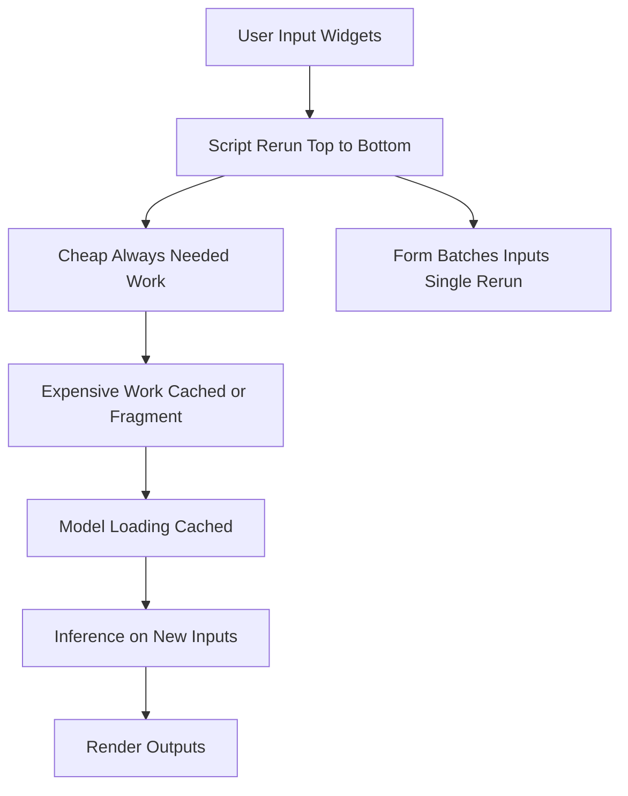

# Streamlit as a Data Pipeline: Wiring Inputs to Models and Outputs

## English

The most natural way to think about a Streamlit app is as a directed graph of data flowing from inputs, through transformations, to outputs — and the script you write is literally that graph, rendered top to bottom. On any given rerun, the sequence of statements is the execution order: read a file, clean a dataframe, run a model, draw a chart. There is no hidden event loop deciding what to compute; your code runs linearly and the widgets that were interacted with simply carry new values into that linear flow.

This linearity is a feature for data work because it matches how a notebook or a script already reads. But it also means you should structure the script the way you would structure a pipeline: cheap, always-needed work at the top; expensive work behind caching or fragments; and output rendering at the bottom. A common anti-pattern is to load a large CSV on every rerun because the load sits above a widget that triggers frequent reruns. Wrapping the load in a cache decorator, or moving it into a fragment that only reruns when its own inputs change, turns a sluggish app into a responsive one without changing the logic.

Streamlit also gives you primitives that behave like pipeline operators. st.form batches several inputs so that the app reruns once when the user clicks submit, rather than on every keystroke — perfect for a search form with five fields. st.spinner and st.progress give feedback during a long step, while st.status lets you annotate a multi-stage process as it advances. These are not cosmetic: they let you keep the linear script model while giving users a sense of staged computation.

For machine learning specifically, the pipeline view clarifies where to put model loading versus inference. Model weights are the same for every user and rarely change, so they belong in a resource-style cache that loads once and is shared. Inference, by contrast, depends on the user's input and must run per interaction. Mixing the two — reloading a model on every keystroke — is the single most common performance mistake in Streamlit ML demos. Separating load from predict is the fix.

Finally, outputs are just as much part of the graph as inputs. st.dataframe, st.metric, and chart functions all consume the result of your computation and render it; if you compute a value but never render it, the work is wasted. Reading your script as a pipeline — inputs, transforms, outputs, with cost annotations on each — is the mental model that keeps Streamlit apps fast and easy to reason about.

## 中文

諗 Streamlit 應用程式最自然嘅方式，就係將佢睇成一張有向圖（directed graph）：數據由輸入流經轉換，再到輸出——而你寫嘅腳本本身就係嗰張圖，由頭到尾渲染出嚟。喺任何一次重新運行，一連串陳述式就係執行順序：讀取檔案、清理 dataframe、跑模型、畫圖表。冇隱藏嘅事件迴圈去決定要計啲乜；你嘅程式碼線性咁運行，而被互動過嘅組件只係將新值帶入呢個線性流程。

對數據工作嚟講，呢種線性係一個優點，因為佢同 notebook 或腳本本身嘅讀法一致。但佢亦意味住你應該好似結構化一條管道咁去結構化腳本：平價、永遠需要嘅工作放喺頂部；昂貴嘅工作放喺快取或者 fragment 後面；輸出渲染放喺底部。一個常見嘅反模式，就係喺每次重新運行都載入一個大 CSV，因為嗰個載入放喺一個會頻繁觸發重新運行嘅組件上面。將載入包入快取裝飾器，或者搬入一個只有佢自己輸入改變先會重新運行嘅 fragment，就可以喺唔改邏輯嘅情況下，將一個慢吞吞嘅應用變成反應靈敏嘅應用。

Streamlit 亦提供一啲行為似管道操作符嘅原語。st.form 會將幾個輸入打包，令應用喺用戶撳提交嗰陣先重新運行一次，而唔係每次打字都重新運行——用喺有五個欄位嘅搜尋表單就最啱。st.spinner 同 st.progress 喺漫長步驟期間提供回饋，而 st.status 就讓你喺多階段過程推進嗰陣加註解。呢啲唔係裝飾：佢哋讓你保留線性腳本模型，同時俾用戶一種分階段計算嘅感覺。

特別係對機器學習嚟講，管道視角釐清咗邊度放模型載入、邊度放推論。模型權重對每個用戶都一樣，而且好少改變，所以佢哋屬於資源式快取，載入一次然後共用。相反，推論取決於用戶輸入，必須每次互動都跑。將兩者混淆——每次打字都重新載入模型——係 Streamlit 機器學習示範入面最常見嘅效能錯誤。將載入同預測分開就係解法。

最後，輸出同輸入一樣都係圖嘅一部分。st.dataframe、st.metric 同各種圖表函數都會消費你計算嘅結果然後渲染；如果你計咗一個值但從來冇渲染佢，嗰啲工作就係白費。將你嘅腳本讀成一條管道——輸入、轉換、輸出，每一段都標上成本——就係令 Streamlit 應用保持快速、容易推理嘅心智模型。

## Key Takeaway

Read your Streamlit script as a cost-annotated data pipeline: cheap loads at the top, expensive work behind caching or fragments, and rendering at the bottom.

## Related Concepts
- Cache decorators vs fragments
- st.form batching reruns

## Diagram

