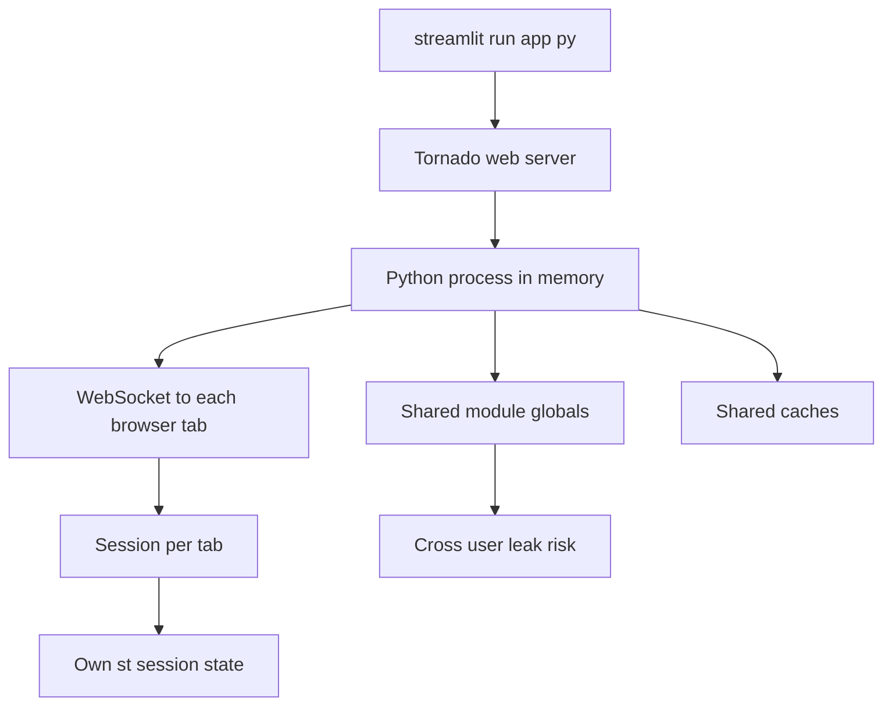

# Deploying and Sharing a Streamlit App: What Actually Happens Behind the URL

## English

When you run streamlit run app.py locally, Streamlit starts a small web server (a Tornado-based server) and opens a browser tab pointing at it. That server holds the Python process in memory, keeps a WebSocket connection open to each browser tab, and uses that socket to push reruns and receive widget interactions. Understanding this architecture explains a lot of deployment behaviour: the app is not a set of static files, it is a live Python process serving one or more connected sessions.

Each browser tab that connects gets its own session with its own st.session_state, but they all share the same Python process and any module-level globals. That is why a global variable mutated inside a script can leak between users — a classic source of cross-user bugs. It is also why caches are shared: a cached function's result is available to every session, which is usually what you want for expensive model loads but dangerous if the cached data is user-specific. The rule of thumb is that anything user-specific belongs in session state, and anything expensive-and-shared belongs in a cache.

For sharing, the common paths are Streamlit Community Cloud, a container on a platform like Docker plus a cloud provider, or a self-hosted server. In every case the deployment is just running the same command behind a network boundary. When you put it behind a reverse proxy — nginx, a load balancer, or a platform's ingress — you must ensure the proxy supports WebSocket upgrade headers and does not buffer the connection, or the app will hang or fall back unpredictably. Long-running requests and idle timeouts on the proxy also need to be generous enough for a data app.

Secrets are handled by a config file that Streamlit reads at startup, typically .streamlit/secrets.toml, which you must never commit to version control. In deployment you provide those values through the platform's secret store or environment, and your code reads them via st.secrets. Because the file is read at startup, changing a secret usually requires a restart or redeploy; the same applies to .streamlit/config.toml, which controls server options like the port and whether to run headless.

Finally, remember that a deployed Streamlit app is single-process by default, so heavy computation blocks every connected user. If you need concurrency, you either scale out with multiple replicas behind a load balancer (each with its own process and its own sessions) or move heavy work to an external service and have the app call it. Knowing where the process boundary sits — one process, many sessions, one WebSocket per tab — is the key to reasoning about scaling, secrets, and cross-user isolation.

## 中文

當你喺本機執行 streamlit run app.py，Streamlit 會啟動一個小型網頁伺服器（一個基於 Tornado 嘅伺服器），然後開一個瀏覽器分頁指向佢。嗰個伺服器會將 Python 程式保留喺記憶體，同每個瀏覽器分頁保持一條 WebSocket 連線，並用嗰條 socket 去推送重新執行同接收元件互動。理解呢個架構就解釋咗好多部署行為：個應用唔係一組靜態檔案，而係一個活生生嘅 Python 程式，服務一個或者多個已連線嘅 session。

每個連線嘅瀏覽器分頁都會有自己嘅 session 同自己嘅 st.session_state，但佢哋全部共用同一個 Python 程式，以及任何模組層級嘅全域變數。呢個就係點解喺指令碼入面被改動嘅全域變數會喺使用者之間洩漏——一個經典嘅跨使用者 bug 來源。呢個亦係點解快取係共用嘅：一個快取函式嘅結果對每個 session 都可用，對於昂貴嘅模型載入嚟講通常係你想要嘅，但如果快取嘅資料係使用者專屬嘅就危險。經驗法則係：任何使用者專屬嘅嘢屬於 session state，任何昂貴而且共用嘅嘢屬於快取。

至於分享，常見途徑有 Streamlit Community Cloud、喺 Docker 加雲端供應商上面嘅容器，或者自架伺服器。喺每個情況，部署都只係喺網路邊界後面執行同一條指令。當你將佢放喺反向代理（reverse proxy）後面——nginx、負載平衡器，或者平臺嘅 ingress——你必須確保代理支援 WebSocket 升級標頭（upgrade header），而且唔會緩衝條連線，否則個應用會卡住或者以不可預測嘅方式降級。代理上面嘅長時間請求同閒置逾時亦要設得夠寬鬆，先應付到資料應用。

機密（secrets）由一個 Streamlit 喺啟動時讀取嘅設定檔處理，通常係 .streamlit/secrets.toml，你絕對唔可以 commit 佢入版本控制。喺部署嗰陣，你透過平臺嘅機密儲存或者環境提供呢啲值，而你嘅程式碼就透過 st.secrets 讀取佢哋。因為個檔案係喺啟動時讀取，改一個機密通常需要重新啟動或者重新部署；同樣適用於 .streamlit/config.toml，佢控制伺服器選項例如埠號同係咪以 headless 模式執行。

最後，記住一個已部署嘅 Streamlit 應用預設係單一程式，所以繁重嘅計算會阻塞每個已連線嘅使用者。如果你需要並發，你要麼用多個副本喺負載平衡器後面橫向擴充套件（每個副本有自己嘅程式同自己嘅 session），要麼將繁重工作搬去外部服務，再由應用去呼叫佢。知道程式邊界喺邊——一個程式、多個 session、每個分頁一條 WebSocket——就係推理擴充套件、機密同跨使用者隔離嘅關鍵。

## Key Takeaway

A deployed Streamlit app is one Python process holding many sessions over WebSockets, so user-specific data must live in session state and expensive shared data in a cache — and the reverse proxy must pass WebSocket upgrades.

## Related Concepts
- WebSocket-based session model
- Reverse proxy and secrets handling

## Diagram

