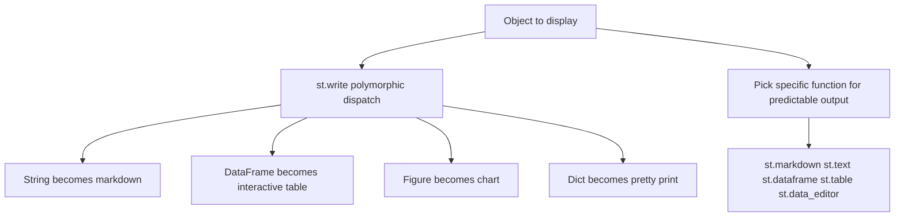

# Choosing the Right Display Primitive: st.write vs st.markdown vs st.dataframe

## English

Streamlit gives you several ways to put something on the page, and beginners often reach for st.write for everything because it is the most forgiving. st.write is a polymorphic dispatcher: hand it a string and it renders markdown, hand it a DataFrame and it renders an interactive table, hand it a matplotlib figure and it draws the chart, hand it a dict and it pretty-prints it. That convenience hides a cost — the exact rendering depends on the runtime type of the object, so the same line of code can produce very different output depending on what your data pipeline produced. When you need predictable output, pick the specific function instead.

st.markdown renders a string as Markdown, and by default it also allows raw HTML when you pass unsafe_allow_html=True. That flag is literally named as a warning: if any part of the string comes from user input, you have opened an HTML injection hole. Treat it the way you would treat any templating engine — escape untrusted values or keep them out of the HTML string entirely. st.text, by contrast, renders preformatted plain text with no interpretation, which is the safe choice for showing user-supplied strings verbatim.

For tabular data, the choice matters for both performance and user experience. st.dataframe renders an interactive, sortable, scrollable grid that handles large frames reasonably well because it only sends a window of rows to the browser. st.table renders a static HTML table of the entire frame, which is fine for a handful of rows but becomes slow and unreadable for thousands. st.data_editor goes further and lets the user edit cells, returning the edited frame as a value you can capture — useful for lightweight data correction without building a form.

Charts follow the same pattern. st.line_chart, st.bar_chart, and friends are thin convenience wrappers that accept a DataFrame and infer the axes; they are fast to write but give you limited control. When you need axis labels, tooltips, or layered traces, pass a figure object from a library like Plotly, Altair, or matplotlib to st.plotly_chart, st.altair_chart, or st.pyplot. Streamlit renders those natively in the browser for the interactive libraries, which keeps the experience snappy.

A practical rule: use st.write while prototyping to see what your object looks like, then replace it with the explicit primitive once you know the type. Explicit primitives document your intent, behave consistently, and let you reason about security and performance. The one-line st.write is a debugging tool, not an architecture.

## 中文

Streamlit 有好多方法將內容放上頁面，初學者通常乜都用 st.write，因為它最「包容」。st.write 是一個多型分派器：你給它字串，它會當 Markdown 渲染；給它 DataFrame，它會畫出可互動的表格；給它 matplotlib 圖表物件，它會畫圖；給它 dict，它會漂亮地印出來。這種方便是有代價的——實際渲染結果取決於物件的執行時型別，所以同一行程式碼可能因為你的資料管道產出咗唔同嘅東西而顯示完全不同的結果。當你需要可預測的輸出時，就應該選用具體的函式。

st.markdown 會將字串當 Markdown 渲染，而當你傳入 unsafe_allow_html=True 時，它亦預設允許原始 HTML。這個旗標的名字本身就是警告：如果字串有任何部分來自使用者輸入，你就開啟了 HTML 注入的漏洞。要當它像任何模板引擎一樣處理——轉義唔可信的值，或者乾脆唔好將它們放入 HTML 字串。相反，st.text 會以純文字原樣顯示，唔作任何解釋，係顯示使用者提供字串的安全選擇。

對於表格資料，選擇會同時影響效能和使用者體驗。st.dataframe 會渲染一個可互動、可排序、可滾動的網格，因為它只會將一部分行送到瀏覽器，所以處理大 DataFrame 都算合理。st.table 則會將整個 DataFrame 渲染成靜態 HTML 表格，幾行資料冇問題，但幾千行就會又慢又難讀。st.data_editor 更進一步，讓使用者編輯儲存格，並將編輯後的 DataFrame 作為值返回，方便做輕量的資料修正而毋須建立表單。

圖表都係同一個模式。st.line_chart、st.bar_chart 之類係薄薄的便利封裝，接受 DataFrame 並自動推斷座標軸；寫起來快，但控制有限。當你需要軸標籤、工具提示或分層軌跡時，就將 Plotly、Altair 或 matplotlib 產生的圖表物件傳給 st.plotly_chart、st.altair_chart 或 st.pyplot。對於可互動的函式庫，Streamlit 會直接在瀏覽器原生渲染，令體驗保持流暢。

實用原則：原型階段用 st.write 睇下物件係咩樣，知道型別之後就換成明確的原語。明確的原語會記錄你的意圖、行為一致，亦讓你思考安全與效能。單行 st.write 係除錯工具，唔係架構。

## Key Takeaway

Use st.write for exploration, then switch to explicit primitives like st.markdown, st.dataframe, and st.plotly_chart for predictable, secure, and performant output.

## Related Concepts
- st.write polymorphic dispatch
- HTML injection with unsafe_allow_html

## Diagram

