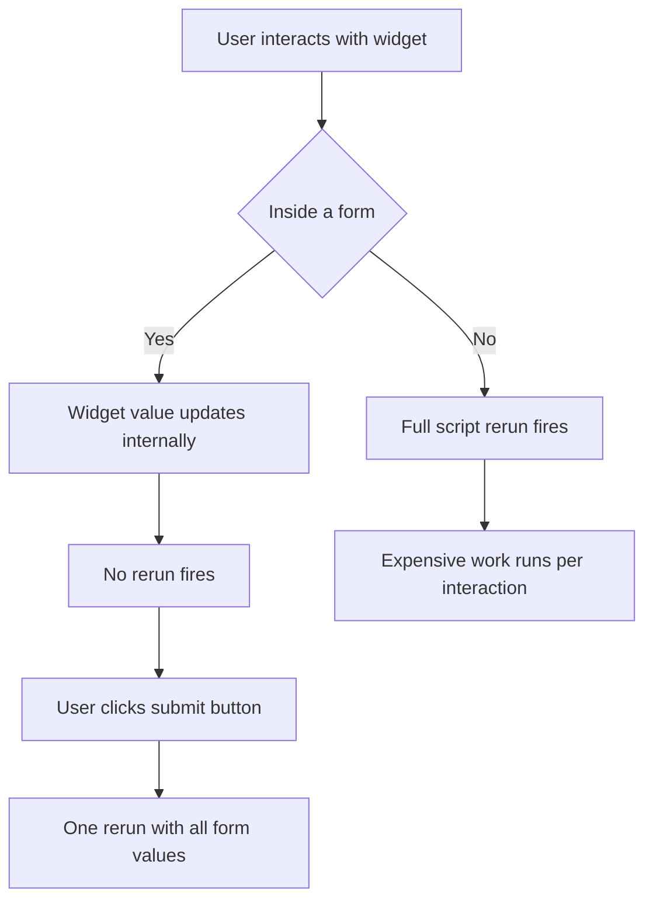

# Forms and Batched Inputs: Controlling When a Rerun Fires

## English

Every widget interaction in Streamlit normally triggers a full script rerun. That is fine for a slider that updates a chart instantly, but painful for a search box where the user types ten characters and you fire ten expensive queries. st.form solves this by grouping widgets into a batch that only submits when the user presses a submit button. Inside a form, widget values are collected but do not trigger reruns; the entire form's values become available together in one rerun when the submit button is clicked.

The mechanics are worth understanding. You open a form with `with st.form("my_form"):`, place widgets inside, and add a submit button with st.form_submit_button. The button returns True only on the rerun triggered by its click; on all other reruns it returns False. Crucially, the widgets inside the form still have their own keys and still update their internal values as the user interacts, but those changes are not propagated to your script until submission. This is a deliberate trade-off: you lose live reactivity but gain control over when expensive work happens.

A common pattern is a filter panel: several st.selectbox and st.text_input widgets inside a form, plus a submit button. The user sets up all filters, then clicks once, and your script runs the query once with the complete filter set. Without the form, each dropdown change would rerun the script and potentially fire a query with a half-configured filter set, which is both slow and confusing.

Note that forms and fragments solve related but different problems. A fragment (st.fragment) lets a small part of the script rerun independently, so you can have a live-updating widget without rerunning the whole app. A form does the opposite: it suppresses reruns until an explicit submit. You can combine them — a fragment containing a form lets the form's submitted result update just that fragment rather than the whole page.

There are limits. You cannot nest forms inside each other, and you cannot put a form inside a fragment that is itself inside another form. Also, a form submit button is a widget like any other, so it needs a unique key if you have multiple forms. When you find yourself adding st.button after st.button to gate work, that is usually a signal to reach for a form instead.

## 中文

在 Streamlit 裡面，每次組件互動通常都會觸發完整的腳本重跑。對於一個即時更新圖表的滑桿來說，這冇問題；但對於搜尋框來說就很痛苦——使用者打十個字，你就觸發十次昂貴的查詢。st.form 就是用來解決這個問題：它將組件分組，只有在使用者按下提交按鈕時才提交。在表單裡面，組件的值會被收集，但唔會觸發重跑；當提交按鈕被按下時，整個表單的值會在一次重跑中一併提供。

背後的機制值得理解。你用 `with st.form("my_form"):` 開啟表單，在裡面放置組件，再用 st.form_submit_button 加入提交按鈕。按鈕只會在由它點擊所觸發的那次重跑中返回 True；在其他所有重跑中都返回 False。關鍵是：表單內的組件仍然有自己的 key，使用者在互動時仍然會更新它們的內部值，但這些變更在提交之前唔會傳遞到你的腳本。這是一個刻意的取捨：你犧牲了即時反應，換來對昂貴工作何時執行的控制。

一個常見模式是篩選面板：幾個 st.selectbox 和 st.text_input 放在表單內，再加一個提交按鈕。使用者設定好所有篩選條件，然後按一次，你的腳本就用完整的篩選集執行一次查詢。冇表單的話，每次下拉選單變更都會重跑腳本，可能用半完成的篩選集去查詢，既慢又令人困惑。

要注意，表單和 fragment 解決的是相關但不同的問題。fragment（st.fragment）讓腳本的一小部分獨立重跑，所以你可以有即時更新的組件而毋須重跑整個應用。表單就相反：它抑制重跑，直到明確提交為止。你可以結合兩者——將表單放在 fragment 裡面，表單提交的結果就只會更新該 fragment，而唔係整個頁面。

亦有限制。你不能將表單嵌套在另一個表單裡面，亦不能將表單放在本身位於另一個表單內的 fragment 中。另外，表單提交按鈕同其他組件一樣，如果你有多個表單，就需要唯一的 key。當你發現自己一個接一個咁加 st.button 去控制工作流程，通常就係時候改用表單。

## Key Takeaway

st.form batches widget values so that expensive work runs once on submit instead of on every keystroke, trading live reactivity for control.

## Related Concepts
- st.form_submit_button
- st.fragment partial reruns

## Diagram

