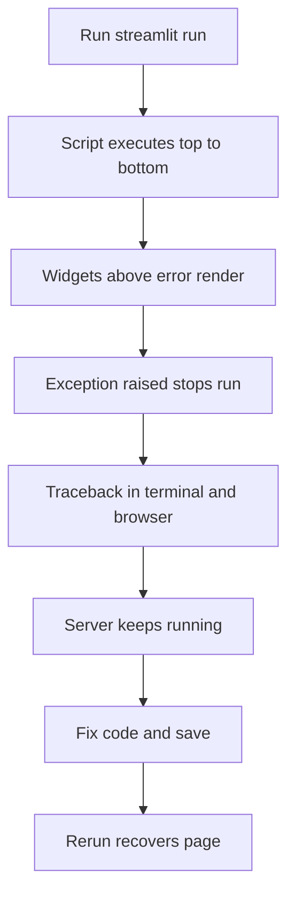

# Reading Errors and Debugging a Rerun-Based App

## English

Debugging Streamlit feels strange at first because there is no obvious call stack tied to a request. When something goes wrong, the traceback appears in the browser and usually also in the terminal where you ran `streamlit run`. That terminal output is your primary debugging surface: it shows the full Python traceback with file and line numbers, while the browser shows a friendlier summary. Keep the terminal visible while developing — many bugs are diagnosed there in seconds.

A frequent source of confusion is that an exception stops the current script run at the point it is raised, but the widgets above it have already rendered. So you see a half-drawn page with an error box in the middle. This is not a crash of the server; the server is still running and waiting for the next interaction. Fixing the code and saving the file triggers a rerun, and the page recovers. Understanding this prevents the instinct to restart the server every time.

st.exception, st.error, and st.warning are your friends for surfacing problems deliberately. st.exception takes an exception object and renders its traceback in the app, which is useful when you want users to see what failed without digging into logs. Wrap risky sections in try/except and call st.exception(e) to keep the rest of the app usable. For softer problems — a missing column, an empty result set — st.warning or st.info communicates the situation without implying a crash.

The rerun model has a subtle debugging trap: print statements inside your script go to the terminal, not the browser, and they fire on every rerun. That is useful for tracing, but if you print inside a loop over a large dataset, the terminal floods. Prefer st.write or st.json for inspecting values in the browser, and reserve print for quick terminal checks. Also remember that st.write of a large object can itself be slow because it has to serialize and send it to the browser.

Finally, the classic mistake is assuming state persists between reruns when it does not. A plain local variable is recreated every run, so incrementing a counter with `count = count + 1` fails unless count lives in st.session_state. When a value mysteriously resets, the first thing to check is whether it is stored in session state or in a local variable. The AppTest framework lets you write automated tests that simulate interactions and assert on outputs, which catches these regressions before users do.

## 中文

Streamlit 的調試一開始會覺得好奇怪，因為冇明顯同請求綁定的調用堆疊。出錯時，traceback 會出現在瀏覽器，通常亦會出現在你執行 `streamlit run` 的終端機。那個終端機輸出就係你主要的調試介面：它會顯示完整的 Python traceback，包括檔案和行號，而瀏覽器就顯示較友善的摘要。開發時保持終端機可見——好多 bug 都在那裡幾秒鐘就診斷到。

一個常見的困惑來源：異常會在中斷點停止當前腳本運行，但它上面的組件已經渲染咗。所以你會見到一個半畫好的頁面，中間有個錯誤框。這唔係伺服器崩潰；伺服器仍然運行，等待下一次互動。修正代碼並儲存檔案會觸發重跑，頁面就會恢復。明白這一點，就唔會每次出錯都反射式咁重啟伺服器。

st.exception、st.error 和 st.warning 係你刻意顯示問題的好幫手。st.exception 接受異常物件並在應用內渲染其 traceback，適合讓使用者看到咩出錯而毋須翻查日誌。將有風險的部分包在 try/except 中，並呼叫 st.exception(e)，令應用其餘部分保持可用。對於較軟的問題——缺少欄位、空結果集——用 st.warning 或 st.info 傳達情況，而唔係暗示崩潰。

重跑模型有一個微妙的調試陷阱：腳本內的 print 語句會輸出到終端機，而唔係瀏覽器，而且每次重跑都會觸發。用來追蹤係有用，但如果你在大型數據集的迴圈內 print，終端機會被淹沒。優先用 st.write 或 st.json 在瀏覽器檢視值，print 留給快速的終端檢查。另外要記住，st.write 大型物件本身都可能很慢，因為它要序列化並送到瀏覽器。

最後，經典錯誤係以為狀態會在重跑之間保留，但其實唔會。普通的區域變數每次運行都會重新建立，所以用 `count = count + 1` 遞增計數器會失敗，除非 count 存在 st.session_state 裡面。當某個值莫名其妙咁重置，第一件要檢查的事就係它存喺 session state 定係區域變數。AppTest 框架讓你寫自動化測試，模擬互動並對輸出斷言，可以在使用者發現之前捕捉到這些回歸。

## Key Takeaway

Watch the terminal for full tracebacks, remember that an exception pauses but does not kill the server, and check session state first when values mysteriously reset.

## Related Concepts
- st.exception traceback rendering
- AppTest automated testing

## Diagram

