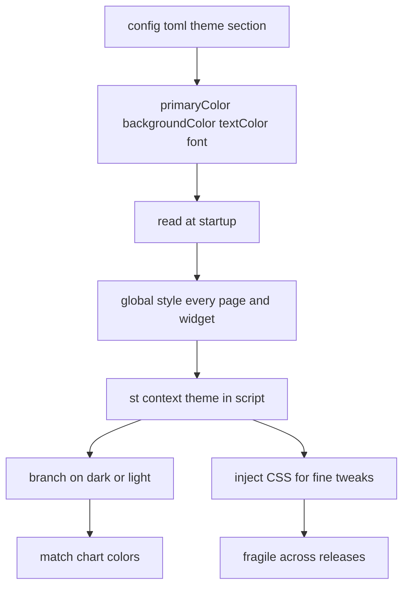

# Theming and Branding: Making a Streamlit App Look Like Yours

## English

Streamlit ships with a default visual identity, but almost every production app eventually needs to look like it belongs to a particular organisation. The theming system is configured through the `[theme]` section of `.streamlit/config.toml`, where you can set values such as `primaryColor`, `backgroundColor`, `secondaryBackgroundColor`, `textColor`, and `font`. Because these are read at startup, they apply globally to every page and widget without you touching a single line of layout code. A common workflow is to keep a light theme for development and a branded theme for deployment by supplying different config files per environment.

Beyond static config, Streamlit exposes the current theme values to your script through the `st.context.theme` attribute, which lets you branch on things like whether the viewer is in dark or light mode. This matters for charts: a plot with a white background looks wrong on a dark theme. You can read the theme and pass matching colours into your plotting library so the figure blends into the surrounding page instead of fighting it. The same idea applies to custom HTML you inject with `st.markdown(..., unsafe_allow_html=True)` — hard-coded colours there will clash when the theme changes.

For finer control you can inject CSS through `st.markdown` with a `<style>` block. This is the escape hatch for tweaks the theme config does not expose, such as tightening padding on a container or restyling a specific element. The trade-off is fragility: Streamlit's internal CSS class names and DOM structure are not a public API and can change between releases, so aggressive CSS hacking tends to break on upgrade. The pragmatic rule is to use the theme config for anything it supports and reserve CSS injection for small, well-documented adjustments you are prepared to re-check after each version bump.

Branding also includes non-visual assets: the page title and favicon set via `st.set_page_config`, the app name shown in the browser tab, and any logo you render in the sidebar. These are cheap to add and make a big difference in how polished an internal tool feels. A dashboard that says 'Streamlit' in the tab and uses default colours reads as a prototype; the same dashboard with a company favicon and matching palette reads as a product.

Finally, remember that theming is presentation only — it does not change behaviour. If a widget looks disabled or a button looks primary, that is styling, not logic. Keep theme decisions in config and styling, and keep logic in your script, so that a rebrand never accidentally changes what the app actually does.

## 中文

Streamlit 本身有一套預設外觀，但幾乎所有正式上線的應用，最終都要看起來像屬於某個機構。主題系統是透過 `.streamlit/config.toml` 裡面的 `[theme]` 區段設定的，你可以設定 `primaryColor`、`backgroundColor`、`secondaryBackgroundColor`、`textColor` 和 `font` 等值。因為這些設定在啟動時讀取，所以會全域套用到每一個頁面和組件，你完全不用改動任何一行佈局程式碼。常見做法是開發時用淺色主題、部署時用品牌主題，方法是為每個環境提供不同的設定檔。

除了靜態設定，Streamlit 亦透過 `st.context.theme` 屬性把目前的主題值暴露給你的腳本，讓你可以根據檢視者身處深色或淺色模式來分支處理。這對圖表很重要：白色背景的圖放在深色主題上會很突兀。你可以讀取主題，把相符的顏色傳給繪圖函式庫，令圖表融入周圍頁面而不是互相打架。同樣道理適用於你用 `st.markdown(..., unsafe_allow_html=True)` 注入的自訂 HTML——裡面寫死的顏色在主題改變時就會撞色。

想要更細緻的控制，你可以透過 `st.markdown` 注入一段 `<style>` 區塊來加 CSS。這是主題設定沒有涵蓋的微調的逃生門，例如收緊某個容器的內距，或重新設計某個特定元素。代價是脆弱：Streamlit 內部的 CSS class 名稱和 DOM 結構並不是公開 API，版本之間可能改變，所以激進的 CSS 改造往往會在升級時壞掉。務實的原則是：主題設定支援的就用主題設定，CSS 注入只留給小型、有好好記錄、而你準備好在每次版本更新後重新檢查的調整。

品牌還包括非視覺的資產：透過 `st.set_page_config` 設定的頁面標題和 favicon、瀏覽器分頁顯示的應用名稱，以及你在側邊欄渲染的標誌。這些加起來成本很低，但對內部工具的精緻感影響很大。一個分頁寫著「Streamlit」、用預設顏色的儀表板，讀起來像原型；同一個儀表板換上公司 favicon 和相符的色盤，讀起來就像產品。

最後要記住，主題只是呈現，不會改變行為。如果某個組件看起來像停用、某個按鈕看起來像主要按鈕，那只是樣式，不是邏輯。把主題決策留在設定和樣式裡，把邏輯留在腳本裡，這樣重新品牌化就永遠不會意外改變應用實際做的事。

## Key Takeaway

Use the [theme] config for global look-and-feel, read st.context.theme to match charts, and treat CSS injection as a fragile escape hatch rather than a primary styling tool.

## Related Concepts
- st.set_page_config
- st.markdown with unsafe_allow_html

## Diagram

