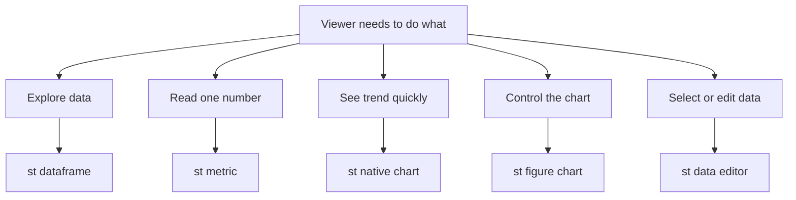

# Data Display Primitives in Depth: Choosing Between Tables, Charts, and Metrics

## English

Streamlit gives you many ways to show data, and picking the right one is mostly about what the viewer needs to do with it. `st.dataframe` renders an interactive, sortable, scrollable grid that is great for exploration — the user can click column headers, resize columns, and search. It is backed by a dataframe library and handles reasonably large tables by virtualising rows. `st.table`, by contrast, renders a static, fully-styled HTML table that shows every row at once; it is good for small, fixed summaries where you want the exact formatting preserved, but it does not scale and is not interactive.

For single numbers that matter, `st.metric` is the right primitive. It shows a big value with an optional delta (the change versus some reference), coloured green or red automatically. This is the building block of dashboards: a row of `st.columns` each containing a metric gives you the classic KPI strip at the top of a page. Using a full dataframe to show one number wastes the viewer's attention; a metric makes the number the hero.

Charts are where the choice gets richer. Streamlit's native `st.line_chart`, `st.bar_chart`, and `st.area_chart` are thin wrappers that accept a dataframe and render quickly with sensible defaults — perfect for a first pass. When you need control over axes, legends, tooltips, or interactivity, you pass a figure object from a library like Altair, Plotly, Matplotlib, or Bokeh to `st.altair_chart`, `st.plotly_chart`, and so on. The general pattern is: start with the native chart, and graduate to a figure object only when the defaults are not enough.

A subtle but important point is the difference between displaying data and letting the user select from it. `st.dataframe` with selection enabled, or `st.data_editor`, turns the table into an input widget — the user can tick rows or edit cells, and you read the result back. This is powerful for tasks like labelling or correcting records, but it also means the table now participates in the rerun model: every edit can trigger a rerun, so you often want to wrap it in a form or use callbacks to control when the value is committed.

Finally, think about honesty in presentation. A metric with a green delta implies 'good', but a rising number is not always good (think error rate). A truncated table can hide outliers. A chart with a non-zero baseline can exaggerate small differences. The primitive you choose shapes what the viewer concludes, so match the visual to the meaning, not just to what looks impressive.

## 中文

Streamlit 有很多方法顯示數據，選對方法主要取決於檢視者需要用它做甚麼。`st.dataframe` 會渲染一個可互動、可排序、可滾動的表格，非常適合探索——使用者可以點欄頭、調整欄寬、搜尋。它背後由 dataframe 函式庫支撐，透過虛擬化列來處理相當大的表格。相反，`st.table` 會渲染一個靜態、完整套用樣式的 HTML 表格，一次過顯示所有列；它適合小型、固定的摘要，你想保留確切的格式，但它不能擴展，也不可互動。

對於真正重要的單一數字，`st.metric` 就是正確的原語。它顯示一個大數值，可選擇附帶 delta（相對某個參考值的變化），並自動以綠色或紅色標示。這是儀表板的積木：用一排 `st.columns`，每個放一個 metric，就得到頁面頂部經典的 KPI 列。用整個 dataframe 去顯示一個數字，是浪費檢視者的注意力；metric 令數字成為主角。

圖表的選擇就更豐富。Streamlit 原生的 `st.line_chart`、`st.bar_chart` 和 `st.area_chart` 是薄薄的封裝，接受一個 dataframe，用合理的預設值快速渲染——很適合第一版。當你需要控制軸、圖例、工具提示或互動性時，你就把 Altair、Plotly、Matplotlib 或 Bokeh 等函式庫的圖表物件傳給 `st.altair_chart`、`st.plotly_chart` 等等。一般模式是：先從原生圖表開始，只有當預設值不夠用時才升級到圖表物件。

一個微妙但重要的分別，是「顯示數據」和「讓使用者從中選擇」的分別。啟用了選取功能的 `st.dataframe`，或者 `st.data_editor`，會把表格變成輸入組件——使用者可以勾選列或編輯儲存格，你再把結果讀回來。這對標註或修正紀錄等工作很強大，但同時代表表格現在參與了重跑模型：每次編輯都可能觸發重跑，所以通常你會想把它包在 form 裡，或用 callback 控制數值何時提交。

最後，要考慮呈現上的誠實。綠色的 delta 暗示「好」，但數字上升不一定好（想想錯誤率）。被截斷的表格可能隱藏離群值。基線不是零的圖表可能誇大微小差異。你選的原語會塑造檢視者得出的結論，所以要讓視覺配合意義，而不只是配合好看。

## Key Takeaway

Match the display primitive to the viewer's task — st.metric for single KPIs, st.dataframe for exploration, st.table for small fixed summaries, and figure objects only when native charts fall short.

## Related Concepts
- st.data_editor
- st.altair_chart

## Diagram

