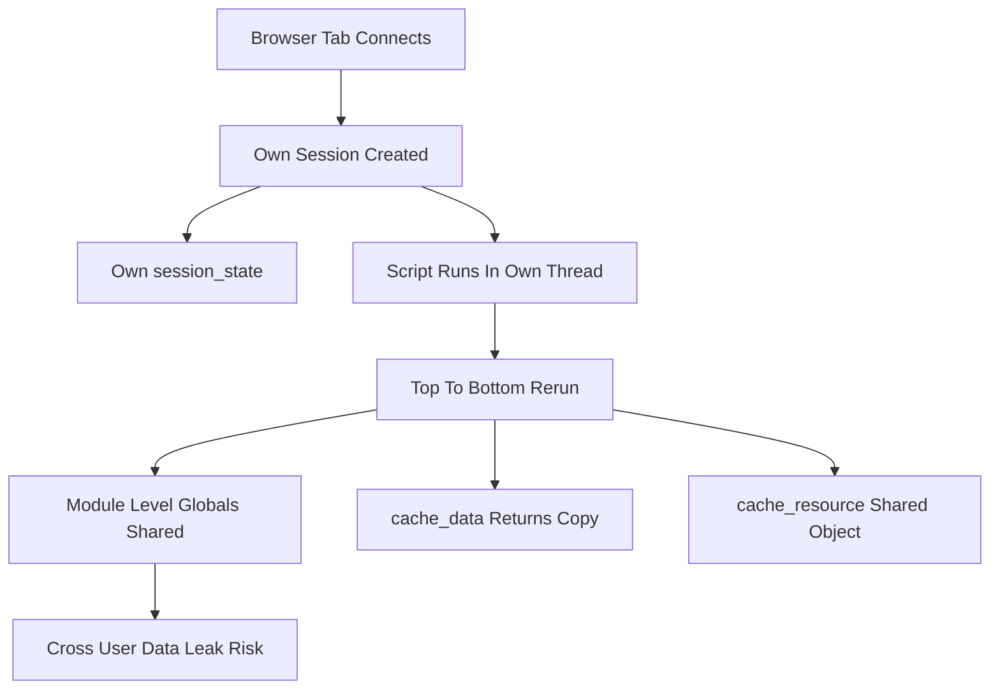

# Streamlit's Concurrency Model: What Happens When Two Users Hit Your App

## English

A Streamlit app is a long-running Python process, not a request handler that starts fresh per HTTP call. Each browser tab that connects gets its own session, with its own `st.session_state`, and the server keeps those sessions alive between interactions. When a user triggers a rerun, the script executes top to bottom for that session. The crucial question is: what happens when two users click at the same time? By default, Streamlit runs each session's script in its own thread, so two users can be mid-rerun simultaneously. That means any module-level global variable your script mutates is shared across all sessions — a classic source of cross-user data leaks.

This is why the guidance is emphatic: put per-user data in `st.session_state`, never in globals. A list defined at the top of the script and appended to during the run is re-created on every rerun anyway, but a list defined in a separate imported module and mutated there is a genuine shared object. If two sessions append to it, they see each other's entries. The same hazard applies to cached functions: `st.cache_data` returns a copy per call, which protects you, but `st.cache_resource` returns the same object to every session — appropriate for a database connection pool or a loaded model, dangerous for anything holding user-specific state.

Concurrency also interacts with expensive work. If a rerun takes ten seconds and a user clicks another widget, Streamlit will generally stop the in-flight run and start a new one for that session, so stale results do not pile up. But a long-running computation still occupies a thread, and with many concurrent users you can exhaust the server's capacity. This is where fragments and caching earn their keep: a fragment that isolates an expensive query means a click elsewhere does not re-trigger it, and caching means identical inputs do not recompute at all.

For heavier loads, the deployment pattern matters. Running multiple Streamlit processes behind a load balancer gives you horizontal scaling, but sessions are sticky to the process that created them — a user's websocket connection must keep hitting the same process, or their session state disappears. This is a common surprise when moving from a single instance to a scaled deployment. The practical answer is usually sticky sessions at the proxy, or accepting that state is per-instance and designing around it.

Understanding this model changes how you write code. Treat the script as a function of (session state, inputs) with no hidden shared mutable state. Prefer `st.session_state` for per-user values, `st.cache_resource` only for genuinely shared, read-mostly resources, and design for the possibility that two users are running your code at the same instant.

## 中文

一個 Streamlit 應用是一個長期運行的 Python 程序，而不是每次 HTTP 呼叫都重新開始的請求處理器。每個連接的瀏覽器分頁都有自己的 session，有自己的 `st.session_state`，而伺服器會在互動之間讓這些 session 保持存活。當使用者觸發重跑，腳本會為該 session 由上而下執行。關鍵問題是：當兩個使用者同時點擊會怎樣？預設情況下，Streamlit 在各自的執行緒中運行每個 session 的腳本，所以兩個使用者可以同時處於重跑之中。這代表你腳本改動的任何模組層級全域變數，都是跨所有 session 共享的——這是跨使用者資料洩漏的經典來源。

這就是為甚麼指引講得很強調：把每個使用者的資料放在 `st.session_state`，永遠不要放在全域變數。在腳本頂部定義、在運行期間附加的 list，反正每次重跑都會重新建立；但在另一個被 import 的模組中定義、並在那裡被改動的 list，就是真正共享的物件。如果兩個 session 都向它附加，它們就會看到彼此的項目。同樣的危險適用於快取函數：`st.cache_data` 每次呼叫都回傳副本，保護了你；但 `st.cache_resource` 把同一個物件回傳給每個 session——對資料庫連線池或已載入的模型很合適，對任何持有使用者專屬狀態的東西就很危險。

併發亦與昂貴工作互動。如果一次重跑要十秒，而使用者又點了另一個組件，Streamlit 一般會停止該 session 進行中的運行，並開始新的運行，這樣過時的結果就不會堆積。但長時間的計算仍然佔用一個執行緒，使用者一多，就可能耗盡伺服器容量。這正是 fragment 和快取發揮作用的地方：用 fragment 隔離昂貴查詢，代表在別處點擊不會重新觸發它；而快取代表相同的輸入完全不會重算。

負載更重時，部署模式就很關鍵。在負載平衡器後面運行多個 Streamlit 程序可以水平擴展，但 session 會黏在建立它的那個程序上——使用者的 websocket 連線必須持續打到同一個程序，否則他們的 session 狀態就會消失。這是從單一實例轉到擴展部署時常見的意外。務實的答案通常是在代理層做黏性 session，或者接受狀態是每個實例各自一份，並圍繞這一點來設計。

理解這個模型會改變你寫程式的方式。把腳本當成一個以（session 狀態、輸入）為參數的函數，沒有隱藏的共享可變狀態。每個使用者的值優先用 `st.session_state`，`st.cache_resource` 只留給真正共享、以讀為主的資源，並且要為「兩個使用者同一瞬間在跑你的程式」這個可能性來設計。

## Key Takeaway

Each browser session runs your script in its own thread, so per-user data belongs in st.session_state and only genuinely shared, read-mostly resources belong in st.cache_resource.

## Related Concepts
- st.cache_resource
- sticky sessions behind a load balancer

## Diagram

