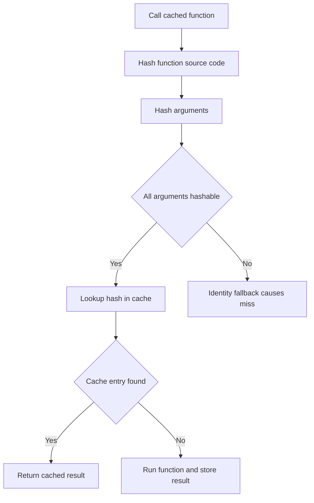

# Streamlit's Cache Invalidation Logic: Hashing Arguments and Why Your Cached Function Silently Misses

## English

Streamlit's caching decorators (st.cache_data for data-returning functions, st.cache_resource for shared singletons like database connections or ML models) work by hashing the function's source code plus its arguments, then looking up that hash in a cache. The subtle part is what counts as 'hashable'. A pandas DataFrame argument is hashed by value, which is expensive but correct; a list of dicts is hashed structurally; but an arbitrary Python object with no meaningful __hash__ or __eq__ may fall back to identity, so passing a freshly constructed object each rerun can cause the cache to miss every time even though the data looks identical. This is the classic 'why is my cached function still slow?' trap.

The other half of the story is invalidation. Streamlit hashes the function body itself, so editing the source of a cached function automatically invalidates its entries — you do not need to manually clear anything during development. But it does NOT know about external state: if your function reads a file from disk, calls an API, or queries a database, and that underlying data changes, the cache will happily keep serving stale results because the arguments never changed. You have to either pass the changing data in as an argument (so it becomes part of the hash) or call the cache's .clear() method yourself.

A concrete example: a function `load_sales(start_date, end_date)` that internally opens `sales.parquet` and filters it. If someone rewrites the parquet file with corrected numbers, your app keeps showing the old numbers until you clear the cache or restart. The fix is to make the file's modification time or a version tag part of the arguments, or to use st.cache_data with a ttl (time-to-live) so entries expire after, say, 3600 seconds.

Choosing between the two decorators matters too. st.cache_data returns a fresh copy of the value on each call, so mutating the returned DataFrame does not corrupt other users' views — good for data. st.cache_resource returns the same object to everyone, which is what you want for a database connection pool or a loaded model, but dangerous for anything mutable that a user might modify in place. Mixing them up produces bugs that only appear when two users interact at once.

Finally, remember that cache entries live in the process. In a multi-worker deployment each worker has its own cache, so a warm cache in one worker does not help another. For expensive shared computations across workers, an external store (Redis, a precomputed table) is usually the right answer, with the Streamlit cache acting only as a per-process fast path.

## 中文

Streamlit 嘅快取裝飾器（st.cache_data 用嚟快取回傳資料嘅函數，st.cache_resource 用嚟快取共享單例，例如資料庫連線或者已載入嘅機器學習模型）嘅原理係：將函數嘅原始碼連同佢嘅參數一齊做雜湊（hash），然後用嗰個雜湊值去快取度查。微妙之處在於「乜嘢先算可雜湊」。pandas DataFrame 參數會按值做雜湊，雖然貴但正確；一個 list of dict 會按結構做雜湊；但一個冇有意義 __hash__ 或 __eq__ 嘅任意 Python 物件，可能會退化成按身份（identity）比較，於是每次重跑都新建一個物件傳入，就算資料睇落一模一樣，快取都會次次 miss。呢個就係經典嘅「點解我加咗快取都仲係咁慢？」陷阱。

另一半故事係失效（invalidation）。Streamlit 會將函數本體都做雜湊，所以開發期間你改咗快取函數嘅原始碼，佢會自動令相關條目失效——你唔需要手動清任何嘢。但佢唔知道你函數外部嘅狀態：如果你嘅函數由磁碟讀檔、呼叫 API、或者查資料庫，而底層資料變咗，快取會照樣回傳舊結果，因為參數從來冇變。你要麼將會變嘅資料當參數傳入（令佢成為雜湊嘅一部分），要麼自己呼叫快取嘅 .clear() 方法。

具體例子：一個 `load_sales(start_date, end_date)` 函數，內部打開 `sales.parquet` 再過濾。如果有人用修正咗嘅數字重寫咗個 parquet 檔，你個 app 會繼續顯示舊數字，直到你清快取或者重啟。解法係將檔案嘅修改時間或者版本標籤納入參數，或者用 st.cache_data 嘅 ttl（time-to-live，存活時間）令條目喺例如 3600 秒後過期。

揀邊個裝飾器都好重要。st.cache_data 每次呼叫都回傳一份新副本，所以你改動回傳嘅 DataFrame 唔會汙染其他用戶睇到嘅版本——適合放資料。st.cache_resource 就將同一個物件回傳畀所有人，呢個正正係資料庫連線池或者已載入模型想要嘅效果，但對任何用戶可能就地改動嘅可變物件就非常危險。撈亂咗就會產生啲只有兩個用戶同時互動先會出現嘅 bug。

最後要記住，快取條目係活在進程（process）之內。喺多 worker 部署之下，每個 worker 有自己嘅快取，所以一個 worker 嘅暖快取幫唔到另一個。如果要做跨 worker 嘅昂貴共享計算，通常正確答案係用外部儲存（Redis、預先算好嘅表），而 Streamlit 快取只係做每個進程嘅快速通道。

## Key Takeaway

Streamlit caches by hashing your function's source and arguments, so anything it cannot see — files, APIs, database rows — can silently go stale until you pass it in, set a ttl, or clear the cache yourself.

## Related Concepts
- Hash-based cache keys
- st.cache_data vs st.cache_resource

## Diagram

