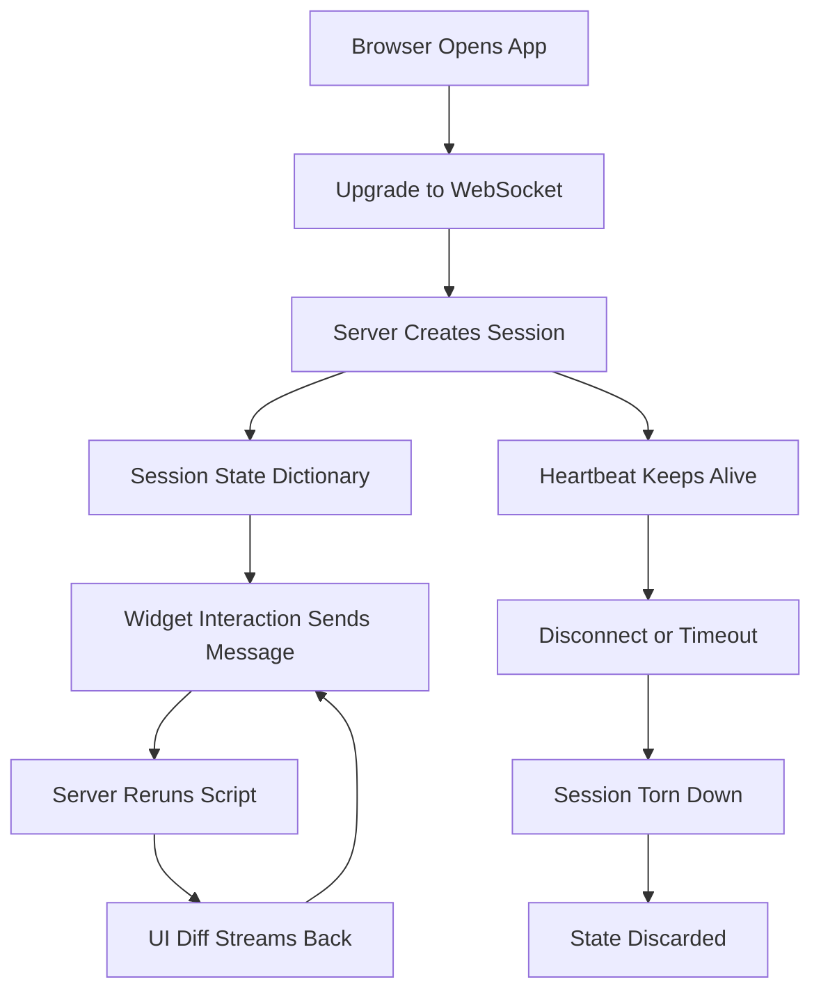

# Streamlit's WebSocket Heartbeat: Connection Lifecycle, Disconnects, and What Happens to Your Session

## English

Every Streamlit app is a long-lived bidirectional conversation between the browser and the Python server, carried over a WebSocket rather than ordinary HTTP requests. When you open the page, the browser upgrades the connection to WebSocket, and from then on every widget interaction (a button click, a slider drag, a text edit) sends a small message up the socket; the server reruns the script and streams the resulting UI diff back down the same socket. This is why Streamlit feels different from a classic request-response site: there is no page reload, and the server always knows who you are for the life of the connection.

Because the connection is stateful, it has a lifecycle. The server assigns each connection a session, and that session owns its own st.session_state dictionary. If you close the tab, the browser drops the socket, and the server eventually tears down the session and discards its state — which is why refreshing the page loses everything you put in session_state unless you have persisted it elsewhere. If the network hiccups briefly, the client tries to reconnect; Streamlit shows the familiar 'Connecting…' overlay while it re-establishes the socket, and a brand-new session may be created, meaning your session_state is gone and widgets reset to their defaults.

This has practical consequences. Long-running computations block that session's reruns, and if the user gets impatient and refreshes, the server may keep working on an orphaned run for a while. A WebSocket that goes quiet for too long is considered dead by intermediaries (proxies, load balancers, corporate firewalls), so Streamlit sends periodic heartbeat/ping traffic to keep it alive; if you deploy behind a reverse proxy, you must configure it to allow WebSocket upgrades and to not time out idle connections too aggressively, or users will see constant disconnects even though the app is healthy.

Session identity is also not authentication. The session ID is a random token used to route messages; it is not a login. Anyone with the URL can open their own session, and two users are two independent sessions with independent state. If your app needs to remember a user across tabs or devices, you must build that yourself — a login flow that stores a token in a cookie or query parameter, then maps it to server-side data — because the built-in session is per-connection, not per-person.

A useful mental model: think of the WebSocket as a phone call, not a letter. While the call is up, the server can push updates to you instantly (progress bars, streaming text, live charts). The moment the call drops, the conversation is over and whatever was only in memory goes with it. Design your app so that anything precious — uploaded files, computed results the user cares about — is written to durable storage or offered as a download before the call can end.

## 中文

每個 Streamlit app 都係瀏覽器同 Python 伺服器之間一條長期嘅雙向對話，行嘅係 WebSocket 而唔係普通 HTTP 請求。你打開頁面嗰陣，瀏覽器會將連線升級做 WebSocket，之後每次組件互動（撳掣、拖 slider、改文字）都會經條 socket 送一個細訊息上去；伺服器重跑腳本，再將結果嘅 UI 差異經同一條 socket 串流落嚟。呢個就係點解 Streamlit 同傳統請求-回應網站感覺唔同：冇頁面重載，而伺服器喺連線存活期間永遠知道你係邊個。

因為連線係有狀態嘅，所以佢有生命週期。伺服器會為每條連線分配一個 session，而嗰個 session 擁有自己嘅 st.session_state 字典。如果你閂咗個 tab，瀏覽器會斷開 socket，伺服器最終會拆掉個 session 並丟棄佢嘅狀態——所以除非你喺其他地方持久化咗，否則撳一下重新整理就會冇晒你放喺 session_state 嘅嘢。如果網絡短暫卡一卡，客戶端會嘗試重連；Streamlit 會顯示大家熟悉嘅「Connecting…」遮罩，等佢重新建立 socket，而過程中可能會建立一個全新 session，即係你嘅 session_state 冇咗、組件重設返預設值。

呢點有實際後果。長時間嘅運算會阻塞嗰個 session 嘅重跑，如果用戶等唔切撳重新整理，伺服器可能仲會繼續做一個已經被遺棄嘅運行一段時間。一條靜得太久嘅 WebSocket 會被中間人（代理、負載平衡器、企業防火牆）當成死線，所以 Streamlit 會定期發 heartbeat／ping 流量令佢保持活躍；如果你部署喺反向代理後面，就要設定佢允許 WebSocket 升級、唔好對閒置連線設太進取嘅逾時，否則用戶會見到不停斷線，即使 app 本身健康。

Session 身份亦唔等於認證。Session ID 只係一個隨機 token，用嚟路由訊息；佢唔係登入。任何有條 URL 嘅人都可以開自己嘅 session，兩個用戶就係兩個獨立 session、各自獨立狀態。如果你個 app 要跨 tab 或跨裝置記住用戶，就要自己砌——一個登入流程，將 token 存喺 cookie 或 query parameter，再喺伺服器端映射到資料——因為內建 session 係按連線計，唔係按人計。

一個好用嘅心智模型：將 WebSocket 當成講電話，唔係寄信。電話通緊嗰陣，伺服器可以即時推送更新畀你（進度條、串流文字、即時圖表）。電話一斷，對話就完，只存在記憶體嘅嘢就跟住消失。設計你個 app 嗰陣，要令任何珍貴嘅嘢——上載嘅檔案、用戶在意嘅計算結果——喺通話結束前已經寫入持久儲存或者提供做下載。

## Key Takeaway

A Streamlit session lives and dies with its WebSocket, so treat the connection as a phone call: anything that must survive a refresh or a dropped network has to be persisted outside session_state.

## Related Concepts
- WebSocket transport
- Session lifecycle and reconnection

## Diagram

