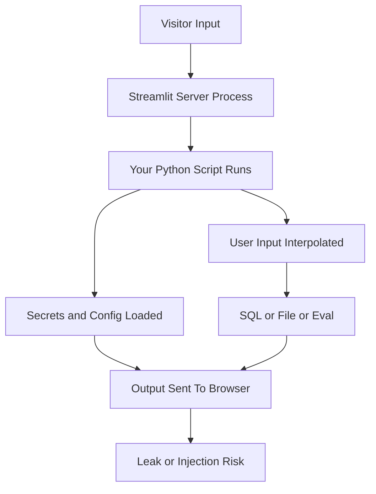

# Streamlit's Security Posture: Who Can Run What, and Why 'It's Just a Python Script' Is Not a Safety Argument

## English

A Streamlit app is, mechanically, a Python process that runs whatever code is in your script, on a server, in response to input from anyone who can reach the URL. That framing matters because it inverts the usual intuition. In a static site, a malicious visitor can only affect their own browser. In a Streamlit app, a malicious visitor's input flows into code running on your machine — and if that code does something like `eval` a text box, build a SQL string by concatenation, or read a path supplied by the user, the visitor is effectively executing code or queries on your server. The framework does not protect you from yourself; it just makes it very easy to forget that you are writing a server-side program.

The most common real-world issue is not exotic exploits but exposed secrets and unguarded resources. Because the script runs server-side, any API key, database password, or internal URL it touches is available to the process — and any output it prints is sent to the browser. A stray `st.write(config)` or an exception traceback that includes a connection string can leak credentials to every visitor. This is why secrets belong in .streamlit/secrets.toml (never committed) or environment variables, why you should catch and sanitise exceptions before displaying them, and why debug modes that show stack traces should never be on in a public deployment.

Injection is the second theme. If your app takes a text input and interpolates it into a SQL query, you have SQL injection with extra steps — the fix is the same as anywhere else: parameterised queries. If it takes a file path and opens it, a visitor can try `../../etc/passwd` style traversal; validate against an allow-list or resolve and check the path stays inside a known directory. If it renders user-supplied Markdown or HTML with unsafe options, you can get script injection into other users' browsers. Streamlit's display functions are generally careful about escaping, but the moment you opt into raw HTML you own that risk.

Authorisation is the third and most overlooked theme. Streamlit's built-in session is per-connection, not per-user, so 'who is this?' is a question you must answer yourself. A typical pattern is an OAuth or password login that sets a flag in st.session_state and gates the rest of the script behind it — but remember that every rerun re-executes the whole script, so the gate must be checked on every run, not just at startup. And because sessions are independent, one user's session_state is never visible to another; that is a safety property you get for free, but it also means you cannot rely on it for shared coordination.

Finally, think about resource limits. A public Streamlit app accepts uploads, runs computations, and holds memory for as long as sessions are open. Without limits on upload size, computation time, and concurrent sessions, a single visitor can exhaust the server. Set sensible caps, validate file types and sizes before processing, and remember that anything expensive should be cached or queued rather than recomputed per interaction. Security here is mostly the discipline of remembering that your notebook-shaped script is, in fact, a public web service.

## 中文

一個 Streamlit app 機械上就係一個 Python 進程，喺伺服器上、因應任何能夠去到條 URL 嘅人嘅輸入，去執行你腳本入面嘅任何程式碼。呢個講法好重要，因為佢扭轉咗一般直覺。喺靜態網站，惡意訪客最多只影響自己個瀏覽器。喺 Streamlit app，惡意訪客嘅輸入會流入你機器上運行嘅程式碼——如果嗰段碼會 `eval` 一個文字框、用字串拼接砌 SQL、或者讀取用戶提供嘅路徑，訪客就等同喺你伺服器上執行緊程式碼或者查詢。框架唔會保護你唔犯自己嘅錯；佢只係令你非常容易忘記自己寫緊一個伺服器端程式。

現實世界最常見嘅問題唔係乜嘢奇技淫巧，而係洩露嘅密鑰同無防護嘅資源。因為腳本喺伺服器端運行，佢接觸到嘅任何 API key、資料庫密碼、內部 URL 都對個進程可用——而佢印出嚟嘅任何輸出都會送去瀏覽器。一個唔小心嘅 `st.write(config)`，或者一個包含連線字串嘅例外 traceback，就可以將憑證洩露畀每個訪客。所以密鑰要放喺 .streamlit/secrets.toml（絕對唔好 commit）或者環境變數；所以要喺顯示之前捕捉同淨化例外；所以喺公開部署絕對唔可以開會顯示堆疊追蹤嘅 debug 模式。

第二個主題係注入（injection）。如果你個 app 攞文字輸入再插值入 SQL 查詢，你就係多咗幾步嘅 SQL 注入——解法同邊度都一樣：參數化查詢。如果佢攞一個檔案路徑去打開，訪客可以試 `../../etc/passwd` 式嘅路徑穿越；要對照白名單驗證，或者解析之後檢查路徑仍然喺已知目錄之內。如果佢用唔安全嘅選項去渲染用戶提供嘅 Markdown 或 HTML，你就可以將腳本注入到其他用戶嘅瀏覽器。Streamlit 嘅顯示函數一般對轉義好小心，但一旦你選擇用原始 HTML，風險就由你承擔。

第三個、亦係最被忽略嘅主題係授權（authorisation）。Streamlit 內建 session 係按連線計，唔係按用戶計，所以「呢個係邊個？」係你必須自己答嘅問題。典型做法係一個 OAuth 或者密碼登入，喺 st.session_state 設一個旗標，再將腳本其餘部分閘喺佢後面——但要記住每次重跑都會重新執行成個腳本，所以道閘要每次運行都檢查，唔可以只喺啟動時檢查。而且因為 session 各自獨立，一個用戶嘅 session_state 永遠唔會畀另一個睇到；呢個係你免費得到嘅安全屬性，但亦意味住你唔可以靠佢做共享協調。

最後，想想資源限制。一個公開嘅 Streamlit app 會接受上載、運行運算、喺 session 開住期間佔用記憶體。如果冇對上載大小、運算時間、並行 session 設限，單一訪客就可以耗盡伺服器。設合理上限，喺處理之前驗證檔案類型同大小，並記住任何昂貴嘅嘢都應該快取或者排隊，而唔係每次互動都重算。呢度嘅安全，主要就係記住：你嗰個 notebook 形狀嘅腳本，其實係一個公開嘅網絡服務。

## Key Takeaway

Streamlit runs your script on the server in response to anyone who reaches the URL, so treat it as a public web service: guard secrets, parameterise queries, validate paths and uploads, and check authorisation on every rerun.

## Related Concepts
- Server-side execution risk
- Injection and input validation

## Diagram

