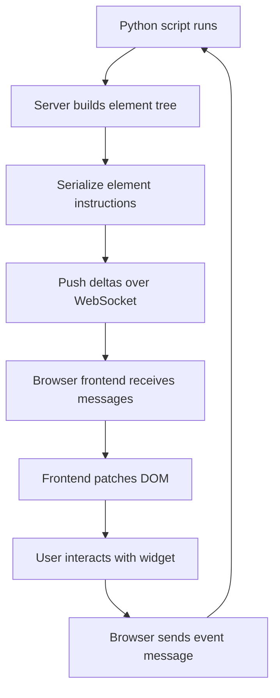

# The Streamlit Wire Protocol: What Actually Travels Between Browser and Server

## English

When you call st.write("hello"), nothing in your Python process renders HTML. Instead, the Streamlit server serializes a small instruction — roughly "add a text element with this content at this position" — into a compact message and pushes it to the browser over a persistent WebSocket connection. The browser-side JavaScript runtime (the frontend) keeps a virtual tree of elements and patches the DOM when instructions arrive. This is why Streamlit feels different from Flask or Django: you are not generating a page, you are streaming a sequence of element-add and element-update commands down an already-open pipe.

The practical consequence is that the Python process and the browser hold two representations of the same UI. The server knows the element tree because it built it during the script run; the browser knows it because it received the deltas. When a widget changes, the browser sends a small event message back — the widget's identity plus its new value — and the server responds to that event by rerunning the script, which produces a fresh batch of element instructions. That round trip is the entire interaction loop, and it is why latency is dominated by how fast your script runs, not by how fast HTML can be assembled.

Because the protocol is delta-based rather than page-based, the frontend must be able to reconcile. If a rerun emits fewer elements than before, the frontend has to remove the extras; if element identities shift, you can get the classic flicker or stale-widget symptoms. This is also why some things you would do casually in raw HTML — inline JavaScript event handlers, arbitrary DOM manipulation — are not available: the frontend only understands the message types the protocol defines. Custom components exist precisely to extend that vocabulary.

Knowing the protocol shapes debugging. A blank page with no error usually means the script raised before emitting anything, or the WebSocket never established. A page that shows stale values usually means the rerun did not fire because the widget event was not recognised. A page that flashes content means the frontend is tearing down and rebuilding elements between reruns. None of these are HTML problems; they are message-flow problems, and thinking in deltas rather than documents is the mental shift that makes them tractable.

One more detail worth internalising: the protocol is stateful per connection. Each browser tab holds its own WebSocket and therefore its own session, its own script-run context, and its own element tree. Two tabs are two independent apps sharing one Python process. That is the correct model for reasoning about almost every surprising multi-user behaviour you will encounter.

## 中文

當你呼叫 st.write("hello") 的時候，你嘅 Python 進程其實冇渲染任何 HTML。真正發生嘅係：Streamlit 伺服器將一條細細嘅指令——大概就係「喺呢個位置加一個文字元素，內容係咁咁咁」——序列化成精簡訊息，經一條長期保持嘅 WebSocket 連線推送去瀏覽器。瀏覽器那邊嘅 JavaScript 運行時（即前端）會維護一棵虛擬元素樹，收到指令就修補 DOM。呢個就係為何 Streamlit 同 Flask、Django 感覺唔同：你唔係生成一個頁面，你係喺一條已經打開嘅管道上面，源源不絕咁送出一連串「加元素」同「更新元素」嘅命令。

實際後果係：Python 進程同瀏覽器各自持有一份同一個介面嘅表示。伺服器知道元素樹，因為係佢喺腳本執行期間砌出嚟嘅；瀏覽器知道，因為佢收到咗啲差異訊息。當組件有變，瀏覽器會送一條細細嘅事件訊息返去——包括組件嘅身份同新值——伺服器收到就重跑腳本，產生一批全新嘅元素指令。呢個來回就係整個互動循環，亦解釋咗為何延遲主要取決於你腳本跑得幾快，而唔係 HTML 砌得幾快。

因為協議係基於差異（delta）而唔係基於頁面，前端必須識得協調。如果重跑產生嘅元素比之前少，前端就要刪走多出嚟嘅；如果元素身份移位，就會出現典型嘅閃爍或者組件殘留症狀。亦正因如此，一啲你喺原生 HTML 好順手嘅嘢——例如內聯 JavaScript 事件處理器、任意 DOM 操作——都用唔到：前端只認得協議定義嘅訊息類型。自訂組件之所以存在，正正就係為咗擴充呢套詞彙。

明白咗協議，對除錯好有幫助。空白頁又冇錯誤，通常代表腳本喺發出任何嘢之前就拋錯，或者 WebSocket 根本冇建立成功。頁面顯示舊值，通常代表重跑冇觸發，因為組件事件冇被辨認到。頁面內容閃爍，代表前端喺兩次重跑之間拆掉再重建元素。呢啲全都唔係 HTML 問題，而係訊息流問題；用差異而唔係文件嘅心態去思考，先至搞得掂。

仲有一個細節值得記住：協議係每條連線各自有狀態嘅。每個瀏覽器分頁都持有自己嘅 WebSocket，因此有自己嘅 session、自己嘅腳本執行上下文、自己嘅元素樹。兩個分頁就係兩個獨立嘅 app，只係共用同一個 Python 進程。用呢個模型去推理，幾乎所有令人意外嘅多用戶行為都會變得講得通。

## Key Takeaway

Streamlit streams element deltas over a persistent WebSocket rather than generating pages, so debugging is about message flow, not HTML.

## Related Concepts
- WebSocket
- Virtual DOM reconciliation

## Diagram

