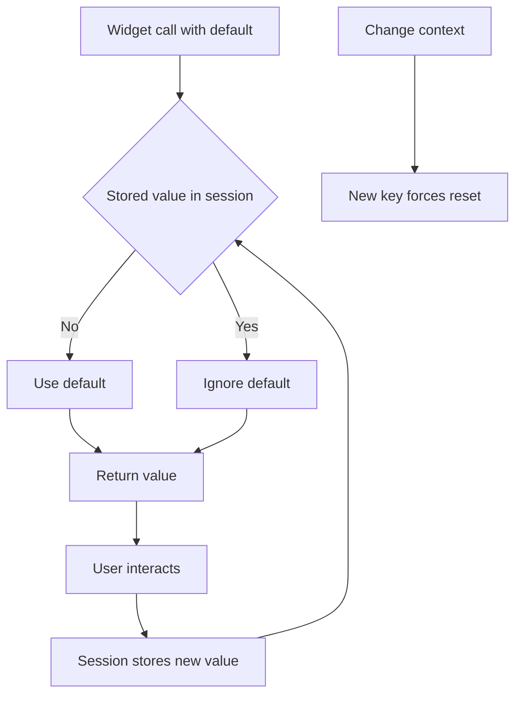

# Widget Return Values and the Default-Value Trap

## English

Every Streamlit widget is a function that returns a value, and that return value is the current state of the widget as the server understands it. st.slider("n", 0, 10, 5) returns 5 on the first run, and returns whatever the user last set on subsequent runs. This sounds trivial, but it creates a subtle trap: the default you pass is only the initial value. Once the user moves the slider, your literal 5 is ignored forever, because the widget's identity now has a stored value in the session. If you later change the default in code and redeploy, existing sessions will keep the old value until they reset.

The trap deepens when you compute the default from other data. Suppose you write st.selectbox("Country", options=countries, index=countries.index(user_country)). On first run this selects the user's country, which is what you want. But the widget now owns that choice. If the user's country changes elsewhere in the app, the index argument is re-evaluated but ignored, because the widget already has a value. You will stare at the code convinced it should update, and it will not. The fix is either to give the widget a new key when the underlying context changes (forcing a fresh identity and therefore a fresh default) or to drive the value through session state explicitly.

A related confusion is that the return value is not the same as the value you passed in. For st.text_input, the return is a string; for st.file_uploader, the return is an uploaded-file object or None; for st.multiselect, the return is a list. Code that assumes a widget returns its default type will break the first time the user interacts. Always treat the return as untrusted user input and validate it, exactly as you would a query parameter in a traditional web app.

There is also an ordering subtlety. Because widgets return their current value during the script run, and because the script runs top to bottom, a widget's value is only available after the line that created it. You cannot reference a widget's value before its declaration, and you cannot use a widget to control whether an earlier widget is rendered — at least not without splitting the UI into fragments or using forms. This is the same top-to-bottom constraint that makes Streamlit simple, showing up as an annoyance when you want conditional layout.

Finally, remember that widgets with the same label and type in the same script run can collide. Streamlit derives identity from the widget type, its parameters, and its key; two identical sliders with no keys are ambiguous. Giving explicit keys is not bureaucratic overhead — it is how you tell Streamlit that two visually similar widgets are genuinely different things with independent values.

## 中文

每個 Streamlit 組件都係一個函數，會回傳一個值，而嗰個回傳值就係伺服器理解嘅組件當前狀態。st.slider("n", 0, 10, 5) 第一次執行回傳 5，之後就回傳用戶最後設定嘅值。聽落好簡單，但呢度有個微妙陷阱：你傳入嘅預設值只係初始值。一旦用戶拖動過滑桿，你寫死嘅 5 就永遠被忽略，因為組件嘅身份而家喺 session 入面已經儲住一個值。如果你之後改咗程式碼入面嘅預設值再重新部署，現有 session 會繼續用舊值，直到佢哋重置為止。

當你根據其他數據去計算預設值，陷阱就更深。假設你寫 st.selectbox("Country", options=countries, index=countries.index(user_country))。第一次執行會揀中用戶嘅國家，正合你意。但係個組件而家已經擁有咗嗰個選擇。如果用戶嘅國家喺 app 其他地方改變咗，index 參數雖然會重新計算，但會被忽略，因為組件已經有值。你會盯住段程式碼，堅信佢應該更新，但佢偏偏唔會。解法有兩個：要麼喺底層上下文改變時俾組件一個新 key（逼佢換新身份，因而換新預設值），要麼明確咁透過 session state 去驅動個值。

另一個相關嘅混淆係：回傳值唔等於你傳入嘅值。st.text_input 回傳字串；st.file_uploader 回傳上載檔案物件或者 None；st.multiselect 回傳列表。啲假設組件會回傳預設類型嘅程式碼，第一次遇到用戶互動就會爆。永遠當回傳值係不可信嘅用戶輸入，要驗證，就好似傳統 web app 入面驗證查詢參數一樣。

仲有個次序上嘅微妙位。因為組件喺腳本執行期間回傳當前值，而腳本由上至下執行，所以組件嘅值要喺建立佢嗰行之後先至攞得到。你唔可以喺宣告之前引用組件嘅值，亦唔可以用一個組件去控制較早嘅組件會唔會渲染——至少唔可以唔拆做 fragment 或者用 form。呢個同「由上至下」嘅限制，正正係令 Streamlit 簡單嘅原因，但當你想做條件式佈局，就會變成麻煩。

最後，記住同一次腳本執行入面，標籤同類型都一樣嘅組件會撞。Streamlit 由組件類型、參數同 key 推導身份；兩個冇 key 嘅一模一樣滑桿就係含糊。俾明確嘅 key 唔係官僚式開支——而係你話俾 Streamlit 知：兩個睇落似嘅組件其實係兩件唔同嘅嘢，有各自獨立嘅值。

## Key Takeaway

A widget's default value only applies until the widget has stored state; after that, the widget owns its value and you must change its key or use session state to override it.

## Related Concepts
- Widget identity
- Session state

## Diagram

