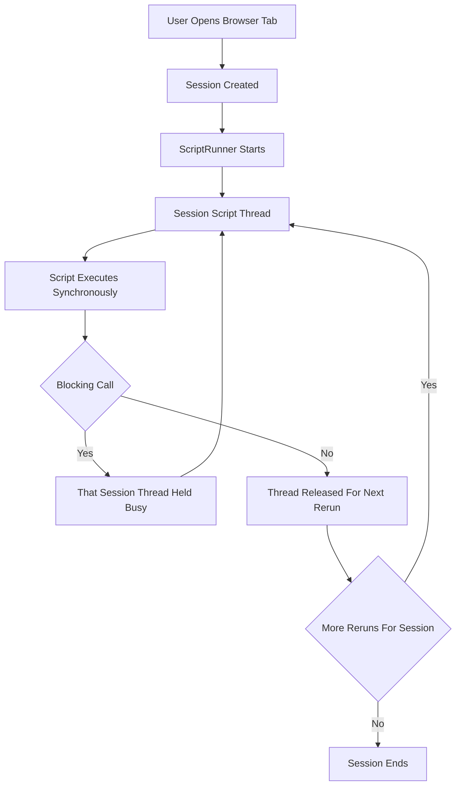

# Script Runs Are Not Threads: Understanding the Single-Run Execution Context

## English

A common assumption is that each user of a Streamlit app gets a process running their script, isolated from everyone else. The reality is somewhere in between. Streamlit runs each user session's page code on its own script thread — a script thread is created by a ScriptRunner when it starts, and a given script thread may execute several reruns for that session before a new one is created. So there is no shared, fixed-size pool of workers that a burst of users can exhaust; instead, a long-running script blocks its own session's thread and nothing else. What you should take away is that a script run is a bounded, synchronous pass through your code, and the thread executing it is tied to that session.

This is why blocking calls are dangerous in Streamlit. A synchronous HTTP request to a slow API, a heavy database query without a timeout, or a long training loop inside the script body will hold that session's script thread for the duration. The mitigation is not to spawn threads ad hoc — Streamlit's rerun model does not give you stable places to join them, and functions called from a thread you spawned will usually have no ScriptRunContext attached — but to move slow work behind caching so it happens once, to keep queries fast and indexed, and to use the tools the framework provides for long-running work rather than improvising.

There is a second, more confusing layer: the session. A session is tied to a browser connection, and session state lives with that connection. If a user opens two tabs, they get two sessions and two independent script-run contexts, even though they share the same Python process and the same module-level globals. Module-level mutable state — a list you append to at import time, a global dictionary — is therefore shared across all users and all sessions, and is a classic source of cross-user data leakage. The rule is simple: per-user data belongs in st.session_state, never in a module global.

Caching interacts with this in a way that surprises people. Cached functions are shared across sessions, which is exactly what you want for expensive pure computations, but it means a cached function must not depend on session-specific data unless that data is part of the cache key. If you cache a function that reads st.session_state internally, the first caller's session data gets baked into the cached result and served to everyone else. The fix is to pass the session-dependent value as an explicit argument so it participates in the hash.

Putting it together: think of each session as owning a script thread that performs bounded script passes, with caches as the unit of shared computation and module globals as the unit of accidental sharing. Almost every concurrency bug in Streamlit is a violation of one of those three boundaries — blocking your own session's thread, sharing a global, or caching something session-dependent. Once you can name which boundary was crossed, the fix is usually obvious.

## 中文

好多人以為 Streamlit app 每個用戶都會有一個進程去跑佢哋嘅腳本，同其他人完全隔離。實際情況係喺兩者之間。Streamlit 係為每個用戶 session 開一條屬於佢嘅腳本線程（script thread）去跑頁面代碼——腳本線程由 ScriptRunner 啟動時建立，同一條腳本線程可以先後為嗰個 session 執行多次重跑，之後先至可能換一條新的。所以並唔存在一個共享而固定大小、可以被湧入用戶耗盡嘅工作線程池；取而代之嘅係，一段長時間運行嘅腳本只會阻塞自己嗰個 session 嘅線程。你真正要記住嘅係：一次腳本執行係一次有界嘅同步代碼掃描，而執行佢嘅線程係綁定於嗰個 session 嘅。

呢個就係為何阻塞式呼叫喺 Streamlit 好危險。一個同步 HTTP 請求去慢 API、一個冇 timeout 嘅重型資料庫查詢、或者腳本主體入面一個漫長嘅訓練迴圈，都會霸住嗰個 session 嘅腳本線程直到完成。紓緩方法唔係臨時開線程——Streamlit 嘅重跑模型冇俾你穩定嘅位置去 join 佢哋，而且從你自己開嘅線程呼叫嘅函數通常冇附上 ScriptRunContext——而係將慢工作放喺快取後面令佢只做一次、令查詢保持快速同有索引、同埋用框架提供嘅工具處理長時間工作，而唔係自己亂咁砌。

仲有第二層更令人混亂嘅嘢：session。Session 綁定瀏覽器連線，而 session state 就跟住嗰條連線。如果用戶開兩個分頁，佢哋會有兩個 session 同兩個獨立嘅腳本執行上下文，即使佢哋共用同一個 Python 進程同同一批模組層級全域變數。所以模組層級嘅可變狀態——你喺 import 時 append 嘅列表、一個全域字典——係跨所有用戶同所有 session 共用嘅，係經典嘅跨用戶資料洩漏源頭。規則好簡單：每個用戶嘅資料屬於 st.session_state，永遠唔好放喺模組全域。

快取同呢件事嘅互動會令人意外。快取函數係跨 session 共用嘅，對於昂貴嘅純計算嚟講正合你意，但咁即係話快取函數唔可以依賴 session 專屬資料，除非嗰啲資料係快取 key 嘅一部分。如果你快取一個內部讀取 st.session_state 嘅函數，第一個呼叫者嘅 session 資料就會被烙入快取結果，再派俾所有人。解法係將依賴 session 嘅值當作明確參數傳入，令佢參與雜湊。

綜合嚟講：將每個 session 想像成擁有一條腳本線程，由佢執行有界嘅腳本掃描；快取係共用計算嘅單位，模組全域則係意外共用嘅單位。幾乎所有 Streamlit 並發 bug 都係違反咗呢三條界線之一——阻塞自己 session 嘅線程、共用全域、或者快取咗依賴 session 嘅嘢。當你能夠講出係邊條界線被跨越，修法通常一目了然。

## Key Takeaway

Each session runs its script on its own script thread, and caches are shared across users — cross either boundary and you get concurrency bugs.

## Related Concepts
- Script thread and ScriptRunner
- Session isolation
- Caching and hash keys

## Diagram

