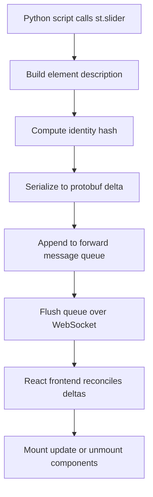

# Streamlit's Internal State Machine: How Widgets Become Protobuf Deltas

## English

When you call st.slider, Streamlit does not render HTML directly. Instead, the Python process builds an internal description of the element — its type, label, min/max, current value, and a stable identity hash — serializes it into a Protocol Buffer message, and appends it to a forward-message queue. At the end of the script run, that queue is flushed over the WebSocket to the browser, where a React frontend reconciles the deltas against its existing component tree. This is why widget identity matters so much: if the hash changes between runs, the frontend sees a 'new' widget and remounts it, losing focus, cursor position, and any client-side state.

The reconciliation is deliberately minimal. Streamlit's frontend keeps a map of element IDs to React components; when a delta arrives for an existing ID, it updates props in place; when a delta arrives for an unknown ID, it mounts a fresh component; when an ID disappears from the delta stream, the component unmounts. This is conceptually similar to React's virtual DOM diffing, but driven by the server rather than the client. The consequence is that layout containers like st.columns and st.container are themselves elements with IDs, and children are associated with parents via the delta's parent reference.

Understanding this pipeline explains several behaviours that otherwise look like bugs. A widget inside an st.expander that gets collapsed still exists in the tree — it just isn't visible — which is why its value survives collapsing. A widget whose label changes will get a new hash and therefore reset. A widget created inside a loop without an explicit key will collide with its siblings because the auto-generated identity is derived from the arguments passed to the widget command (its type, label, params, and any explicit key) — not from the loop variable, and not from its position in the widget tree.

The delta protocol also carries non-widget elements: st.markdown emits a markdown delta, st.dataframe emits a dataframe delta with a serialized Arrow buffer, st.plotly_chart emits a chart delta with the figure JSON. Because every element is a delta, the frontend never needs to know what a 'Streamlit app' is — it only needs to know how to render each delta type. This is why adding a new st.* function is mostly a frontend-plus-protobuf-schema change, not a server rewrite.

Finally, this explains the 'flicker' phenomenon people sometimes see on slow connections. When the script reruns, the frontend receives a fresh set of deltas for the same element IDs; if the new run produces structurally different output (say, a conditional branch now renders a chart where a table used to be), the old elements are unmounted and new ones mounted. The visual jump is not a bug — it is the reconciliation algorithm doing exactly what it was told.

## 中文

當你呼叫 st.slider 時，Streamlit 並唔會直接產生 HTML。相反，Python 程序會建立一個元素嘅內部描述——包括型別、標籤、min/max、當前值，同埋一個穩定嘅身份雜湊——將佢序列化成 Protocol Buffer 訊息，再附加到一個 forward-message 佇列。指令碼執行完之後，呢個佇列會經 WebSocket 送到瀏覽器，React 前端會將啲 delta 同現有元件樹做 reconciliation（協調）。呢個就係點解 widget 身份咁重要：如果雜湊喺兩次執行之間變咗，前端就會當佢係「新」元件，重新掛載，焦點、遊標位置同任何客戶端狀態都會冇咗。

呢個協調過程刻意做到最精簡。Streamlit 前端維護一個 element ID 到 React 元件嘅對映；當收到現有 ID 嘅 delta，就原地更新 props；收到未知 ID 嘅 delta，就掛載新元件；當某個 ID 唔再出現喺 delta 流，就解除安裝。概念上好似 React 嘅 virtual DOM diffing，不過係由伺服器驅動而唔係客戶端。結果係，st.columns 同 st.container 呢啲佈局容器本身都係有 ID 嘅元素，子元素透過 delta 嘅 parent 引用同父層關聯。

明白呢條管線，就解釋咗幾個睇落似 bug 嘅行為。收埋咗嘅 st.expander 入面嘅 widget 其實仲喺樹入面——只不過唔可見——所以佢嘅值喺收埋再展開之後仍然存在。改咗 label 嘅 widget 會得到新雜湊，因此會被重置。喺迴圈入面冇明確 key 嘅 widget 會同兄弟撞，因為自動生成嘅身份係由傳畀 widget 指令嘅引數衍生（型別、label、各項參數同任何明確 key），而唔係由迴圈變數衍生，亦唔係由佢喺 widget 樹裡嘅位置衍生。

delta 協議亦會攜帶非 widget 元素：st.markdown 發 markdown delta，st.dataframe 發帶序列化 Arrow buffer 嘅 dataframe delta，st.plotly_chart 發帶 figure JSON 嘅 chart delta。因為每個元素都係 delta，前端根本唔需要知咩叫「Streamlit app」——佢只需要知點樣渲染每種 delta 型別。呢個就係點解新增一個 st.* 函式主要係前端加 protobuf schema 嘅改動，而唔係重寫伺服器。

最後，呢個亦解釋咗慢網路下有時見到嘅「閃爍」現象。指令碼重跑時，前端會收到同一批 element ID 嘅新 delta 集；如果新一輪嘅輸出結構唔同（例如條件分支而家渲染圖表而唔係表格），舊元素會被解除安裝、新元素會被掛載。視覺上嘅跳動唔係 bug——係協調演算法忠實執行指令嘅結果。

## Key Takeaway

Streamlit's frontend is a delta-reconciler, not a page renderer, so widget identity and structural stability are what keep your UI from flickering or resetting.

## Related Concepts
- Protocol Buffers
- React reconciliation

## Diagram

