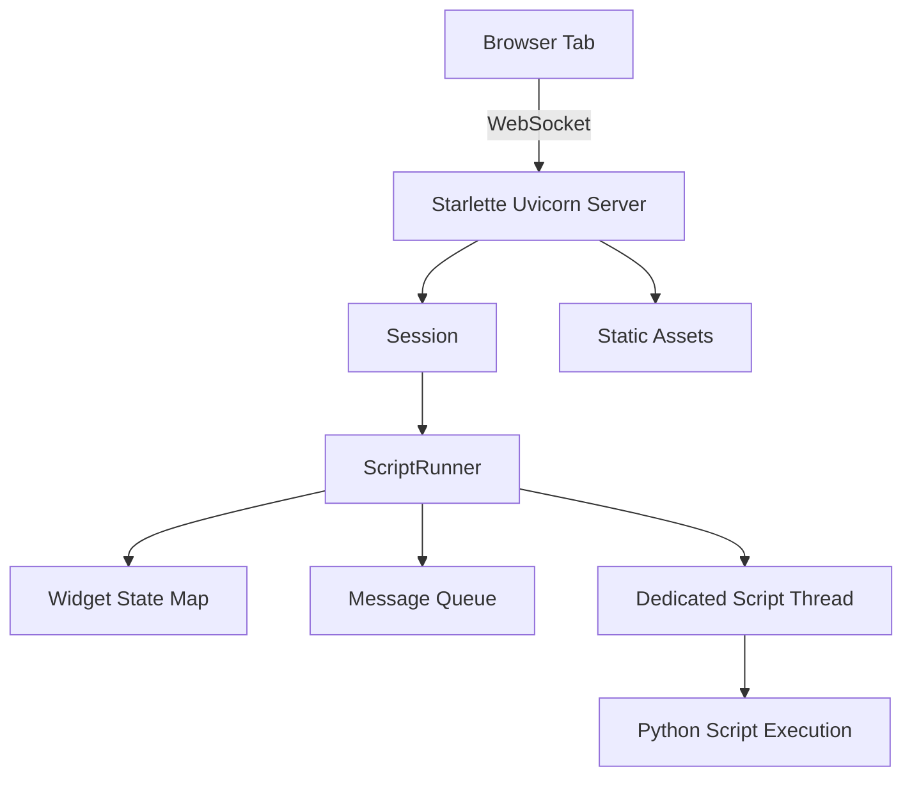

# Streamlit's Runtime Environment: The ASGI Server, Threads, and the ScriptRunner

## English

A running Streamlit app is not a single process doing one thing. At its core sits a Starlette/Uvicorn ASGI server that serves the static frontend assets (the React bundle, CSS, fonts) and upgrades WebSocket connections. (Streamlit 1.57.0 replaced the older Tornado server with Starlette/Uvicorn as the default; the Tornado-based server is no longer the one serving current apps.) Each browser tab that loads the app opens one WebSocket, and the server creates a Session object to represent that connection. The Session owns a ScriptRunner, which is the thing that actually executes your Python script. So the mental model is: one ASGI server, many Sessions, one ScriptRunner per Session, and your script runs inside the ScriptRunner's context.

The ScriptRunner is not a thread in the sense of 'a thread that runs your script forever'. It is a stateful object that, on each rerun request, compiles and executes your script in a fresh module namespace. Between runs it holds the compiled code, the widget state map, and the message queue. When a widget event arrives over the WebSocket, the Session forwards it to the ScriptRunner, which updates the widget state and triggers a rerun. This is why two browser tabs are isolated: each has its own ScriptRunner with its own widget state, even though they share the same Python process.

The execution itself happens on a dedicated script thread — each Session's ScriptRunner spawns its own thread, separate from the server's event loop. This matters because your script might block for seconds — running a pandas groupby, calling an LLM, hitting a database — and you do not want that to freeze the server's ability to accept new connections or serve static assets. The server's event loop continues handling WebSocket frames while your script blocks. The trade-off is that a single Session's script runs are serialized: if a rerun is already in flight when a new event arrives, the new event is queued, not run concurrently within that Session.

This is also where st.cache_data and st.cache_resource live. The cache stores are process-global, keyed by a hash of the function's code plus its arguments. When two Sessions call the same cached function with the same arguments, the cache store is shared — but st.cache_data returns a copy of the cached value to each caller (a pickle round-trip), which is exactly why it is safe against accidental mutation. Only st.cache_resource hands back the same shared instance to every session, which is why it is appropriate for things like database connection pools or loaded ML models, and why you must be careful about thread safety in resources that multiple Sessions may touch concurrently. The cache store itself is not per-Session; it is per-process.

Understanding this layout clarifies deployment concerns. Running `streamlit run app.py` starts one Tornado process; scaling to many users means either running multiple processes behind a load balancer (with sticky sessions if you rely on WebSocket affinity) or using a platform that handles this for you. It also explains why `--server.maxUploadSize`, `--server.port`, and `--server.enableCORS` are server-level flags: they configure Tornado, not your script. And it explains why killing the process kills every Session at once — there is no per-user process to survive.

## 中文

一個執行緊嘅 Streamlit app 唔係單一程序做一件事。佢核心係一個 Starlette/Uvicorn ASGI 伺服器，負責提供靜態前端資源（React bundle、CSS、字型），同埋將 WebSocket 連線升級。（由 Streamlit 1.57.0 開始，舊有嘅 Tornado 伺服器已經由 Starlette/Uvicorn 取代做預設伺服器。）每個載入 app 嘅瀏覽器分頁會開一條 WebSocket，伺服器會建立一個 Session 物件代表嗰條連線。Session 擁有一個 ScriptRunner，先至係真正執行你 Python 指令碼嘅嘢。所以心智模型係：一個 ASGI 伺服器、好多個 Session、每個 Session 一個 ScriptRunner，而你嘅指令碼喺 ScriptRunner 嘅 context 入面跑。

ScriptRunner 唔係「一條永遠跑你指令碼嘅 thread」嗰種意義上嘅 thread。佢係一個有狀態嘅物件，每次收到重跑請求，就會喺一個全新嘅 module namespace 入面編譯同執行你嘅指令碼。兩次執行之間，佢會儲存已編譯嘅程式碼、widget 狀態對映，同埋訊息佇列。當 widget 事件經 WebSocket 到達，Session 會轉發俾 ScriptRunner，後者更新 widget 狀態並觸發重跑。呢個就係點解兩個瀏覽器分頁係隔離嘅：每個都有自己嘅 ScriptRunner 同自己嘅 widget 狀態，即使佢哋共用同一個 Python 程序。

執行本身係喺一條專用嘅 script thread 上面發生——每個 Session 嘅 ScriptRunner 會開自己嘅 thread，同伺服器嘅 event loop 分開。呢點好重要，因為你嘅指令碼可能阻塞幾秒——跑 pandas groupby、呼叫 LLM、打資料庫——你唔想佢凍結伺服器接受新連線或者提供靜態資源嘅能力。你指令碼阻塞緊嘅時候，伺服器嘅 event loop 繼續處理 WebSocket frame。代價係單一 Session 嘅指令碼執行係序列化嘅：如果新事件到達時已經有一個重跑進行緊，新事件會排隊，而唔會喺同一個 Session 入面並行執行。

st.cache_data 同 st.cache_resource 亦係喺呢度。快取儲存係程序全域性嘅，以函式程式碼加引數嘅雜湊做 key。當兩個 Session 用相同引數呼叫同一個已快取函式，佢哋共享同一個快取儲存——但 st.cache_data 會將快取值複製一份（經過 pickle 往返）交返畀每個呼叫者，正因如此佢對意外修改係安全嘅。只有 st.cache_resource 會將同一個共享實例交畀每一個 session，呢個就係點解佢適合用喺資料庫連線池或者已載入嘅 ML 模型，亦係點解你要小心多個 Session 可能同時touch 嘅資源嘅 thread safety。快取儲存本身唔係 per-Session，係 per-process。

明白呢個佈局就釐清咗部署上嘅考慮。跑 `streamlit run app.py` 會啟動一個 Streamlit 程序（伺服器層係 Starlette/Uvicorn）；擴充套件到好多使用者，就要麼喺負載均衡器後面跑多個程序（如果你依賴 WebSocket affinity 就要 sticky sessions），要麼用一個幫你處理呢啲嘅平臺。呢個亦解釋咗點解 `--server.maxUploadSize`、`--server.port`、`--server.enableCORS` 係伺服器層級嘅 flag：佢哋配置伺服器本身，而唔係你嘅指令碼。亦解釋咗點解殺咗個程序會一次過殺死所有 Session——冇 per-user 程序可以生存。

## Key Takeaway

A Streamlit deployment is one ASGI server (Starlette/Uvicorn since 1.57.0) multiplexing many Sessions, each with its own ScriptRunner and its own script thread, sharing a process-global cache — and that layout dictates your scaling and thread-safety decisions.

## Related Concepts
- ASGI servers
- per-Session script threads

## Diagram

