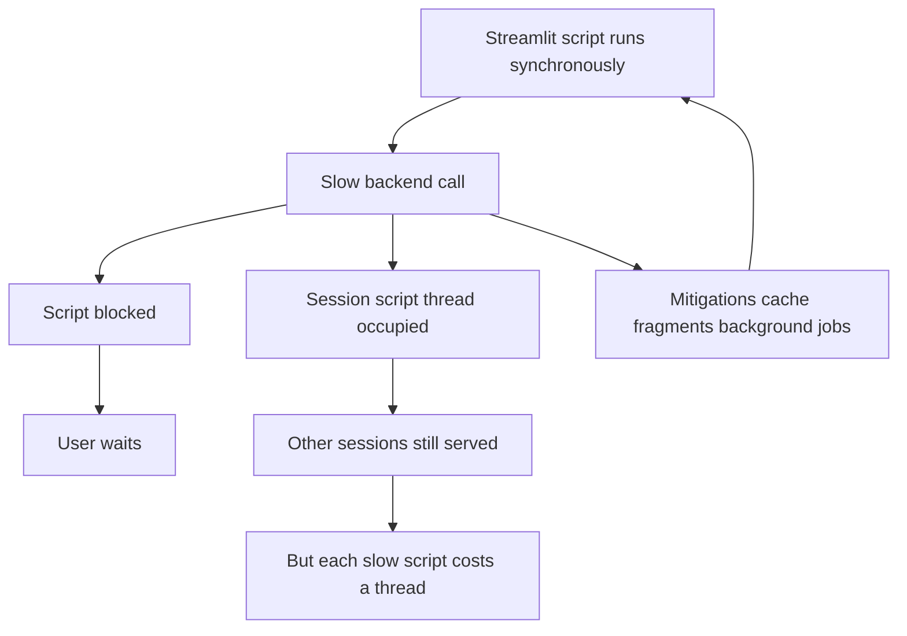

# Connecting Streamlit to Slow Backends: Async, Threads, and the Blocking Trap

## English

Streamlit scripts are synchronous by default. You write top-level code, it runs to completion, and the browser waits. That is fine for a pandas filter but painful when you call an LLM that takes eight seconds, or a REST API that occasionally hangs. The naive fix — wrapping the call in asyncio.run — often makes things worse, because Streamlit's ScriptRunner is not itself an asyncio event loop, and nesting event loops inside a synchronous script is a recipe for 'this event loop is already running' errors or silent deadlocks. Understanding why requires separating two questions: what is blocking the script, and what is blocking the server?

Blocking the script is the obvious one: your rerun takes longer, the spinner spins longer, the user waits. Blocking the server is subtler. Because script execution happens on the Session's own script thread while the server's event loop runs separately, a slow script does not stop other Sessions from being served. Each Session gets its own thread rather than drawing from a shared bounded pool, so there is no fixed worker-pool capacity to exhaust — but every extra slow script still costs a thread and memory, so a flood of concurrent long-running scripts will still degrade the process. This is why heavy synchronous work inside a Streamlit app is a scaling concern, not just a UX concern.

The idiomatic answers are three. First, cache aggressively: st.cache_data for pure functions of arguments (API responses keyed by query), st.cache_resource for clients and connection pools. Second, push slow work into fragments (st.fragment) so that only a small part of the page reruns when that specific piece of data refreshes, rather than the whole script. Third, for genuinely long jobs — training runs, batch exports — decouple: kick off work in a background process or task queue (Celery, RQ, a cloud job), store the result somewhere durable, and have the Streamlit app poll or read the result. Streamlit is a presentation layer, not a job runner.

When you do need async, the supported pattern is to run an asyncio event loop in a dedicated thread and submit coroutines to it via asyncio.run_coroutine_threadsafe, then block on the returned Future. That gives you a single long-lived loop without nesting, and it plays nicely with libraries that expect a persistent loop (some HTTP clients, some database drivers). The alternative — using a library's synchronous API — is often simpler and perfectly adequate; async is not a virtue in itself, it is a tool for I/O concurrency, and Streamlit already gives you concurrency across Sessions.

A related trap is timeouts. Because the script is synchronous, a hung backend call hangs the rerun indefinitely unless you set explicit timeouts on the client (requests' timeout parameter, database connection timeouts, LLM SDK timeout settings). There is no framework-level watchdog that will kill a stuck script run for you. Treat every external call as if it might hang, set a timeout, and surface the failure to the user with st.error or st.warning rather than letting the spinner spin forever. That single habit prevents most 'the app is frozen' reports.

## 中文

Streamlit 指令碼預設係同步嘅。你寫頂層程式碼，佢跑到完，瀏覽器就等。對 pandas 過濾冇問題，但當你呼叫一個要八秒嘅 LLM，或者一個偶爾會 hang 嘅 REST API，就好痛苦。天真嘅修法——用 asyncio.run 包住個呼叫——好多時會令情況更差，因為 Streamlit 嘅 ScriptRunner 本身唔係 asyncio event loop，喺同步指令碼入面巢狀 event loop 係「this event loop is already running」錯誤或者靜默死鎖嘅溫床。要明白點解，就要分開兩個問題：乜嘢阻塞咗指令碼，同乜嘢阻塞咗伺服器？

阻塞指令碼係明顯嗰個：你嘅重跑耐咗，spinner 轉耐咗，使用者等耐咗。阻塞伺服器就微妙啲。因為指令碼執行喺 Session 自己嘅 script thread 上面，而伺服器嘅 event loop 係分開嘅，一個慢指令碼唔會阻止其他 Session 被服務。每個 Session 有自己嘅 thread，而唔係由一個有上限嘅共享 thread pool 抽取，所以冇固定嘅 worker 容量會被耗盡——但每多一個慢指令碼，仍然會多佔一條 thread 同記憶體，所以大量長時間執行嘅指令碼同時湧入，程序一樣會變差。呢個就係點解 Streamlit app 入面嘅重型同步工作係擴充套件問題，唔止係 UX 問題。

慣用嘅答案有三個。第一，積極快取：st.cache_data 用喺引數嘅純函式（以查詢做 key 嘅 API 回應），st.cache_resource 用喺 client 同連線池。第二，將慢工作推入 fragment（st.fragment），咁樣當嗰舊特定資料重新整理時，只有頁面一小部分重跑，而唔係成個指令碼。第三，對於真正長時間嘅工作——訓練、批次匯出——解耦：喺背景程序或者任務佇列（Celery、RQ、雲端 job）啟動工作，將結果存喺持久地方，然後 Streamlit app 輪詢或者讀取結果。Streamlit 係展示層，唔係 job runner。

當你真係需要 async，受支援嘅模式係喺一個專用 thread 跑 asyncio event loop，透過 asyncio.run_coroutine_threadsafe 提交 coroutine，然後喺返嚟嘅 Future 上面阻塞。咁你就有一個單一長壽 loop 而唔使巢狀，亦同啲期望持久 loop 嘅 library（某啲 HTTP client、某啲資料庫 driver）配合得好。另一個做法——用 library 嘅同步 API——通常更簡單而且完全夠用；async 本身唔係美德，佢係 I/O 併發嘅工具，而 Streamlit 已經喺 Session 之間俾咗你併發。

相關嘅陷阱係 timeout。因為指令碼係同步嘅，一個 hang 咗嘅後端呼叫會無限期 hang 住個重跑，除非你喺 client 設定明確 timeout（requests 嘅 timeout 引數、資料庫連線 timeout、LLM SDK 嘅 timeout 設定）。冇框架層級嘅 watchdog 會幫你殺死一個卡住嘅指令碼執行。將每個外部呼叫都當佢可能會 hang，設定 timeout，用 st.error 或者 st.warning 將失敗呈現俾使用者，而唔係俾個 spinner 永恆咁轉。呢個單一習慣就防止咗大部分「app 凍結咗」嘅報告。

## Key Takeaway

Treat every external call as potentially hanging, cache and fragment what you can, and decouple genuinely long jobs — Streamlit's synchronous script model means you own the timeouts.

## Related Concepts
- asyncio.run_coroutine_threadsafe
- st.fragment

## Diagram

