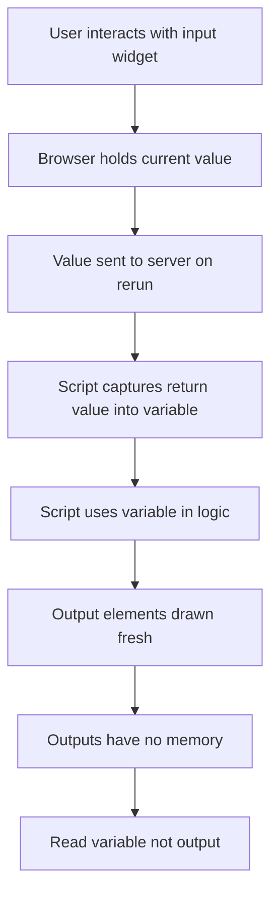

# Input Widgets Versus Output Elements: Who Owns the Truth

## English

One of the most useful mental models in Streamlit is the split between input widgets and output elements, because they behave in fundamentally opposite ways. Input widgets — things like st.slider, st.text_input, st.selectbox, st.checkbox, st.radio, st.number_input — are stateful in the sense that the browser holds a current value for each one, and that value is sent back to the server on every interaction. Output elements — st.write, st.markdown, st.dataframe, st.pyplot, st.metric, st.line_chart — are purely presentational. They have no memory. On each rerun the script throws away the previous render and draws fresh output elements from scratch.

The practical consequence is that you should never try to 'read back' what an output element is showing. If you call st.dataframe(df) and later want to know what df contains, you look at the Python variable df, not at the widget. Conversely, if you want the user's latest slider position, you must capture the return value of st.slider into a variable (or read st.session_state if you gave it a key). The slider's value lives in the browser and in Streamlit's internal widget state; your script only sees it when you ask for it.

A second consequence is the default-value trap that catches almost everyone. If you write st.slider('x', 0, 10) with no key and no explicit value capture, then every rerun re-creates the slider with default value 0 — but Streamlit remembers the user's last position via widget identity, so the user sees their own value while your script may see something different if you are not careful about how you read it. The safe pattern is always: value = st.slider(...) and then use value. Never assume the widget 'wrote into' some global.

This split also explains why output elements are cheap to re-create and why you should not fear calling st.write many times. Each call appends a new element to the current run's element tree; the frontend diffs that tree against the previous one and updates the DOM. There is no hidden cost to re-declaring an output element, but there is a real cost to re-computing the expensive data that feeds it — which is exactly what caching is for.

Finally, this model gives you a clean rule for where to put logic. Anything that depends on user input must run after the input widget has been declared, and anything that produces visible output must run before the script finishes. If you find yourself writing code that 'checks what the chart is showing', stop — you have confused an output for a variable, and the fix is to keep the underlying data in a normal Python variable or in st.session_state.

## 中文

Streamlit 入面一個非常有用嘅心智模型，就係將「輸入組件」同「輸出元素」分開嚟睇，因為佢哋嘅行為基本上係相反嘅。輸入組件——例如 st.slider、st.text_input、st.selectbox、st.checkbox、st.radio、st.number_input——係有狀態嘅，意思係瀏覽器會為每一個組件保留一個當前值，而每次互動都會將嗰個值傳返去伺服器。輸出元素——例如 st.write、st.markdown、st.dataframe、st.pyplot、st.metric、st.line_chart——就純粹係展示用，完全冇記憶。每次重新運行，腳本都會丟棄上一次嘅渲染結果，由零開始重新繪製輸出元素。

實際後果就係：你永遠唔應該試圖「讀返」一個輸出元素而家顯示緊乜。如果你呼叫 st.dataframe(df)，之後想知 df 入面有咩，你應該睇 Python 變數 df，而唔係睇個組件。反過來講，如果你想知用戶最新嘅 slider 位置，你必須將 st.slider 嘅回傳值捕捉落一個變數（或者如果你俾咗 key，就讀 st.session_state）。Slider 嘅值住喺瀏覽器同 Streamlit 內部嘅 widget 狀態入面；你嘅腳本只有喺你主動去攞嘅時候先會見到佢。

第二個後果就係幾乎人人都會踩中嘅「預設值陷阱」。如果你寫 st.slider('x', 0, 10)，冇 key 又冇明確捕捉回傳值，咁每次重新運行都會用預設值 0 重新建立個 slider——但 Streamlit 會透過 widget 身份記住用戶上一次嘅位置，所以用戶見到嘅係自己嘅值，而你嘅腳本如果唔小心處理讀取方式，就可能見到唔同嘅嘢。安全嘅做法永遠係：value = st.slider(...)，然後用 value。千萬唔好假設個組件會「寫入」某個全域變數。

呢個劃分亦都解釋咗點解輸出元素重建起上嚟好便宜，以及點解你唔應該怕呼叫 st.write 好多次。每次呼叫都會喺當前運行嘅元素樹上面加一個新元素；前端會將嗰棵樹同上一次嘅做 diff，然後更新 DOM。重新宣告一個輸出元素冇隱藏成本，但重新計算餵俾佢嘅昂貴數據就有真實成本——而呢個正正就係快取嘅用途。

最後，呢個模型俾你一條清晰嘅規則去決定邏輯放喺邊。任何依賴用戶輸入嘅嘢，都必須喺輸入組件宣告之後先至行；任何產生可見輸出嘅嘢，都必須喺腳本完結之前行。如果你發現自己寫緊「檢查張圖表而家顯示緊乜」嘅程式碼，停一停——你已經將輸出當咗做變數，解決方法就係將底層數據放喺普通 Python 變數或者 st.session_state 入面。

## Key Takeaway

Input widgets carry state and return values you must capture; output elements are stateless and re-drawn every run, so never try to read state back from them.

## Related Concepts
- Widget return values
- Streamlit element tree and DOM diffing

## Diagram

