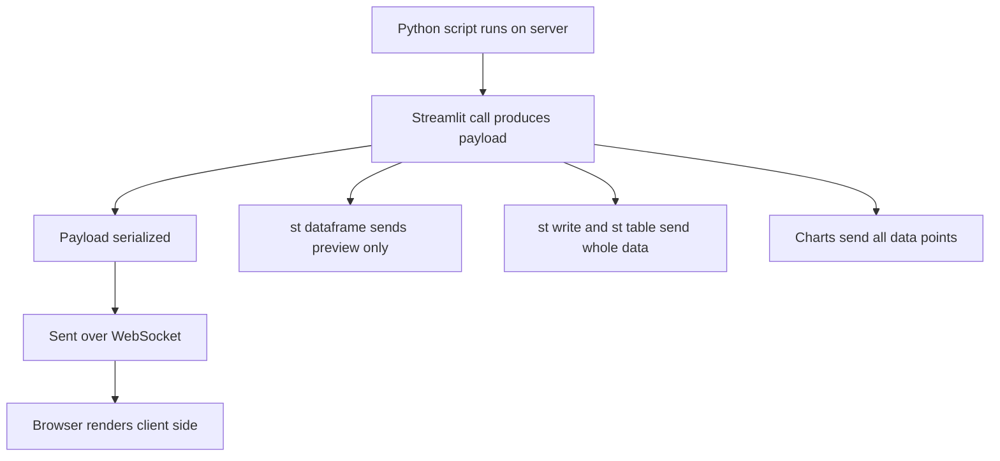

# Streamlit's Data Model: What 'Sending Data to the Browser' Actually Costs

## English

It is easy to forget that a Streamlit app is a client-server system: your Python script runs on a server, and the browser is a thin renderer that receives serialized descriptions of what to draw. Every st.dataframe, st.line_chart, st.image, or st.write call produces a payload that is serialized, sent over the WebSocket connection, and rendered client-side. Understanding this cost model turns vague 'my app feels slow' complaints into concrete, fixable problems.

Consider st.dataframe(big_df). By default Streamlit does not ship the entire dataframe to the browser; it sends a preview, and the frontend requests more rows as the user scrolls. That is why a million-row dataframe can render in a fraction of a second — the initial payload is small. But some operations defeat this. Calling st.write(big_df) or st.table(big_df) materializes the whole thing, and st.table in particular is intended for small, static tables. Similarly, st.dataframe(df) where df has thousands of columns will still be slow because column metadata is large. The fix is to select the columns you need before display, not after.

Charts have their own cost profile. st.line_chart and st.bar_chart accept a dataframe and serialize its data points to the browser, where Vega-Lite renders them. If you pass a dataframe with a million rows, you are sending a million points across the wire on every rerun. The standard remedy is to aggregate or downsample before charting — for example, resample a time series to hourly or daily buckets — and to cache the aggregation so it is not recomputed on every slider drag. For very large data, consider letting the browser fetch data via a custom component or serving a pre-aggregated file.

Images and media are another common surprise. st.image accepts a PIL image, a NumPy array, a file path, or bytes. Each of these is converted to bytes and base64-encoded inside the payload, which inflates size by roughly a third. Re-reading a large image from disk on every rerun is wasteful; loading it once into a cached function (st.cache_data) and reusing the returned object is the right pattern. The same logic applies to st.audio and st.video.

A useful habit is to think of every Streamlit call as having two costs: the Python-side cost of preparing the argument, and the wire-side cost of serializing and shipping it. Caching addresses the first; choosing the right display primitive and pre-aggregating addresses the second. When an app feels sluggish, ask which of the two you are paying for — the answer usually points directly at the fix.

## 中文

好容易會忘記，Streamlit 應用其實係一個客戶端—伺服器系統：你嘅 Python 腳本喺伺服器上面行，而瀏覽器只係一個瘦渲染器，負責接收「要畫啲乜」嘅序列化描述。每一個 st.dataframe、st.line_chart、st.image 或者 st.write 呼叫，都會產生一份 payload，經序列化之後透過 WebSocket 連線傳送，再喺客戶端渲染。理解呢個成本模型，就可以將含糊嘅「我個 app 好慢」投訴，變成具體、可以修復嘅問題。

試諗 st.dataframe(big_df)。默認情況下 Streamlit 唔會將成個 dataframe 送去瀏覽器；佢只會送一個預覽，前端喺用戶捲動嘅時候先至要求更多行。呢個就係點解一百萬行嘅 dataframe 都可以喺零點幾秒內渲染——初始 payload 好細。但係有啲操作會破壞呢個優勢。呼叫 st.write(big_df) 或者 st.table(big_df) 會將成個嘢實體化，而 st.table 尤其係為細小、靜態嘅表格而設。同樣道理，如果 df 有幾千欄，st.dataframe(df) 都仍然會慢，因為欄位嘅 metadata 好大。解決方法係喺顯示之前先揀好你需要嘅欄，而唔係顯示之後先至揀。

圖表有自己嘅成本特性。st.line_chart 同 st.bar_chart 接受一個 dataframe，並將佢嘅數據點序列化去瀏覽器，由 Vega-Lite 負責渲染。如果你傳一個一百萬行嘅 dataframe，你就係每次重新運行都將一百萬個點送過網絡。標準補救方法係喺畫圖之前先做聚合或者降採樣——例如將時間序列重採樣做每小時或者每日嘅桶——並且將聚合結果快取起嚟，咁就唔會每次拖 slider 都重新計一次。對於極大量數據，可以考慮用自訂組件俾瀏覽器自己攞數據，或者提供一個預先聚合好嘅檔案。

圖片同媒體係另一個常見嘅意外。st.image 接受 PIL 圖片、NumPy 陣列、檔案路徑或者 bytes。以上每一種都會被轉換成 bytes 並喺 payload 入面做 base64 編碼，令大小膨脹大約三分之一。每次重新運行都由磁碟重新讀取一張大圖係好浪費嘅；正確做法係將佢載入一次到快取函數（st.cache_data）然後重用回傳嘅物件。同樣邏輯適用於 st.audio 同 st.video。

一個有用嘅習慣，係將每一個 Streamlit 呼叫都睇成有兩種成本：準備參數嘅 Python 端成本，同埋序列化同傳送佢嘅網絡端成本。快取針對第一種；揀啱顯示原語同預先聚合針對第二種。當個 app 覺得卡嘅時候，問吓自己你係俾緊邊一種成本——答案通常就直接指向解決方法。

## Key Takeaway

Every display call has a Python-side preparation cost and a wire-side serialization cost; cache the former and shrink the latter by choosing the right primitive and pre-aggregating.

## Related Concepts
- Data serialization over WebSocket
- Downsampling and aggregation before display

## Diagram

