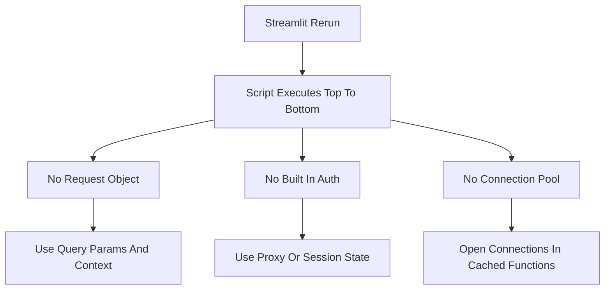

# Streamlit's Hidden Constraints: What the Framework Does Not Do For You

## English

Streamlit is deliberately opinionated, and the fastest way to become productive with it is to learn its boundaries — the things it will not do, and the things you must not assume. These constraints are not bugs; they are consequences of the rerun model, and knowing them prevents a whole class of frustrating debugging sessions.

First, there is no request object. In a traditional web framework you would read query parameters, headers, cookies, or the request body from an incoming request. Streamlit does expose some of this — st.query_params gives you URL query parameters, and st.context (in recent versions) exposes headers and cookies — but the mental model is different: these are read at the top of the script on each rerun, not handled by a route function. There is no router, no URL-to-function mapping, and no notion of a 'POST handler'. If you need true REST endpoints alongside your app, you run a separate service (FastAPI, Flask) and have Streamlit call it.

Second, there is no per-user authentication layer built in. Streamlit gives you a session per browser tab, but it does not know who the user is. If your app must be restricted, you either put it behind a reverse proxy that handles authentication (OAuth2 proxy, an identity-aware proxy, or your company's SSO gateway), or you implement a login form yourself and store the authenticated flag in st.session_state. The latter is fine for internal tools but is not a substitute for real auth — anyone who can reach the port can run the script.

Third, there is no built-in database connection pool or ORM. Each rerun is a fresh execution of your script, so naively opening a database connection at the top of the file will open a new connection on every interaction. The correct pattern is to open connections inside a function decorated with st.cache_resource, which caches the object across reruns and sessions, and to be careful about thread safety because Streamlit may execute script runs concurrently across sessions. Similar reasoning applies to model loading: load the model once with st.cache_resource, not on every run.

Fourth, there is no client-side routing or JavaScript escape hatch by default. If you need a rich interactive widget that Streamlit does not provide — a drag-and-drop canvas, a complex map with custom layers — you build a custom component (a small React or plain-JS bundle that talks to Python via a defined protocol). This is powerful but is a real project, not a one-liner.

Knowing these limits lets you choose Streamlit for what it is excellent at — data apps, dashboards, internal tools, prototypes — and reach for other tools when you need them. The worst outcome is fighting the framework to do something it was never designed for; the best is composing Streamlit with the right neighbours.

## 中文

Streamlit 係刻意有主見嘅框架，而最快上手嘅方法，就係學識佢嘅邊界——佢唔會做嘅嘢，以及你唔可以假設嘅嘢。呢啲限制唔係 bug；佢哋係重跑模型嘅必然結果，而認識佢哋可以避免一整類令人沮喪嘅除錯過程。

第一，冇 request 物件。喺傳統 web 框架入面，你會由一個傳入嘅 request 讀取 query 參數、headers、cookies 或者 request body。Streamlit 的確有暴露部分呢啲嘢——st.query_params 俾你 URL query 參數，而 st.context（喺較新版本）會暴露 headers 同 cookies——但心智模型係唔同嘅：呢啲嘢係喺每次重跑嘅時候喺腳本頂部讀取，而唔係由一個 route 函數處理。冇 router、冇 URL 對應函數嘅映射、亦都冇「POST handler」呢個概念。如果你需要真正嘅 REST endpoint 同 app 並存，你應該另外跑一個服務（FastAPI、Flask），再由 Streamlit 去呼叫佢。

第二，冇內建嘅逐用戶認證層。Streamlit 會為每個瀏覽器分頁俾一個 session，但佢唔知用戶係邊個。如果你個 app 要限制存取，你要麼將佢放喺一個處理認證嘅反向代理後面（OAuth2 proxy、identity-aware proxy，或者你公司嘅 SSO gateway），要麼自己實作一個登入表單，並將已認證嘅標記存喺 st.session_state。後者對內部工具嚟講冇問題，但唔可以代替真正嘅認證——任何去到個 port 嘅人都可以行你個腳本。

第三，冇內建嘅資料庫連線池或者 ORM。每次重跑都係你腳本嘅一次全新執行，所以天真咁喺檔案頂部開一個資料庫連線，就會每次互動都開一個新連線。正確做法係喺一個用 st.cache_resource 裝飾嘅函數入面開連線，咁就可以跨重跑同跨 session 快取嗰個物件，同時要小心執行緒安全，因為 Streamlit 可能會跨 session 並發執行腳本。同樣道理適用於模型載入：用 st.cache_resource 載入一次模型，而唔係每次都載。

第四，默認情況下冇客戶端路由，亦都冇 JavaScript 逃生門。如果你需要一個 Streamlit 冇提供嘅豐富互動組件——例如拖放畫布、有自訂圖層嘅複雜地圖——你就要建立一個自訂組件（一個細小嘅 React 或者純 JS bundle，透過既定協議同 Python 溝通）。呢個好強大，但係一個真正嘅項目，唔係一行 code 搞得掂。

認識呢啲限制，就可以幫你喺 Streamlit 擅長嘅地方用佢——數據應用、儀表板、內部工具、原型——而需要嘅時候轉用其他工具。最差嘅結果係同框架搏鬥，逼佢做佢從來冇設計過嘅嘢；最好嘅結果係將 Streamlit 同啱嘅鄰居組合埋一齊。

## Key Takeaway

Streamlit deliberately omits routing, built-in auth, connection pooling, and client-side scripting; design around those gaps by composing it with proxies, separate services, and cached resources.

## Related Concepts
- Reverse proxy authentication
- st.cache_resource for connection and model objects

## Diagram

