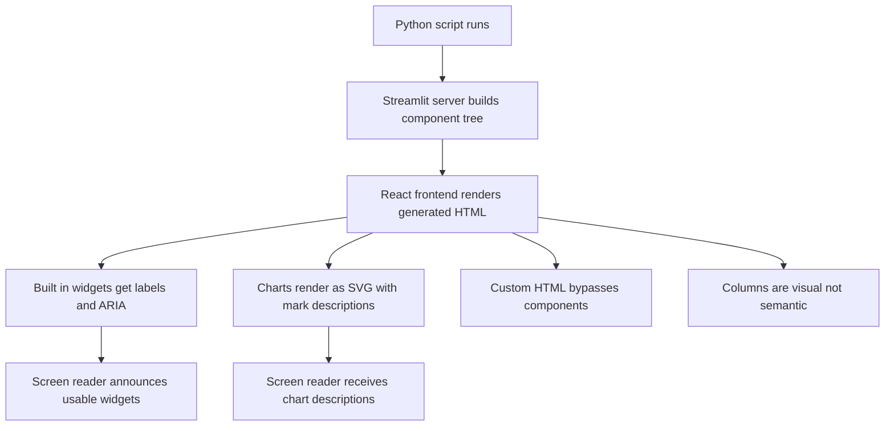

# Streamlit's Accessibility and HTML Semantics: What Screen Readers Actually Receive

## English

Streamlit renders its UI as a React single-page application that speaks a custom protocol to the server. That means the HTML your browser receives is not hand-written markup with semantic tags like <h1>, <label for>, or <table>; it is a tree of generated components that Streamlit's frontend library decides how to render. For sighted mouse users this is invisible. For a screen reader user, it decides everything: whether a slider announces its current value and label, whether a chart has a text alternative, whether keyboard focus lands somewhere sensible after a rerun. Understanding this layer helps you build apps that more people can actually use.

The good news is that Streamlit does invest in baseline accessibility. Most built-in widgets render as real interactive elements (buttons as buttons, text inputs as inputs) with associated labels, and the framework ships with ARIA attributes on many components. Keyboard navigation generally works: Tab moves between widgets, Enter activates buttons, arrow keys adjust sliders. So a Streamlit app is not automatically inaccessible; it is accessible to the degree that the specific widgets you chose were implemented well.

The weak spots are worth knowing. Streamlit's built-in plotting wrappers do not leave screen readers empty-handed: the charts render as SVG via Vega-Lite, and each mark carries a screen-reader description generated from the underlying data. The canvas renderer is only used as a fallback above roughly 2,000 marks per row (and `config.mark.aria` can be disabled above 5,000 rows), so the accessibility degradation is a high-volume edge case rather than the default. On top of that, `st.altair_chart`, `st.line_chart` and friends accept an `alt=` parameter where you can supply your own text alternative, so a descriptive sentence for a chart is always within reach. The genuine weak spots are elsewhere: custom HTML injected via st.markdown with unsafe_allow_html=True bypasses Streamlit's component system entirely, and you become responsible for any semantics or ARIA you need. st.columns is a visual layout primitive, not a semantic one; it does not announce as a region or a group, so a user tabbing through cannot tell that two widgets belong to the same logical section. Dynamic content that appears after a rerun is not automatically announced unless focus moves or a live region is present.

A practical approach: treat accessibility as part of your data-display decision, not an afterthought. If a number matters, also show it as text via st.metric or st.write alongside the chart, because a screen reader reads text more fluently than it reads a chart description. And when a chart is the primary carrier of meaning, pass `alt=` to the chart call (`st.altair_chart`, `st.line_chart` and friends) to give it an explicit text alternative. Give every input a clear label argument rather than relying on adjacent markdown, since the label is what gets wired to the control. Keep forms linear where possible; deep column nesting makes tab order confusing even for sighted keyboard users. Test with a screen reader for ten minutes on one screen; it will tell you more than any checklist.

Finally, remember that Streamlit's accessibility is a moving target tied to the frontend component library it uses. Specific ARIA behaviour can change between versions, so verify claims against your installed version rather than trusting a blog post. The durable principle is simpler: anything you can only perceive visually is invisible to some users, so pair every visual encoding with a textual one, and prefer built-in widgets over hand-rolled HTML when you can.

## 中文

Streamlit 會將 UI 渲染成一個 React 單頁應用，並用自家協議同伺服器溝通。即係話，你瀏覽器收到嘅 HTML 唔係人手寫嘅語意標記（例如 <h1>、<label for>、<table>），而係由 Streamlit 前端庫決定點樣渲染嘅一棵生成組件樹。對用滑鼠嘅視力正常用戶嚟講，呢層完全睇唔到；但對螢幕閱讀器用戶嚟講，呢層決定咗一切：滑桿會唔會報出自己嘅值同標籤、圖表有冇文字替代、重跑之後鍵盤焦點會唔會落到合理嘅位置。理解呢一層，先至寫得出更多人真正用到嘅應用。

好消息係 Streamlit 確實有做基本嘅無障礙支援。大部分內置組件會渲染成真正嘅互動元素（按鈕就係 button、文字輸入就係 input），並且帶有關聯標籤；框架亦為好多組件加上 ARIA 屬性。鍵盤導航一般行得通：Tab 喺組件之間移動、Enter 啟動按鈕、方向鍵調整滑桿。所以 Streamlit 應用唔係天生就唔無障礙；佢嘅無障礙程度，取決於你揀嘅嗰個組件本身實作得有幾好。

弱點就值得留意。不過 Streamlit 內置嘅繪圖封裝唔會令螢幕閱讀器兩手空空：圖表係經 Vega-Lite 渲染成 SVG，每個 mark 都帶有根據底層數據生成嘅螢幕閱讀器描述。canvas 渲染器只係喺每行超過大約 2,000 個 mark 時先會用（而 `config.mark.aria` 喺超過 5,000 行時可以關閉），所以無障礙程度下降係高數量量嘅邊界情況，唔係預設行為。除此以外，`st.altair_chart`、`st.line_chart` 等函數都接受 `alt=` 參數，你可以自己提供文字替代描述，所以為圖表寫一句說明永遠做得到。真正嘅弱點喺其他地方：用 st.markdown 加 unsafe_allow_html=True 注入嘅自訂 HTML 會完全繞過 Streamlit 嘅組件系統，任何語意同 ARIA 都要你自己負責。st.columns 係視覺排版原語，唔係語意原語；佢唔會宣告成一個 region 或者 group，所以用戶用 Tab 行過時，根本唔知兩個組件屬於同一個邏輯區塊。重跑之後先出現嘅動態內容亦唔會自動被朗讀，除非焦點轉移或者有 live region。

實務做法係：將無障礙當成「點樣顯示數據」嘅一部分，而唔係事後補救。如果某個數字重要，就同時用 st.metric 或 st.write 以文字顯示，因為螢幕閱讀器讀文字流暢過讀圖表描述。而如果圖表係承載意思嘅主要媒介，就喺圖表呼叫（`st.altair_chart`、`st.line_chart` 等）傳入 `alt=`，為佢提供明確嘅文字替代描述。每個輸入都畀明確嘅 label 參數，唔好靠旁邊嘅 markdown，因為真正綁定到控件嘅係 label。盡量保持表單線性；欄位嵌套太深，連視力正常嘅鍵盤用戶都會迷失 Tab 次序。用螢幕閱讀器喺一個畫面試十分鐘，會比任何檢查清單教到你更多。

最後要記住，Streamlit 嘅無障礙程度係跟住佢前端組件庫走嘅移動目標。具體 ARIA 行為可能隨版本改變，所以要用你安裝嘅版本實測，唔好信網誌。耐久嘅原則反而簡單：凡係只能靠視覺感知嘅嘢，對某啲用戶就等於唔存在，所以每個視覺編碼都要配一個文字版本，而喺可以嘅情況下，寧願用內置組件，都唔好自己砌 HTML。

## Key Takeaway

Streamlit gives you decent baseline accessibility for built-in widgets, and its built-in charts render as accessible SVG with `alt=` text alternatives available; custom HTML and column layouts silently drop semantic information, so pair every visual with a textual equivalent.

## Related Concepts
- ARIA attributes
- screen reader navigation

## Diagram

