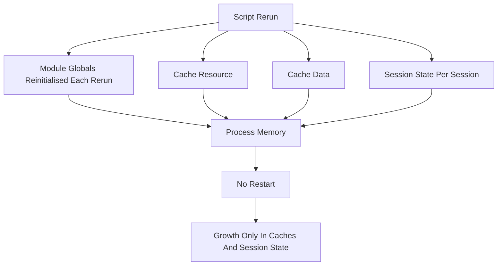

# The App as a Long-Lived Process: Memory, Leaks, and the Cost of Never Restarting

## English

A traditional web app forks a worker per request or reuses a pool, and each request's local variables die when the response is sent. A Streamlit server is different in a way that surprises people: the Python process stays alive for the whole lifetime of the deployment, and your script runs repeatedly inside it. Each rerun re-executes your script from a clean slate, so ordinary Python variables — including plain module-level globals — are re-initialised on every run rather than accumulating. What actually persists across reruns is narrower than it looks: `st.session_state`, which is scoped to a single session, and the caching decorators `st.cache_data` and `st.cache_resource`, whose caches are process-wide. That distinction is convenient and dangerous in equal measure.

Start with the obvious case: a module-level list that you append to on each run. In a script model, the script is re-executed top to bottom on every interaction, and because the script module is re-executed as a fresh namespace each time, module-level names are re-initialised on every rerun — that list starts empty again every time and never grows. The objects that really do accumulate are the ones you deliberately park in a persistent store: anything you cached with st.cache_resource or st.cache_data lives in a cache keyed by function and arguments, and that cache is process-wide, so a cached list that grows by one element per rerun will grow for every user, forever, until the process restarts. Values written into st.session_state likewise outlive a rerun and are shared across all reruns of that session. Memory used by the process is not reclaimed just because a session ended.

This matters most for the things data apps load: machine-learning models, large DataFrames, open file handles, database connections, and thread pools. A model loaded once and shared via st.cache_resource is exactly the right pattern — one copy in memory, all sessions reuse it. But a model loaded per session without caching, or a connection opened per rerun and never closed, will accumulate. Python's garbage collector will eventually free unreferenced objects, but a connection held by a cached object is referenced by the cache and never freed. Over days, a long-running deployment can drift from 300 MB to several gigabytes.

A practical discipline: decide for every expensive object whether it is (a) per-process, (b) per-session, or (c) per-rerun, and make that choice explicit. Per-process things go in st.cache_resource. Per-session things go in st.session_state, and you should think about what happens when the session ends — Streamlit will eventually clean up session state for disconnected sessions, but the timing is not something to rely on for resource release. Per-rerun things are plain local variables and are the safest default. Anything with a close() method deserves a with-block or an explicit cleanup path. If you use threads, they belong to the process, not the session, and should be created once and reused.

Finally, remember that the process is also where your logging, metrics, and background tasks live. Logs written to stdout accumulate in whatever collects them; background threads that never exit keep the process from shutting down cleanly. Treat your Streamlit app less like a script and more like a small service: know what lives for the whole process, know what dies with a session, and periodically check actual memory usage rather than assuming Python handles it. A restart is not a fix; it is a symptom that something was accumulating.

## 中文

傳統 Web 應用通常每個請求 fork 一個 worker，或者重用一個池，請求結束後本地變數就死。Streamlit 伺服器就唔同，而且好多人會詫異：Python 進程喺整個部署壽命期間一直存活，你嘅腳本喺裡面反覆執行。每次重跑都會由乾淨起點重新執行你嘅腳本，所以一般 Python 變數——包括單純嘅模組層級全域變數——都會喺每次執行時重新初始化，而唔係一直累積。真正跨重跑存活嘅嘢比想像中窄：`st.session_state`（範圍限於單一 session）同快取裝飾器 `st.cache_data`、`st.cache_resource`（快取係整個進程共用）。呢個分別既方便又危險。

先講最明顯嘅情況：一個模組層級嘅 list，你每次執行都 append。喺腳本模型下，每次互動腳本都會由頭到尾重新執行，而且因為腳本模組每次都以全新命名空間重新執行，模組層級嘅名會喺每次重跑時重新初始化——嗰個 list 每次都由空開始，永遠唔會增長。真正會累積嘅，係你刻意擺入持久化儲存嘅物件：任何你用 st.cache_resource 或 st.cache_data 快取咗嘅物件，都會住喺一個以函數同參數為 key 嘅快取入面，而嗰個快取係整個進程共用嘅，所以一個快取住嘅 list，會為每個用戶、永遠咁增長，直到進程重啟為止。寫入 st.session_state 嘅值同樣會比一次重跑活得耐，並喺嗰個 session 嘅所有重跑之間共用。進程佔用嘅記憶體唔會因為 session 結束就回收。

呢點對數據應用最常載入嘅嘢影響最大：機器學習模型、大型 DataFrame、開啟咗嘅檔案句柄、資料庫連線、執行緒池。用 st.cache_resource 載入一次再共用嘅模型，正正係正確做法——記憶體得一份，所有 session 共用。但每個 session 各自載入而唔快取嘅模型，或者每次重跑都開一條連線而從不關閉，就會累積。Python 嘅垃圾回收最終會釋放冇引用嘅物件，但被快取物件持有嘅連線係被快取引用住，永遠唔會釋放。跑幾日之後，一個長期部署可以由 300 MB 漂移到幾 GB。

實務紀律係：對每個昂貴物件，明確決定佢係 (a) 每個進程、(b) 每個 session、定 (c) 每次重跑，並且將呢個選擇寫明。每個進程嘅嘢放入 st.cache_resource。每個 session 嘅嘢放入 st.session_state，並且要諗清楚 session 結束時會點——Streamlit 最終會清理已斷線 session 嘅狀態，但時間點唔應該用作資源釋放嘅依據。每次重跑嘅嘢就係普通本地變數，係最安全嘅預設。任何有 close() 方法嘅嘢都應該用 with 區塊或者明確清理路徑。如果你用執行緒，佢哋屬於進程而唔屬於 session，應該建立一次然後重用。

最後要記住，進程亦係你嘅日誌、指標同背景任務所在。寫去 stdout 嘅日誌會喺收集佢嘅地方累積；永遠唔結束嘅背景執行緒會令進程唔能夠乾淨關閉。將你嘅 Streamlit 應用當成一個小型服務，而唔係一支腳本：知道乜嘢活足整個進程、乜嘢隨 session 而死，並且定期檢查實際記憶體用量，而唔係假設 Python 會搞掂。重啟唔係解決方法，而係有嘢一直累積嘅症狀。

## Key Takeaway

Your Streamlit app is one long-lived process, but each rerun re-initialises ordinary module-level variables; only `st.session_state` (per session) and the `st.cache_data` / `st.cache_resource` caches (process-wide) persist across reruns — classify every expensive object as per-process, per-session, or per-rerun, and watch memory over days.

## Related Concepts
- st.cache_resource
- process lifetime

## Diagram

