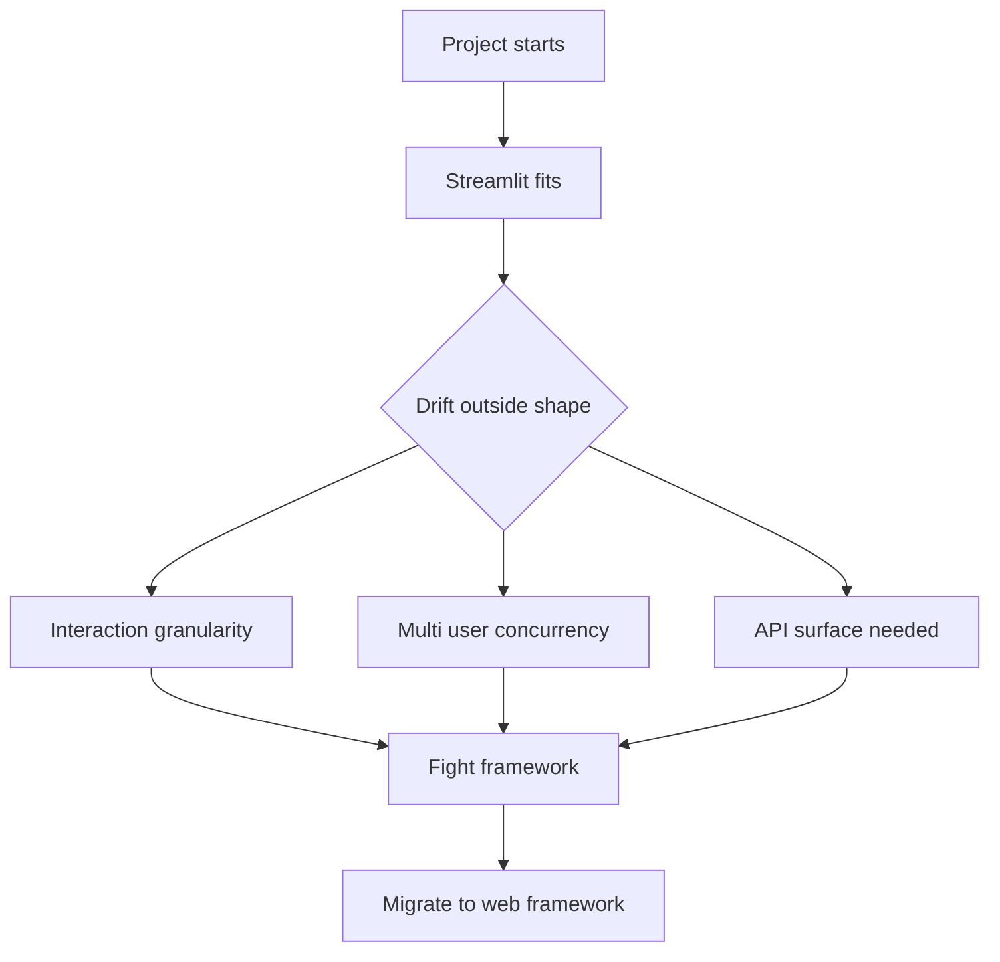

# When Streamlit Is the Wrong Tool: Boundaries, Alternatives, and Migration Signals

## English

Streamlit is optimised for a specific shape of problem: a small number of users, often internal or analytical, interacting with data through forms, filters, and charts, where the interaction latency of a full rerun is acceptable. It is genuinely excellent at that. The trouble starts when a project drifts outside that shape and nobody notices, and you end up fighting the framework instead of using it.

The clearest signal is interaction granularity. Streamlit's default unit of reaction is a rerun of the whole script. Fragments reduce that, but the mental model is still 'something happened, re-evaluate'. If your UI needs sub-100-millisecond feedback on every keystroke — a rich text editor, a drawing canvas, a drag-and-drop board, a real-time collaborative document — you are building a client-side application, and Streamlit's server round-trip will feel wrong no matter how much you optimise. Custom components can host arbitrary JavaScript, but at that point you are writing a React app and using Streamlit as a shell, which is fine if you know that is what you are doing.

The second signal is multi-user concurrency and transactional correctness. Streamlit does not give you per-user request handlers, background job queues, or database transactions tied to a request. If two users click 'buy' at the same time, nothing in the framework serialises that. If you need an audit trail of who did what when, or role-based authorisation enforced on the server for each action, you are building a business application, and a conventional web framework with explicit routes, middleware, and a real auth layer will be less fighting. Streamlit's security model assumes the people running the app are trusted; that assumption is load-bearing.

The third signal is API surface. Streamlit apps are for humans looking at a screen. If other systems need to call your logic, you want an HTTP API with stable contracts, versioning, and error semantics. You can bolt an API on the side, but you will be maintaining two things. Conversely, if your 'app' is really a scheduled job that writes a report, Streamlit is the wrong layer entirely; a cron job plus a static report is simpler and more reliable.

Migration is not always all-or-nothing. A common healthy pattern is to extract the core logic — data loading, feature computation, model inference — into a plain Python package with no Streamlit imports, then have a thin Streamlit front end for exploration and a FastAPI or Django service for production traffic. That way the expensive, correctness-critical code is testable independently, and the choice of front end becomes reversible. The signal to start extracting is when you find yourself writing tests for logic that is tangled with widget calls, or when a second consumer of the same logic appears. Streamlit rewards you most when it is the thin, disposable layer on top, not the place where the business rules live.

## 中文

Streamlit 係為一種特定形狀嘅問題而優化：用戶數量少、通常係內部或者分析用途、透過表單、篩選同圖表同數據互動，而完整重跑嘅互動延遲係可接受嘅。喺呢個形狀下，佢真係好出色。問題係當項目漂移出呢個形狀而無人察覺，你就會變成同框架搏鬥，而唔係使用佢。

最清晰嘅訊號係互動粒度。Streamlit 預設嘅反應單位係重跑整個腳本。Fragments 可以收窄範圍，但心智模型仍然係「有嘢發生，重新評估」。如果你嘅 UI 需要每次按鍵都喺 100 毫秒內有反應——富文本編輯器、繪圖畫布、拖放看板、即時協作文件——你其實喺度砌一個客戶端應用，無論你點優化，Streamlit 嘅伺服器往返都會覺得唔對路。自訂組件可以承載任意 JavaScript，但到咗嗰一步，你其實喺度寫 React 應用，用 Streamlit 做外殼；只要你清楚自己喺做乜，咁樣冇問題。

第二個訊號係多用戶並發同交易正確性。Streamlit 唔會畀你每個用戶嘅請求處理器、背景任務佇列，或者綁定請求嘅資料庫交易。如果兩個用戶同時撳「購買」，框架入面冇任何嘢會將佢哋串行化。如果你需要審計軌跡記錄邊個幾時做咗乜，或者每個動作都要伺服器端強制執行角色授權，你其實喺度砌商業應用，用一個有明確路由、中介軟件同真正認證層嘅傳統 Web 框架會少好多搏鬥。Streamlit 嘅安全模型假設執行應用嘅人係可信嘅；呢個假設係承重嘅。

第三個訊號係 API 表面。Streamlit 應用係畀人望住螢幕用嘅。如果其他系統需要呼叫你嘅邏輯，你要嘅係有穩定契約、版本控制同錯誤語意嘅 HTTP API。你可以喺側邊駁一個 API，但你就會維護兩樣嘢。反過來講，如果你嘅「應用」其實係一個定時寫報告嘅工作，Streamlit 完全係錯嘅層；一個 cron job 加一份靜態報告更簡單、更可靠。

遷移唔一定係全有或全無。一個常見而健康嘅模式係：將核心邏輯——數據載入、特徵計算、模型推論——抽成一個唔 import Streamlit 嘅普通 Python 套件，然後用一個薄薄嘅 Streamlit 前端做探索，用 FastAPI 或 Django 服務處理生產流量。咁樣，昂貴而且關乎正確性嘅程式碼可以獨立測試，前端嘅選擇亦變得可逆。開始抽走嘅訊號係：你發現自己要為同組件呼叫糾纏埋一齊嘅邏輯寫測試，或者同一套邏輯出現咗第二個消費者。Streamlit 最能回報你嘅時候，係佢做頂層嗰層薄薄、可棄嘅外殼，而唔係商業規則住嘅地方。

## Key Takeaway

Streamlit fits exploratory, low-concurrency, human-facing data apps; when you need fine-grained client-side interaction, transactional multi-user correctness, or a stable API, extract the core logic into plain Python and put a proper framework in front.

## Related Concepts
- FastAPI
- custom components

## Diagram

