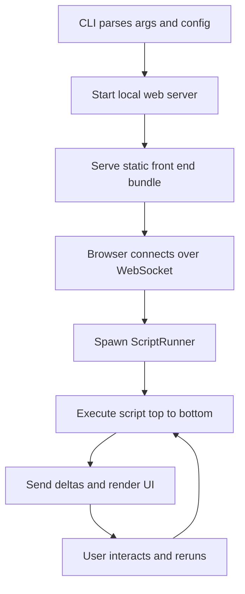

# Streamlit's App Lifecycle: Boot, Serve, Idle, and Shutdown

## English

Most people learn Streamlit by running `streamlit run app.py` and watching a browser tab appear. But what actually happens between that command and the first pixel of your app? The CLI parses arguments, loads configuration from `.streamlit/config.toml` and environment variables, and then starts a local web server (Starlette on Uvicorn since Streamlit 1.57, bound to port 8501). Crucially, that server does not execute your script at startup. It serves a static front-end bundle: HTML, JavaScript, and CSS that the browser downloads and runs. Only after the browser connects back over a WebSocket does the server spawn a ScriptRunner and begin executing your Python file. This is why the first load feels slower than subsequent interactions — you are paying for asset delivery and connection setup, not just Python execution.

Once connected, your app enters a long-lived loop: the ScriptRunner executes the script top to bottom, emitting protobuf messages (deltas) that describe widgets and output elements; the browser renders them; the user interacts; a message travels back over the WebSocket; the script reruns. The process stays alive between reruns, holding your imports, module-level objects, and any global state in memory. That is a double-edged sword: an expensive model loaded into a module-level variable persists across reruns (good), but so does an accidental list that grows on every run (bad — a classic memory leak).

Idle behaviour matters too. If a browser tab is closed or a network blip drops the WebSocket, the server eventually notices the missing connection and tears down that session's ScriptRunner and session_state. The Python process itself, however, keeps running, ready for the next visitor. Multiple concurrent users each get their own session and their own ScriptRunner, but they share the same process — so a module-level cache or a global connection pool is shared across users, while `st.session_state` is not.

Shutdown is the final phase. When you press Ctrl+C, the CLI sends a termination signal; the server stops accepting connections, existing sessions are closed, and the process exits. Anything not persisted to disk (a database, a file, an external cache) is lost. This is why Streamlit apps are usually designed to be stateless at the process level and to push durable state into external stores.

Understanding this lifecycle reframes a lot of debugging. A slow first load is not your code — it is asset delivery. A mysterious memory growth is not Streamlit leaking — it is your module-level objects accumulating. A user reporting that their session vanished is not a bug — it is the WebSocket disconnect path doing its job. Once you can picture boot, serve, idle, and shutdown as distinct phases, the framework stops feeling magical and starts feeling mechanical.

## 中文

大部分人學 Streamlit，都係由 `streamlit run app.py` 開始，然後見到瀏覽器分頁彈出嚟。但由嗰句指令到你 app 嘅第一個像素出現，中間究竟發生咗咩事？CLI 會解析參數、由 `.streamlit/config.toml` 同環境變數載入設定，然後啟動一個本機 web server（自 Streamlit 1.57 起預設係 Starlette／Uvicorn，綁定喺 8501 端口）。關鍵係：呢個 server 喺啟動時**唔會**執行你嘅 script。佢只係提供一個靜態前端 bundle：HTML、JavaScript 同 CSS，由瀏覽器下載同執行。要等到瀏覽器透過 WebSocket 連返嚟，server 先至會開一個 ScriptRunner，開始執行你嘅 Python 檔案。呢個就解釋咗點解第一次載入會慢過之後嘅互動——你付出嘅係靜態資源傳輸同連線建立嘅成本，唔淨止係 Python 執行。

連線建立之後，你嘅 app 就進入一個長期運行嘅循環：ScriptRunner 由上到下執行 script，發出 protobuf 訊息（deltas）去描述組件同輸出元素；瀏覽器負責渲染；用戶互動；訊息經 WebSocket 傳返嚟；script 重新執行。喺兩次 rerun 之間，個 process 一直存活，將你嘅 import、module 層級物件同任何全域狀態都保留喺記憶體度。呢個係雙面刃：一個載入到 module 層級變數嘅昂貴模型會跨 rerun 保留（好事），但一個唔小心每次 run 都增長嘅 list 亦都會保留（壞事——典型嘅記憶體洩漏）。

閒置行為都好重要。如果瀏覽器分頁被關閉，或者網絡抖動令 WebSocket 斷開，server 最終會發現連線消失，並清拆嗰個 session 嘅 ScriptRunner 同 session_state。不過，Python process 本身會繼續運行，準備迎接下一位訪客。多個並發用戶各自有自己嘅 session 同 ScriptRunner，但佢哋共享同一個 process——所以 module 層級嘅 cache 或全域連線池係跨用戶共享嘅，而 `st.session_state` 就唔係。

關機係最後一個階段。當你撳 Ctrl+C，CLI 會送出終止訊號；server 停止接受連線，現有 session 被關閉，process 結束。任何未持久化到磁碟嘅嘢（資料庫、檔案、外部 cache）都會失去。呢個就係點解 Streamlit app 通常設計成喺 process 層面無狀態，並將持久狀態推去外部儲存。

理解呢個生命週期，會令好多 debugging 嘅睇法改觀。第一次載入慢唔係你嘅 code 問題——係靜態資源傳輸。神秘嘅記憶體增長唔係 Streamlit 洩漏——係你嘅 module 層級物件累積。用戶話佢個 session 唔見咗唔係 bug——係 WebSocket 斷線路徑正常運作。一旦你能夠喺腦海描繪出開機、服務、閒置同關機呢幾個獨立階段，個框架就唔再神奇，而係變得機械化。

## Key Takeaway

Streamlit's process is a long-lived server that serves a static front-end first and only runs your script after a WebSocket connects, so boot, idle, and shutdown each have distinct failure modes worth knowing.

## Related Concepts
- WebSocket connection lifecycle
- ScriptRunner execution context

## Diagram

