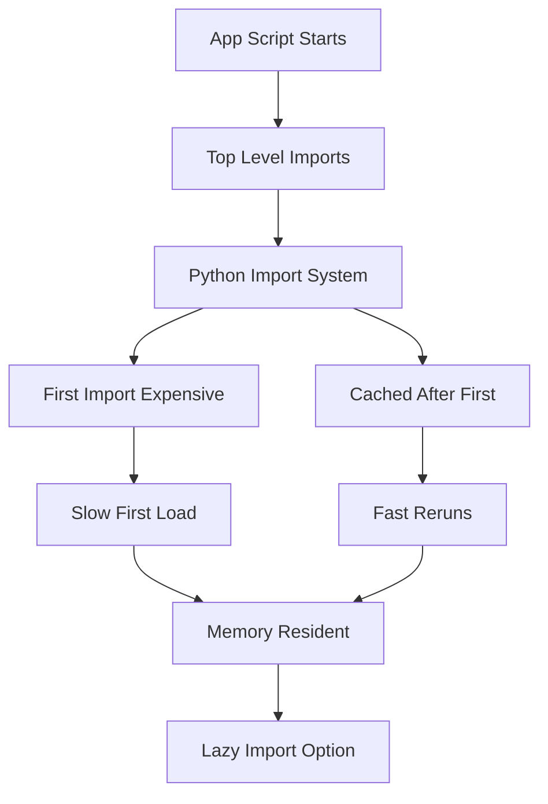

# Streamlit's Dependency Footprint: Why Imports Shape Startup and Memory

## English

A Streamlit app is a Python process, and every library you import lives in that process for as long as it runs. This sounds obvious, but the consequences are non-trivial. Consider a typical data-science stack: importing pandas pulls in numpy, which pulls in a compiled BLAS backend; importing matplotlib pulls in a font cache and a rendering backend; importing torch or tensorflow can add hundreds of megabytes of compiled libraries plus CUDA context if a GPU is present. None of this is Streamlit's fault — but Streamlit makes it visible, because the import happens at module load time in a process that stays alive.

The practical implication is that import order and import scope matter. Imports at the top of your script run on every script rerun in the sense that Python's import system checks `sys.modules` and returns the cached module almost instantly — so a top-level `import pandas` is cheap after the first time. But the *first* import is expensive, and it happens during the ScriptRunner's first execution, which is exactly when the user is waiting for the app to appear. A heavyweight import can turn a two-second first load into a fifteen-second one. Lazy-importing inside a function that only runs when the user clicks a button is a legitimate optimisation, at the cost of a delay on that first click.

Memory is the other half. Every imported module stays resident. A model loaded into a module-level variable stays resident. A large DataFrame stored in `st.session_state` stays resident per session. Multiply by concurrent users and you can exhaust a container's memory limit surprisingly fast. Tools like `st.cache_resource` help by sharing a single instance across sessions, but they do not reduce the baseline cost of the libraries themselves.

There is also a subtler effect: import side effects. Some libraries read environment variables, spawn background threads, or open connections at import time. In a short-lived script this is harmless; in a long-lived Streamlit process it can mean a background thread that outlives your intent, or a connection that is opened before your configuration is applied. Being deliberate about *when* you import — and about what module-level code actually does — is part of writing a well-behaved Streamlit app.

Finally, container images reflect this. A Streamlit image that bundles torch, opencv, and a full scientific stack can be gigabytes; slimming it down (multi-stage builds, CPU-only wheels, deferring optional dependencies) directly improves cold-start time in cloud deployments, where the container must be pulled and started before the first request is served. Dependency hygiene is not glamorous, but in Streamlit it is directly user-visible.

## 中文

一個 Streamlit app 就係一個 Python process，你 import 嘅每一個 library 都會喺個 process 度存活，直到佢結束為止。聽落好似好明顯，但後果一啲都唔簡單。諗下典型嘅數據科學 stack：import pandas 會拉埋 numpy，numpy 又拉埋一個編譯好嘅 BLAS 後端；import matplotlib 會拉埋字型 cache 同渲染後端；import torch 或 tensorflow 可以加幾百 MB 嘅編譯 library，如果部機有 GPU 仲會加埋 CUDA context。呢啲全部都唔係 Streamlit 嘅錯——但 Streamlit 令佢變得可見，因為 import 係喺 module 載入時發生，而個 process 會一直存活。

實際影響係：import 嘅次序同範圍都好重要。放喺 script 頂部嘅 import，喺每次 script rerun 時都會「執行」，但 Python 嘅 import 系統會檢查 `sys.modules`，幾乎即時返回已 cache 嘅 module——所以第一次之後，頂層 `import pandas` 係好便宜嘅。但*第一次* import 就好貴，而佢正正喺 ScriptRunner 第一次執行時發生，亦即係用戶等緊個 app 出現嘅時候。一個重量級 import 可以令兩秒嘅首次載入變成十五秒。喺只有用戶撳掣先會執行嘅函數入面做 lazy import，係一個合理嘅優化，代價係嗰次撳掣會有延遲。

記憶體係另一半。每一個 import 咗嘅 module 都會留喺度。載入到 module 層級變數嘅模型會留喺度。存喺 `st.session_state` 嘅大型 DataFrame 會按 session 留喺度。乘以並發用戶數量，你就可以好快耗盡 container 嘅記憶體上限。好似 `st.cache_resource` 呢類工具幫到手，因為佢會跨 session 共享單一實例，但佢唔會減少 library 本身嘅基本成本。

仲有一個更微妙嘅效應：import 嘅副作用。有啲 library 會喺 import 時讀環境變數、開背景 thread 或者開連線。喺短命嘅 script 入面呢啲無害；喺長命嘅 Streamlit process 入面，就可能意味住一個超出你意圖嘅背景 thread，或者一個喺你套用設定之前就開咗嘅連線。刻意諗清楚*幾時* import——同埋 module 層級 code 實際做咩——係寫好一個 Streamlit app 嘅一部分。

最後，container image 都反映呢點。一個綁埋 torch、opencv 同完整科學運算 stack 嘅 Streamlit image 可以係幾 GB；精簡佢（multi-stage build、只用 CPU 嘅 wheel、延後可選依賴）會直接改善雲端部署嘅冷啟動時間，因為喺第一個請求被服務之前，container 必須被拉取同啟動。依賴衛生唔算好吸引，但喺 Streamlit 度，佢係直接俾用戶睇得到嘅。

## Key Takeaway

Because a Streamlit process is long-lived, every import and module-level object has a persistent cost in startup time and memory, so dependency hygiene is directly user-visible.

## Related Concepts
- Lazy imports and startup latency
- Container image size and cold start

## Diagram

